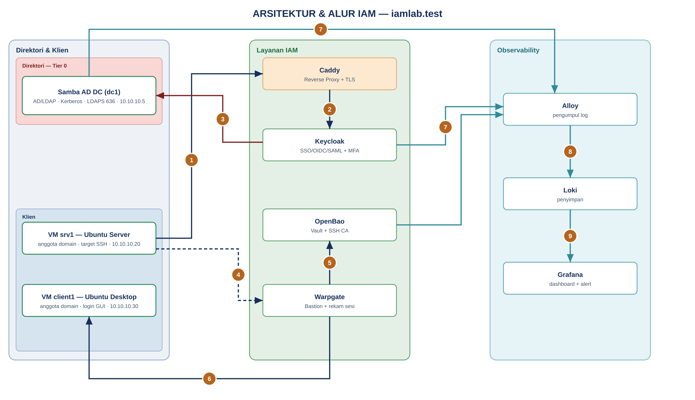
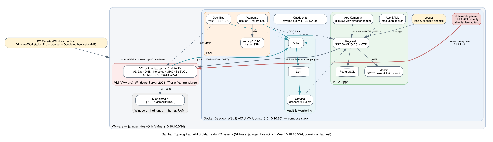

# Sesi 0 — Pengantar: Topologi Sistem & Teori Dasar

Sesi pembuka. Tujuannya memberi **gambaran utuh** sistem IAM yang akan dibangun dan
**fondasi teori** yang dipakai berulang di sesi berikutnya. Detail teknis diperdalam
per sesi (`sesi-1` … `sesi-4`).

## Konvensi "di mana perintah dijalankan"

Sepanjang modul, setiap langkah diberi penanda tempat eksekusi agar tidak keliru:

| Penanda | Tempat menjalankan |
|---------|--------------------|
| 🪟 **PowerShell (host)** | Di PC Windows peserta, PowerShell **Administrator** (mis. `build-lab.ps1`, `VBoxManage`). |
| 🐳 **Container (dc1/svc)** | Masuk ke container lewat `docker compose exec <service> …` (mis. `samba-dc` untuk `samba-tool`, `openbao`). |
| 🖥️ **VM Ubuntu** | Di dalam VM `srv1`/`client1` (SSH atau konsol VirtualBox), mis. `sudo join-domain.sh`, `sudo cis-scan.sh`. |
| 🌐 **Web UI** | Di browser peserta: Keycloak, Grafana, Warpgate, Mailpit. |

## a. Tujuan Sesi

Peserta memahami:
- Peta keseluruhan sistem (komponen, jaringan, aliran data) sebelum masuk praktik.
- Konsep dasar identitas: **IAAA** (Identifikasi, Autentikasi, Otorisasi, Audit).
- Peran **AD/LDAP**, **SSO (SAML/OIDC)**, **MFA**, **PAM**, dan **audit/UBA** serta
  bagaimana semuanya saling terhubung.

## b. Output yang Diharapkan

- Peserta dapat menjelaskan alur "pengguna → aplikasi → IdP → direktori" dengan kata sendiri.
- Peserta mengenali posisi dan fungsi tiap komponen pada topologi.
- Lingkungan lab siap: VM AD berjalan, stack layanan berjalan, nama domain teruji.

## c. Teori Dasar

### Apa itu IAM dan mengapa "terpusat"?
**IAM (Identity & Access Management)** adalah disiplin mengelola *siapa boleh
mengakses apa, kapan, dan bagaimana membuktikannya*. Rangkanya adalah **IAAA**:

| Pilar | Makna | Tujuan | Analogi |
|------|-----------------|-------------------|---------|
| **Identifikasi** | Pengguna mengaku sebagai siapa (username) | Titik awal semua kontrol | Menyebut nama di resepsionis |
| **Autentikasi** | Membuktikan klaim identitas (faktor: sandi, OTP, biometrik) | Mencegah peniruan | Menunjukkan KTP + segel sekali pakai |
| **Otorisasi** | Menentukan hak (peran/izin) | Membatasi akses sesuai kebutuhan (*least privilege*) | Kartu hanya membuka lantai tertentu |
| **Audit** | Mencatat aktivitas | Pembuktian & deteksi penyalahgunaan | Buku tamu + CCTV |

Pihak yang terlibat adalah pengguna akhir, administrator (akun istimewa), akun layanan
(aplikasi), dan auditor. Kontrol bekerja saat login (autentikasi), saat mengakses fitur
(otorisasi), dan terus-menerus (audit). Identitas terpusat memindahkan keempat pilar dari
tiap aplikasi ke **satu direktori** (sumber kebenaran) dan **satu IdP** (gerbang): aplikasi
mendelegasikan login ke IdP, IdP memverifikasi ke direktori lalu menerbitkan token/assertion
yang dipercaya aplikasi.

_Analogi:_ dari "tiap pintu punya daftar tamu sendiri" menjadi "satu lobi, satu
petugas, satu buku tamu" — kebijakan konsisten, penonaktifan akun berlaku serentak,
jejak audit terkumpul di satu tempat.

### Komponen & perannya (dipetakan ke sesi)
- **Active Directory (AD/LDAP)** — direktori + *control plane* identitas: pengguna,
  grup, Kerberos, DNS, Group Policy. *(Sesi 1)*
- **Keycloak (Identity Provider)** — gerbang SSO yang memverifikasi ke direktori,
  menerbitkan token/assertion, dan menegakkan **MFA**. *(Sesi 2)*
- **MFA (Google Authenticator / TOTP)** — faktor "sesuatu yang dimiliki" selain sandi
  "sesuatu yang diketahui". *(Sesi 2)*
- **PAM (OpenBao + Warpgate)** — brankas kredensial istimewa + *jump server* yang
  merekam sesi admin. *(Sesi 3)*
- **Audit & Monitoring (Alloy → Loki → Grafana)** — mengumpulkan log identitas dan
  menampilkan dashboard + alert; **UBA** mendeteksi perilaku tak lazim. *(Sesi 4)*

### Protokol federasi (ringkas — diperdalam di Sesi 2)
- **SAML 2.0** — autentikasi + atribut via XML Assertion bertanda tangan.
- **OAuth 2.0** — otorisasi akses sumber daya (bukan login).
- **OpenID Connect (OIDC)** — lapisan identitas di atas OAuth 2.0; token = ID Token
  (JWT). Alur aman lab: **Authorization Code + PKCE**.

_Analogi SSO:_ gelang masuk festival — diperiksa sekali di gerbang (IdP), lalu semua
panggung (aplikasi) menerimanya tanpa periksa ulang identitas.

## d. Struktur Sistem (Topologi)

Seluruh lab berjalan terisolasi di PC peserta (jaringan Host-Only `10.10.10.0/24`, tanpa
internet), domain sintetis **`iamlab.test`**. **Direktori AD/LDAP = Samba AD DC** yang
berjalan sebagai container bersama layanan lain di **Docker Desktop**; dua **VM Ubuntu**
(VirtualBox) menjadi server & klien yang bergabung ke domain.

Diagram berikut membagi sistem menjadi **tiga segmen** — Direktori & Klien, Layanan IAM,
dan Observability — dengan alur data/aktivitas **bernomor** yang dijelaskan pada *Agenda
Aktivitas* di bawahnya.



*Gambar 1. Arsitektur & alur IAM (3 partisi, alur bernomor)*

**Agenda Aktivitas (penjelasan nomor pada diagram):**

| # | Aktivitas | Sistem terhubung |
|---|-----------|------------------|
| **1** | Pengguna membuka aplikasi/konsol lewat HTTPS; TLS diterminasi reverse proxy | Klien Ubuntu → **Caddy** |
| **2** | Proxy meneruskan permintaan login ke Identity Provider (SSO) | Caddy → **Keycloak** |
| **3** | Keycloak memverifikasi kredensial & menarik atribut/grup lewat LDAPS 636 | Keycloak → **Samba AD DC (dc1)** |
| **4** | Klien & server Ubuntu bergabung ke domain (Kerberos/LDAP) untuk login akun direktori | Ubuntu srv1/client1 → **dc1** |
| **5** | Akses istimewa diarahkan ke bastion; login bastion memakai SSO Keycloak + MFA | Pengguna → **Warpgate** |
| **6** | Bastion mengambil kredensial *break-glass* / meminta sertifikat SSH berumur pendek | Warpgate → **OpenBao (Vault/SSH CA)** |
| **7** | Sesi SSH diproksikan ke target **dan direkam** | Warpgate → **srv1** |
| **8** | Komponen & host mengirim event audit (login, akses vault, perintah user, skor CIS) | Keycloak/OpenBao/dc1/srv1/client1 → **Alloy** |
| **9** | Log terstruktur disimpan lalu divisualkan (dashboard & alert, UBA) | Alloy → **Loki** → **Grafana** |

Secara **jaringan/penempatan**, blok-blok itu berjalan sebagai berikut:



*Gambar 2. Topologi sistem IAM — Docker Desktop + 2 VM Ubuntu*

| Node | Peran | Alamat |
|------|-------|--------|
| **PC Windows Pro** (16 GB) | Menjalankan VirtualBox + Docker Desktop; browser peserta | adapter Host-Only `10.10.10.5` |
| **Container Docker** | Samba AD DC (`dc1`), Keycloak+Postgres, OpenBao, Warpgate, Mailpit, Caddy, Grafana/Loki/Alloy, App-Komentar, App-SAML | di `10.10.10.5` (port dipublikasikan) |
| **VM `srv1`** (Ubuntu Server) | Anggota domain; target SSH/bastion; subjek CIS *server* | `10.10.10.20` |
| **VM `client1`** (Ubuntu Desktop) | Anggota domain; login GUI pengguna direktori; subjek CIS *workstation* | `10.10.10.30` |

**Legenda:**
- 🟦 **Zona Endpoint/Klien** — VM Ubuntu `srv1` & `client1`.
- 🟥 **Zona Direktori (Tier 0)** — Samba AD DC `dc1` (container): LDAP/LDAPS, Kerberos, direktori.
- 🟩 **Blok Layanan IAM (Docker)** — Keycloak, OpenBao, Warpgate, Grafana/Loki/Alloy, di
  belakang **Caddy** (reverse proxy + TLS CA internal).
- **Garis panah:** garis penuh = akses pengguna/aplikasi (HTTPS); **putus-putus** =
  federasi/autentikasi & join direktori (LDAPS/Kerberos); **teal** = aliran event audit.

**Aliran data inti:** pengguna membuka aplikasi → diarahkan ke **Keycloak** → Keycloak
memverifikasi kredensial ke **Samba AD** (LDAPS) dan meminta **MFA** bila perlu → menerbitkan
token → aplikasi memberi akses sesuai peran (klaim grup). Aktivitas autentikasi/otorisasi —
termasuk login & perintah di VM Ubuntu — mengalir sebagai log ke **Alloy → Loki → Grafana**.

> **Mengapa Samba, bukan Windows Server?** Samba AD menyediakan protokol direktori yang sama
> (LDAP, Kerberos, Group Policy) secara *open source* dan ringan, sehingga seluruh lab —
> direktori + layanan — muat di satu PC 16 GB tanpa lisensi Windows Server. Konsep AD/LDAP,
> *tiering*, dan kebijakan akses terpusat identik; yang berbeda hanya perkakas administrasinya
> (`samba-tool` dan kebijakan sisi klien Linux, bukan GPMC).

## Peta Sesi

| Sesi | Fokus | Indikator |
|------|-------|-----------|
| **1** | Pengamanan Direktori (Samba AD/LDAP), join domain, kebijakan akses terpusat & **CIS Benchmark** | 1.1, 1.2 |
| **2** | SSO & MFA (Keycloak) + App-Komentar (RBAC) | 2.1, 2.2 |
| **3** | Privileged Access Management (OpenBao + Warpgate) | 3.1, 3.2 |
| **4** | Audit, Monitoring & **trace aktivitas pengguna** (Alloy/Loki/Grafana) + capstone | 4.1, 4.2 |

> Lingkungan (container layanan + 2 VM Ubuntu) disiapkan `build-lab.ps1`; peserta berfokus pada
> **konfigurasi keamanan** di tiap sesi, bukan instalasi dari nol.

## Prasyarat PC peserta

- **Windows 10/11 Pro/Enterprise**, RAM **16 GB** (disarankan lebih), disk kosong ≥ 80 GB,
  virtualisasi (VT-x/AMD-V) aktif di BIOS/UEFI.
- Hak **Administrator** (membuat VM, jaringan Host-Only, aturan firewall, mengisi berkas hosts).
- Google Authenticator / FreeOTP di ponsel (MFA, Sesi 2).
- VirtualBox & Docker Desktop **tidak perlu dipasang manual** — `build-lab.ps1` memasangnya.

## Deploy awal (satu skrip)

Seluruh lab dibangun oleh **[`build-lab.ps1`](../build-lab.ps1)** di root repo. Jalankan
🪟 **PowerShell sebagai Administrator**:

```powershell
cd <folder-repo>
Set-ExecutionPolicy -Scope Process Bypass -Force
.\build-lab.ps1                 # Check → Requirements → Download → Install → Build
```

Fase skrip (bisa dijalankan satu per satu dengan `-Phase <nama>`):

| Fase | Yang dilakukan |
|------|----------------|
| **Check** | Verifikasi edisi Windows, RAM ≥ 16 GB, disk, virtualisasi CPU, WSL2. |
| **Requirements** | Cek VirtualBox/`VBoxManage`, VC++ runtime, Docker Desktop, jaringan lab, konflik port. |
| **Download** | Unduh yang belum ada (VirtualBox, VC++, Docker Desktop, Ubuntu 24.04 cloud image) ke `.lab\cache`. |
| **Install** | Pasang VirtualBox/VC++/Docker Desktop secara *silent* (bisa minta **reboot** sekali untuk WSL2 — setelah reboot jalankan ulang). |
| **Build** | Buat jaringan Host-Only `10.10.10.5/24` + aturan firewall + isi `hosts`; jalankan stack Docker (termasuk Samba AD `dc1`); buat & *provision* VM `srv1` dan `client1` lalu melepas NAT (lab jadi terisolasi). |

> Build butuh **internet sekali** (unduh paket & image). Sesudahnya lab berjalan **offline**
> di jaringan Host-Only. Untuk kelas tanpa internet, letakkan `iam-images.tar` di
> `distribusi/offline-images/` (lihat `distribusi/README.md`) — skrip memuatnya alih-alih menarik image.

Perintah lain:

| Perintah | Guna |
|----------|------|
| `.\build-lab.ps1 -Phase Check` | Hanya laporkan kesiapan sistem. |
| `.\build-lab.ps1 -Phase Status` | Tampilkan kondisi VM, stack Docker, dan port lab. |
| `.\build-lab.ps1 -Phase Start` | Nyalakan lab yang sudah dibangun (stack + VM). |
| `.\build-lab.ps1 -Phase Build -AutoJoin` | Jalan pintas instruktur: `srv1`/`client1` langsung join domain. |
| `.\build-lab.ps1 -Phase Destroy` | Hapus VM lab, stack, entri hosts & firewall lab. |

> **✅ Validasi / Output yang diharapkan.** Setelah `Build`, `-Phase Status` menampilkan
> kedua VM `running` (ping OK) dan stack Docker `running`/`healthy`. Dari browser Windows,
> `https://kc.iamlab.test` membuka halaman *Welcome to Keycloak*, dan
> `https://grafana.iamlab.test` membuka Grafana. Port `389`/`636` di `10.10.10.5` **terbuka**
> (jalur join domain dari VM). Container inti: `samba-dc` (healthy), `caddy`, `keycloak`
> (healthy ±60 dtk), `postgres`, `openbao` (sealed — normal, di-init Sesi 3), `warpgate`
> (muncul setelah setup Sesi 3), `grafana`, `loki`, `alloy`, `mailpit`, `app-komentar`, `app-saml`.
>
> **Jika `build-lab.ps1` berhenti:** baca pesan `BERHENTI:` dan log lengkap di
> `.lab\logs\build-*.log`. Masalah umum: **port 443 dipakai** `vmware-hostd` (hentikan layanan
> *VMware Workstation Server*), atau **reboot WSL2 belum dilakukan** (jalankan skrip lagi).

> Catatan Docker Desktop: skrip menyetel `%USERPROFILE%\.wslconfig` (batas RAM 6 GB, 2 CPU) agar
> VM VirtualBox dan Docker berbagi 16 GB dengan aman. Ubah nilai di blok konfigurasi atas
> `build-lab.ps1` bila RAM PC berbeda.

---

> **Gambaran lengkap langkah peserta** (semua sesi, dengan validasi tiap perintah):
> lihat [`../ALUR-PESERTA.md`](../ALUR-PESERTA.md).
