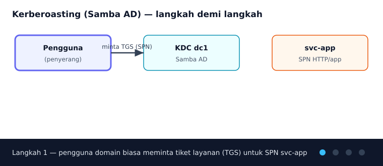
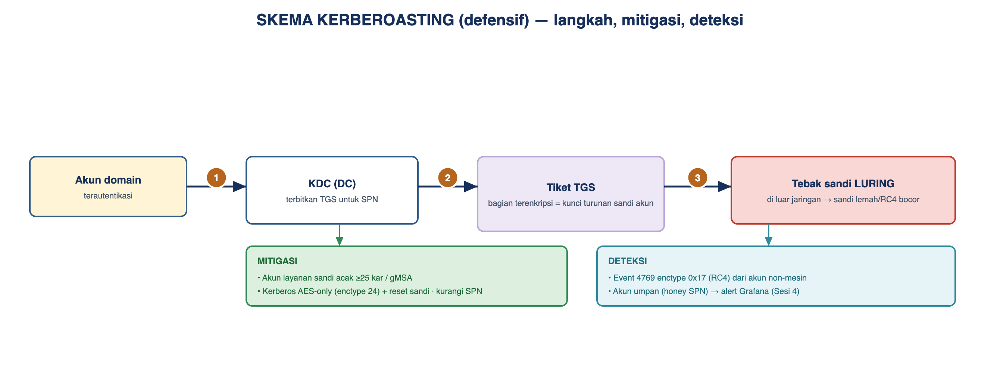
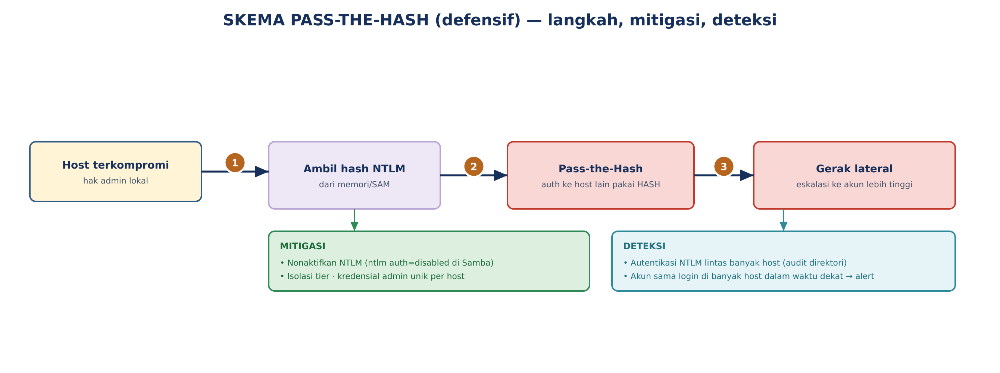
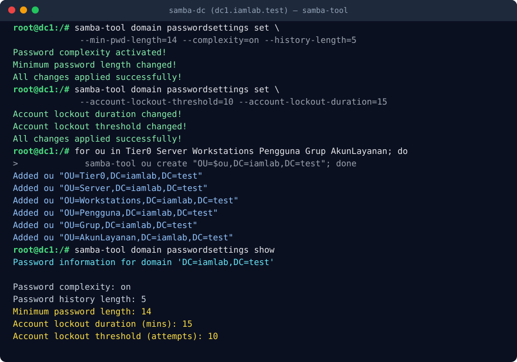
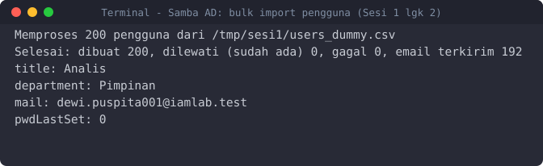
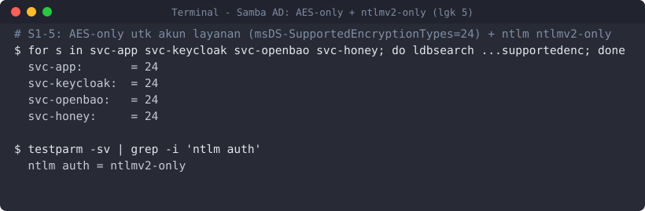
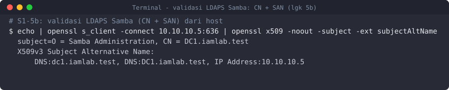
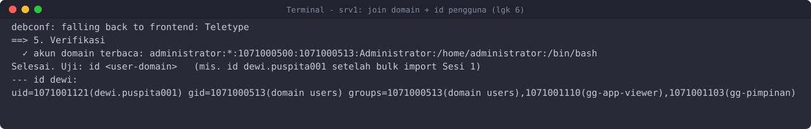
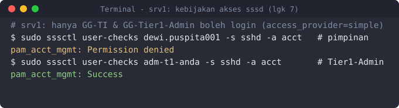
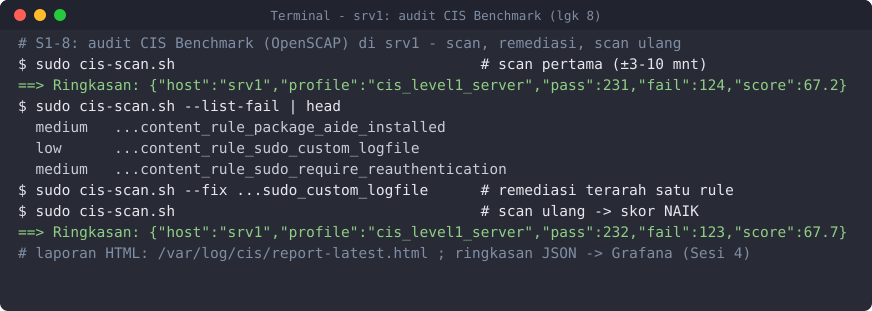

# Sesi 1 — Pengamanan Direktori Terpusat (Samba AD/LDAP), Join Domain & CIS

Indikator 1.1 (hardening direktori AD/LDAP) dan 1.2 (kebijakan keamanan terpusat ke
endpoint). Sesi ini membangun direktori **Samba AD DC** (`dc1`, container), menggabungkan
**VM Ubuntu** `srv1` (server) dan `client1` (desktop) ke domain, menerapkan **kebijakan akses
terpusat**, lalu mengaudit kepatuhan endpoint dengan **CIS Benchmark**.

Penanda tempat menjalankan: 🐳 **container `samba-dc` (dc1)** · 🖥️ **VM Ubuntu (srv1/client1)** ·
🖥️ **terminal host** (docker). (Lihat Sesi 0 untuk arti lengkap.)

## Keterhubungan dengan sesi lain

Ini sesi praktik pertama; ia memakai konsep identitas dari **Sesi 0** (IAAA, tiering).
**Yang dibuat di sini dipakai sesi berikutnya:** OU & grup `GG-*`, akun layanan `svc-keycloak`
(federasi Sesi 2), `svc-openbao` + grup `GG-Tier1-Admin` (Sesi 3), kebijakan sandi, serta
event audit direktori & endpoint yang dipantau di Sesi 4. **VM `srv1`** menjadi target SSH
untuk bastion (Sesi 3). Jadi selesaikan sesi ini lebih dulu.

## a. Tujuan Sesi

Peserta mampu:
- Mengatur direktori terpusat (OU, *tiering*, grup) di Samba AD dan melakukan *bulk import* pengguna.
- Menerapkan kebijakan kata sandi domain dan PSO untuk akun istimewa.
- *Hardening* direktori: LDAPS, AES-only Kerberos, menonaktifkan protokol lemah.
- Menggabungkan klien & server Linux ke domain dan menegakkan **kebijakan akses terpusat**
  (siapa boleh login ke mana, hak sudo berbasis grup).
- Mengaudit kepatuhan endpoint terhadap **CIS Benchmark** (OpenSCAP), meremediasi, lalu menilai ulang.
- Mengenali sinyal **Kerberoasting** & **Pass-the-Hash** pada log, lalu menutupnya dengan mitigasi.

## b. Output yang Diharapkan

- Direktori berisi ±220 pengguna di `OU=Pengguna`; anggota `Domain Admins` minimal.
- Akun layanan (`svc-*`) memakai enkripsi **AES** (bukan RC4); protokol lemah dinonaktifkan.
- `srv1` dan `client1` tergabung ke domain; pengguna direktori dapat login (SSH & GUI), hanya
  grup yang diizinkan, dan hak admin mengikuti keanggotaan grup AD.
- Laporan **CIS Level 1** untuk server (`srv1`) dan workstation (`client1`) tersimpan, dengan
  skor **meningkat** setelah remediasi.
- Pada simulasi: sebelum mitigasi tiket layanan memakai RC4 (hash `$krb5tgs$23$`); setelah
  AES-only, tiket memakai AES (`$krb5tgs$18$`).

## c. Teori dan Struktur Sistem

*Active Directory* (di sini **Samba AD**) adalah direktori + *control plane* identitas:
menyimpan pengguna/grup/komputer (LDAP), menerbitkan tiket **Kerberos** (KDC), dan menjadi
sumber kebenaran (source of truth) identitas bagi layanan (Keycloak, OpenBao) maupun host (klien Linux).

Kompromi pada Domain Controler (DC) atau akun Tier 0 sama dengan kompromi seluruh domain. Karena itu active direktori adalah aset paling bernilai yang harus di hardening lebih dulu.

**Model tiering (Enterprise Access Model).** 
- Tier 0 (DC, sinkronisasi identitas) = bidang kendali tertinggi;
- Tier 1 (server/aplikasi);
- Tier 2 (perangkat pengguna).
Prinsipnya, kredensial tier tinggi tidak boleh terpapar di tier rendah, agar kompromi zona bawah tidak
naik ke atas.

### Kebijakan keamanan terpusat untuk endpoint Linux (padanan GPO)

Di AD Windows, kebijakan endpoint didorong lewat **GPO**. Pada direktori Linux, fungsi serupa
dicapai dengan menggabungkan klien ke domain lalu menegakkan kebijakan di sisi klien dari
sumber terpusat:

| Tujuan kebijakan | Mekanisme di lab Linux |
|------------------|------------------------|
| Siapa boleh login ke suatu host | `sssd` `access_provider = simple` + `simple_allow_groups` (grup AD per host) |
| Hak administratif (sudo) | aturan `sudoers` berbasis **grup AD** (mis. `%GG-Tier1-Admin`) |
| Baseline konfigurasi aman | **CIS Benchmark** via OpenSCAP (audit + remediasi), lihat bagian praktik |
| Kebijakan sandi & penguncian | kebijakan domain Samba + PSO untuk admin |

### Dua teknik serangan 
**Kerberoasting.** *Setiap* akun domain boleh meminta tiket layanan (TGS) untuk akun layanan
ber-SPN; bagian tiket terenkripsi dengan kunci turunan **sandi akun layanan**, lalu penyerang
menebak sandi itu **luring** (di luar jaringan, tanpa menyentuh DC lagi — itulah yang membuatnya
sulit terlihat). Ikuti prosesnya langkah demi langkah:



*Gambar 1. Skema Kerberoasting (animasi langkah demi langkah)*



*Gambar 2. Skema Kerberoasting ringkas — titik mitigasi & deteksi*

*Analogi:* meminjam gembok resmi, membawanya pulang, mencoba ribuan kunci di rumah.
**Mitigasi:** sandi akun layanan sangat panjang/acak, dan **Kerberos AES-only** sehingga tiket
RC4 lemah tak terbit. **Deteksi:** permintaan tiket untuk SPN layanan dari akun non-mesin;
akun umpan (*honey SPN* `svc-honey`).

**Pass-the-Hash (PtH).** Penyerang yang menguasai sebuah host mengambil *hash* kredensial dari
memori, lalu memakainya untuk autentikasi ke host lain **tanpa tahu sandi aslinya**.



*Gambar 3. Skema Pass-the-Hash — titik mitigasi & deteksi*

*Analogi:* mencuri cetakan sidik jari lalu memakainya di pemindai lain. **Mitigasi:** isolasi
tier, kurangi NTLM (`ntlm auth = ntlmv2-only` di Samba — tutup NTLMv1; *disabled* penuh memutus
federasi LDAP, lihat langkah 5), kredensial admin unik per host.
**Deteksi:** autentikasi NTLM lintas banyak host, logon tak lazim.

**Catatan enctype Kerberos:** pada tiket/hasil Kerberoasting, `$krb5tgs$23$` = RC4-HMAC
(lemah), `$krb5tgs$18$` = AES256 (kuat). Target mitigasi: hilangkan RC4.

## d. Praktik: Instalasi dan Konfigurasi

> **Deploy (disiapkan `build-lab.ps1`):** container `samba-dc` sudah ter-*provision* menjadi
> domain `iamlab.test`, dan VM `srv1`/`client1` sudah menyala di jaringan Host-Only. Peserta
> **mengonfigurasi keamanannya**.

### 1. 🐳 Struktur OU, grup, dan akun layanan
Jalankan `samba-tool` **di dalam container `samba-dc`**. Buka shell DC:
```bash
# 🖥️ terminal host (PowerShell/terminal apa pun dengan docker)
cd ../deploy        # stack di IAMLAB-BuildBag; modul diklon di IAMLAB-BuildBag/Pelatihan_IAM
docker compose exec samba-dc bash      # masuk ke container dc1
```
```bash
# 🐳 di dalam container samba-dc (dc1)
for ou in Tier0 Server Workstations Pengguna Grup AkunLayanan; do
  samba-tool ou create "OU=$ou,DC=iamlab,DC=test"; done
for g in GG-Pimpinan GG-Keuangan GG-SDM GG-TI GG-Operasional GG-Layanan GG-Hukum \
         GG-App-Viewer GG-App-Editor GG-App-Admin GG-Tier0-Admin GG-Tier1-Admin; do
  samba-tool group add "$g" --groupou="OU=Grup"; done
for s in svc-keycloak svc-openbao svc-app svc-honey; do
  samba-tool user create "$s" 'Svc#Lab2026!' --userou=OU=AkunLayanan --use-username-as-cn
  samba-tool user setexpiry "$s" --noexpiry; done
# SPN: svc-app = layanan nyata (sasaran simulasi), svc-honey = umpan deteksi
samba-tool spn add HTTP/app.iamlab.test   svc-app
samba-tool spn add HTTP/honey.iamlab.test svc-honey
```

> **✅ Validasi / Output yang diharapkan** (ditangkap nyata). Tiap OU membalas
> `Added ou "OU=…"`, tiap akun `User '…' added successfully`. Cek:
> `samba-tool user getgroups svc-app` dan `samba-tool spn list svc-app` memuat
> `HTTP/app.iamlab.test`.



*Gambar 4. Terminal Samba AD DC — domain, OU, grup, kebijakan sandi*

### 2. 🐳 Bulk import pengguna
`import-ad.sh` membaca CSV lalu membuat akun + keanggotaan grup + sandi awal acak + flag
"ganti saat login pertama". Salin folder sesi ini ke container, lalu jalankan:
```bash
# 🖥️ terminal host
docker compose cp ../Pelatihan_IAM/sesi-1-direktori-akses-cis samba-dc:/tmp/sesi1
# 🐳 di dalam container samba-dc — --send-email mengirim sandi awal ke Mailpit
docker compose exec samba-dc bash /tmp/sesi1/import-ad.sh --csv /tmp/sesi1/users_dummy.csv --send-email
docker compose exec samba-dc bash /tmp/sesi1/import-ad.sh --csv /tmp/sesi1/users_batch2.csv   # latihan +20
docker compose exec samba-dc samba-tool user list | wc -l       # verifikasi jumlah
```
> **✅ Validasi.** Ringkasan `Selesai: dibuat 200, …` (batch2: `dibuat 20`). `samba-tool user
> show dewi.puspita001` menampilkan `pwdLastSet: 0` (wajib ganti saat login) dan atribut
> department/title/mail. Email sandi awal tampak di Mailpit (`https://mail.iamlab.test`).
> 🖥️ Butuh data ulang? `python3 gen_dummy_users.py --count 200 --out users_dummy.csv`.



*Gambar 5. Terminal Samba AD — bulk import pengguna + atribut `dewi`*

### 3. 🐳 Batasi admin domain & siapkan admin Tier 1
Prinsip *least privilege*: jaga `Domain Admins` minimal, siapkan admin Tier 1 (dipakai login
OpenBao via LDAP di Sesi 3):
```bash
samba-tool group listmembers "Domain Admins"            # audit — sisakan seminimal mungkin
samba-tool user create adm-t1-anda 'Adm1#Lab2026' --userou=OU=Pengguna --use-username-as-cn
samba-tool group addmembers GG-Tier1-Admin adm-t1-anda
```

### 4. 🐳 Kebijakan kata sandi + PSO untuk admin
```bash
samba-tool domain passwordsettings set --min-pwd-length=14 --complexity=on --history-length=5
samba-tool domain passwordsettings set --account-lockout-threshold=10 --account-lockout-duration=15
# PSO lebih ketat khusus admin Tier 0:
samba-tool domain passwordsettings pso create PSO-Admin 10 --min-pwd-length=20 --complexity=on
samba-tool domain passwordsettings pso apply PSO-Admin GG-Tier0-Admin
samba-tool domain passwordsettings show
```
> **✅ Validasi.** `Minimum password length: 14` dan `Password complexity: on`;
> `samba-tool domain passwordsettings pso show PSO-Admin` menampilkan min length 20.

### 5. 🐳 Hardening active direktori
Aktifkan Kerberos AES pada akun layanan (reset sandi agar kunci dibuat ulang) dan matikan NTLM:
```bash
# 🐳 di dalam container samba-dc
# AES-only untuk akun layanan ber-SPN: set enctype ke AES128+AES256 (24) — buang RC4 — lalu
# reset sandi agar kunci Kerberos baru dibuat. (svc-app = sasaran simulasi; svc-keycloak = Sesi 2.)
for s in svc-app svc-keycloak svc-openbao svc-honey; do
  printf 'dn: CN=%s,OU=AkunLayanan,DC=iamlab,DC=test\nchangetype: modify\nreplace: msDS-SupportedEncryptionTypes\nmsDS-SupportedEncryptionTypes: 24\n' "$s" \
    | ldbmodify -H /var/lib/samba/private/sam.ldb
done
samba-tool user setpassword svc-keycloak --newpassword='Svc#Lab2026baru'   # catat utk Sesi 2 (Bind credential)
```
> ⚠️ Sandi baru `svc-keycloak` inilah yang diisi sebagai *Bind credential* federasi LDAP
> Keycloak di Sesi 2 — catat baik-baik.
>
> **NTLM & AES di Samba (smb.conf).** Mitigasi PtH/Kerberoasting di tingkat domain diset lewat
> `smb.conf` DC: batasi NTLM ke **`ntlm auth = ntlmv2-only`** (matikan NTLMv1 yang lemah; NTLMv2
> tetap hidup) dan batasi enctype ke AES. Di lab, edit lewat container lalu muat ulang:
> ```bash
> # 🐳 di dalam container samba-dc — sisipkan DI DALAM seksi [global] (bukan di akhir berkas,
> # yang akan masuk ke seksi [netlogon] dan tak berlaku)
> sed -i '/^\[global\]/a\    ntlm auth = ntlmv2-only' /etc/samba/smb.conf
> smbcontrol all reload-config
> testparm -sv 2>/dev/null | grep -i 'ntlm auth'    # validasi -> "ntlm auth = ntlmv2-only"
> ```
> > ⚠️ **Jangan pakai `ntlm auth = disabled`.** Mematikan NTLM sepenuhnya juga mematahkan
> > **LDAP simple-bind** (yang dipakai federasi Keycloak & auth LDAP OpenBao untuk memverifikasi
> > sandi) — federasi akan gagal tanpa kode error setelah DC di-*restart* (`ldap_bind data 418`). Untuk
> > mengurangi PtH tanpa memutus federasi, cukup `ntlmv2-only` (NTLMv1 ditutup) + isolasi tier +
> > kredensial admin unik per host. Diskusi PtH di atas tetap berlaku sebagai konsep.



*Gambar 6. Terminal Samba AD — AES-only (enctype 24) & `ntlmv2-only`*

### 5b. 🐳🖥️ LDAPS: aktifkan Trust CA Samba ke layanan IAM
Samba AD menyalakan LDAPS (636) dengan sertifikat yang dibuat otomatis. Agar Keycloak (Sesi 2)
dan OpenBao (Sesi 3) memercayainya, ekspor CA Samba ke folder `deploy/certs/`:
```bash
# 🖥️ terminal host (dari folder deploy)
docker compose cp samba-dc:/var/lib/samba/private/tls/ca.pem certs/ad-ca.pem
docker compose up -d --force-recreate keycloak openbao     # muat truststore CA
```
> **✅ Validasi.** Dari host (git bash) atau dari `srv1` (SSH):
> `echo | openssl s_client -connect 10.10.10.5:636 2>/dev/null | openssl x509 -noout -subject`
> menampilkan sertifikat ber-`CN = DC1.iamlab.test`. (`srv1`/`client1` adalah VM — bukan service
> Docker — jadi perintah dijalankan di VM lewat SSH/konsol, bukan `docker compose exec`.)
> CA ini otomatis dipercaya Keycloak/OpenBao via mount `deploy/certs`.
> ⚠️ **Untuk OpenBao (Sesi 3) — sertifikat butuh SAN.** Cert auto-generate Samba hanya ber-CN
> (tanpa SAN); klien Go (OpenBao) menolaknya (`x509: legacy Common Name`). `build-lab.ps1` kini
> **me-restart samba-dc sekali** setelah provisioning agar entrypoint meregen cert ber-SAN — jadi
> build baru sudah beres. **Pada lab lama (dibangun sebelum perbaikan ini)**, jalankan sekali di
> container untuk membuat cert ber-SAN, lalu re-ekspor CA:
> ```bash
> # 🐳 di dalam container samba-dc — regen cert LDAPS DENGAN SAN (idempoten)
> docker compose exec samba-dc sh -c 'cd /var/lib/samba/private/tls; \
>   openssl x509 -in cert.pem -noout -text | grep -q "Subject Alternative Name" || { \
>   openssl req -x509 -newkey rsa:4096 -keyout key.new -out cert.new -days 3650 -nodes \
>     -subj "/O=Samba Administration/CN=DC1.iamlab.test" \
>     -addext "subjectAltName=DNS:dc1.iamlab.test,IP:10.10.10.5"; \
>   mv cert.new cert.pem; mv key.new key.pem; cp cert.pem ca.pem; chmod 600 key.pem; }'
> docker compose restart samba-dc
> docker compose cp samba-dc:/var/lib/samba/private/tls/ca.pem certs/ad-ca.pem
> docker compose up -d --force-recreate keycloak openbao
> ```
> Validasi: `… | openssl x509 -noout -ext subjectAltName` menampilkan `DNS:dc1.iamlab.test, IP:10.10.10.5`.



*Gambar 7. Terminal — validasi sertifikat LDAPS Samba (CN + SAN)*

### 6. 🖥️ Gabungkan `srv1` & `client1` ke domain
Login ke VM sebagai admin lokal (`labadmin` / `Lab#Admin2026`), lalu jalankan skrip join
(dibaking saat build). DNS tidak dipakai di lab (port 53 tak dipublikasikan) — skrip menunjuk
DC langsung.
```bash
# 🖥️ di srv1 (SSH: ssh labadmin@srv1.iamlab.test) DAN di client1 (konsol VirtualBox)
sudo join-domain.sh                 # minta sandi Administrator domain (Passw0rd#Lab2026)
id dewi.puspita001                  # harus menampilkan UID/grup dari direktori
```
> **✅ Validasi.** Skrip menampilkan `akun domain terbaca: …`; `id dewi.puspita001` memuat grup
> `gg-pimpinan`, `gg-app-viewer`. Di `client1`, pada layar login GDM pilih "Not listed?" lalu
> masuk sebagai `dewi.puspita001` (wajib ganti sandi awal).



*Gambar 8. Terminal srv1 — join domain & `id dewi.puspita001`*

### 7. 🖥️ Kebijakan akses terpusat (padanan GPO)
Batasi **siapa** boleh login ke tiap host dan **hak sudo** berbasis grup AD. Edit di tiap VM:
```bash
# 🖥️ di srv1 — hanya admin TI & Tier 1 boleh SSH ke server
sudo sed -i 's/^access_provider = .*/access_provider = simple/' /etc/sssd/sssd.conf
echo 'simple_allow_groups = GG-TI,GG-Tier1-Admin' | sudo tee -a /etc/sssd/sssd.conf
# sudo untuk anggota GG-Tier1-Admin (grup AD) — perhatikan tanda % dan \ untuk spasi
echo '%GG-Tier1-Admin ALL=(ALL) ALL' | sudo tee /etc/sudoers.d/iamlab-tier1
sudo systemctl restart sssd
```
```bash
# 🖥️ di client1 — hanya pengguna umum & pimpinan boleh login workstation
sudo sed -i 's/^access_provider = .*/access_provider = simple/' /etc/sssd/sssd.conf
echo 'simple_allow_groups = GG-Pimpinan,GG-SDM,GG-TI,GG-Keuangan,GG-Operasional,GG-Layanan,GG-Hukum' | sudo tee -a /etc/sssd/sssd.conf
sudo systemctl restart sssd
```
> **✅ Validasi.** Di `srv1`, `ssh dewi.puspita001@srv1.iamlab.test` (pimpinan, bukan TI)
> **ditolak**; `ssh adm-t1-anda@srv1.iamlab.test` **diterima** dan `sudo -l` menampilkan izin.
> Perubahan akses ini berlaku terpusat: ubah keanggotaan grup di `dc1`, efeknya di semua host.



*Gambar 9. Terminal srv1 — kebijakan akses `simple` (dewi ditolak, adm-t1 diterima)*

### 8. 🖥️ Audit kepatuhan CIS Benchmark
`cis-scan.sh` (dibaking saat build) memakai **OpenSCAP + SCAP Security Guide**. Profil
dideteksi otomatis: *server* di `srv1`, *workstation* di `client1`.
```bash
# 🖥️ di srv1 dan client1
sudo cis-scan.sh                      # scan CIS Level 1 (±3–10 menit)
sudo cis-scan.sh --list-fail | head   # rule yang gagal, diurut tingkat keparahan
sudo cis-scan.sh --fix <rule-id>      # remediasi SATU rule (terarah), lalu:
sudo cis-scan.sh                      # scan ulang — skor harus naik
```
> **✅ Validasi / Output yang diharapkan.** Tiap scan menulis satu baris JSON ke
> `/var/log/cis/summary.log` (`{"host":"srv1","profile":"cis_level1_server","pass":…,"fail":…,
> "score":…}`) dan laporan HTML di `/var/log/cis/report-latest.html`. Skor scan **kedua** lebih
> tinggi dari scan pertama. Ringkasan ini dikirim ke Grafana (Sesi 4, panel skor CIS per host).
>
> **Level 2 (informasi tambahan).** `sudo cis-scan.sh --level 2` menjalankan profil yang lebih
> ketat; dibahas sebagai pengayaan, bukan target kelulusan Sesi 1.



*Gambar 10. Terminal srv1 — audit CIS (skor naik 67.2 → 67.7 setelah remediasi)*

---

## Simulasi Terkendali & Mitigasi (Kerberoasting & PtH)

Bagian ini memperlihatkan **bagaimana serangan tampak dari sisi log**, lalu membuktikan bahwa
kontrol yang Anda pasang menutupnya. Sepenuhnya defensif dan berjalan di jaringan Host-Only
terisolasi: container `attacker` berjalan di jaringan `attacknet` (`internal: true`) yang hanya
menjangkau `dc1` tanpa rute ke internet, sehingga runner `attack-sim/run.sh` — yang hanya menerima
target dari allowlist `iamlab.test`, mewajibkan `IAMLAB_CONFIRM=1`, dan menolak berjalan bila
internet terjangkau — lolos pagar tanpa perlu memutus Wi-Fi/LAN PC. Tujuannya melatih
mata mengenali pola Kerberoasting/PtH dan merasakan efek mitigasi secara langsung.

1. 🐳 Pastikan SPN ada: `samba-tool spn list svc-app` menampilkan `HTTP/app.iamlab.test`
   (sasaran) dan `samba-tool spn list svc-honey` menampilkan `HTTP/honey.iamlab.test` (umpan).
2. 🐳 Jalankan runner dari container simulasi (`docker compose --profile attack up -d attacker`).
   Runner memvalidasi pagar lalu menampilkan perintah **Impacket** (`GetUserSPNs.py`) yang
   dijalankan instruktur untuk benar-benar meminta tiket layanan:
   ```bash
   # 🐳 (target harus ada di attack-sim/TARGETS.lab; konfirmasi wajib)
   docker compose exec -e IAMLAB_CONFIRM=1 attacker bash /attack-sim/run.sh dc1.iamlab.test kerberoast
   ```
   > **✅ Validasi.** Di lab terisolasi, runner mencetak (tidak mengeksekusi) perintah contoh.
   > Bila dijalankan instruktur terhadap `svc-app`, hasilnya hash tiket. **Sebelum** mitigasi
   > terlihat `$krb5tgs$23$` (RC4); **sesudah** AES-only terlihat `$krb5tgs$18$` (AES256).
   > Hash tidak dipecahkan di kelas — cukup amati perubahan enctype sebagai bukti mitigasi.
3. 🐳 Terapkan mitigasi pada akun layanan sasaran (AES-only), lalu ulangi langkah 2:
   ```bash
   # 🐳 di dalam container samba-dc — paksa AES-only utk svc-app, lalu reset sandi (kunci AES baru)
   printf 'dn: CN=svc-app,OU=AkunLayanan,DC=iamlab,DC=test\nchangetype: modify\nreplace: msDS-SupportedEncryptionTypes\nmsDS-SupportedEncryptionTypes: 24\n' \
     | ldbmodify -H /var/lib/samba/private/sam.ldb
   samba-tool user setpassword svc-app --newpassword='Svc#Lab2026AES'
   ```
4. **Diskusi PtH (tanpa langkah ofensif):** mengapa membatasi NTLM (`ntlm auth = ntlmv2-only`),
   isolasi tier, dan kredensial unik per host memutus pemakaian ulang hash.

> **Troubleshooting.** `GetUserSPNs.py` → `KRB_AP_ERR_SKEW`/galat waktu: selisih jam antara
> container penyerang dan DC. Samakan waktu (lab di satu host biasanya sudah sinkron) lalu ulangi.

**Relevansinya:** akun layanan ber-SPN dan hash kredensial adalah dua jalur eskalasi paling umum
di direktori. Dengan menjalankan simulasi lalu menerapkan AES-only/anti-NTLM, peserta melihat
sendiri perubahan enctype dari RC4 ke AES — bukti konkret bahwa mitigasi bekerja, bukan sekadar teori.

**Hasil yang diharapkan:** direktori terisi & terkeraskan; `srv1`/`client1` tergabung dengan
akses terpusat; laporan CIS membaik setelah remediasi; tiket Kerberos berpindah dari RC4 ke AES.
