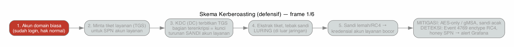
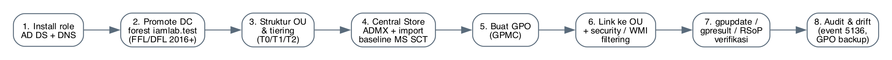
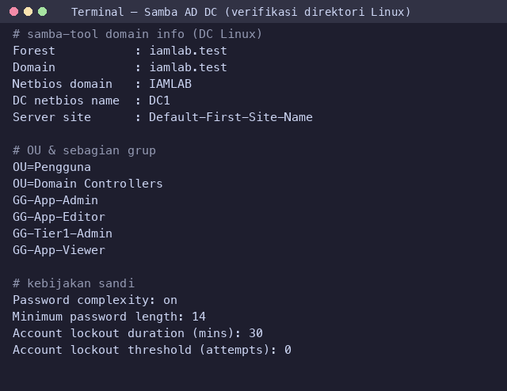

# Sesi 1 — Pengamanan Direktori Terpusat (AD/LDAP) & GPO

Indikator 1.1 (hardening AD/LDAP) dan 1.2 (Group Policy). Sesi ini membangun **empat
sistem**: dua direktori (**Windows Server 2025 AD** dan **Samba AD DC** untuk sisi Linux)
dan dua klien (**Windows 11** dan **Linux**). Windows Server + klien Windows menjadi
**target utama** untuk SSO (Sesi 2), vault & bastion (Sesi 3), dan pemantauan (Sesi 4);
sisi Linux memakai Samba. **Kita kerjakan bagian Samba lebih dulu** karena dapat langsung
dijalankan, baru Windows Server. Skrip provisioning ada di folder ini (`import-ad.ps1`,
`users_dummy.csv`, `gen_dummy_users.py`).

Penanda tempat menjalankan: 🪟 **DC (PowerShell/GPMC)** · 🐳 **container (host)** ·
🖥️ **terminal peserta**. (Lihat Sesi 0 untuk arti lengkap.)

## Keterhubungan dengan sesi lain

Ini sesi praktik pertama; ia memakai konsep identitas dari **Sesi 0** (IAAA, tiering).
**Yang dibuat di sini dipakai sesi berikutnya:** OU & grup `GG-*`, akun layanan `svc-keycloak`
(dipakai Sesi 2 untuk federasi), `svc-openbao` + grup `GG-Tier1-Admin` (Sesi 3), kebijakan
sandi, serta event audit AD yang akan dipantau di Sesi 4. **Windows Server + klien Windows**
menjadi target layanan IAM di sesi-sesi tersebut. Jadi selesaikan sesi ini lebih dulu.

## a. Tujuan Sesi

Peserta mampu:
- Menata direktori terpusat (OU, *tiering*, grup) dan melakukan *bulk import* pengguna.
- Menerapkan kebijakan kata sandi domain dan PSO/FGPP untuk akun istimewa.
- Mengeraskan (*hardening*) direktori: LDAPS/signing, AES-only Kerberos, nonaktifkan protokol lemah.
- Membuat, menautkan, dan memverifikasi **Group Policy Object (GPO)** keamanan.
- Mengenali sinyal **Pass-the-Hash** & **Kerberoasting** pada log, lalu menutupnya dengan mitigasi.

## b. Output yang Diharapkan

- Direktori berisi ±220 pengguna di `OU=Pengguna`; anggota `Domain Admins` ≤ 2.
- Akun layanan (`svc-*`) memakai enkripsi **AES** (bukan RC4); SMBv1 nonaktif.
- GPO tertaut ke OU dan tampil pada `gpresult`/RSoP.
- Pada simulasi: sebelum mitigasi terlihat tiket Kerberos RC4 (event 4769, enctype `0x17`);
  setelah AES-only, permintaan tiket memakai AES (`0x12`) dan akun umpan memicu perhatian.

## c. Teori dan Struktur Sistem

**Apa.** *Active Directory* adalah direktori + *control plane* identitas Windows:
menyimpan pengguna/grup/komputer (LDAP), menerbitkan tiket **Kerberos** (KDC),
menyediakan DNS, dan menyebar kebijakan lewat **GPO** (objek LDAP + berkas di SYSVOL).

**Mengapa penting.** Kompromi DC atau akun Tier 0 = kompromi seluruh domain.
Karena itu direktori adalah aset paling bernilai yang harus dikeraskan lebih dulu.

**Siapa & Di mana — model tiering (Enterprise Access Model):**
Tier 0 (DC, AD CS, sinkronisasi identitas) = bidang kendali tertinggi; Tier 1
(server/aplikasi); Tier 2 (perangkat pengguna). **Prinsip:** kredensial tier tinggi
tidak boleh terpapar di tier rendah, agar kompromi bidang bawah tidak naik ke atas.

**Kapan GPO berlaku & Bagaimana diproses — LSDOU:** Local → Site → Domain
→ OU, dengan pewarisan, *Enforced*, *Block Inheritance*, *security filtering*, dan WMI
filtering. GPO yang ditautkan lebih dekat ke objek menang kecuali di-*Enforce*.

### Empat sistem lab

Lab IAM nyata bersifat heterogen (Windows & Linux), jadi disediakan empat mesin:

| Sistem | Peran | Dipakai untuk |
|--------|-------|---------------|
| **Windows Server 2025** (`dc1`) | AD DC — DNS, Kerberos, GPO (Tier 0) | Direktori utama; sumber identitas untuk SSO/vault/bastion |
| **Klien Windows 11** | Anggota domain `dc1` | **Target** GPO, bastion (RDP), pemantauan |
| **Samba AD DC** (`dc2`, Linux) | Direktori untuk sisi Linux (LDAP/Kerberos) | Alternatif open-source; dikerjakan **lebih dulu** karena ringan/cepat |
| **Klien Linux** | Anggota domain via `sssd`/`winbind` | **Target** bastion (SSH), pemantauan |

> Catatan sumber daya: pada lab nyata keempatnya berjalan; bila sumber daya terbatas,
> prioritaskan **Samba + klien Linux** (Bagian A, ringan) lalu tambahkan **Windows Server +
> klien Windows** (Bagian B) saat perangkat memadai.

### Dua teknik serangan (dibahas untuk DITUTUP, bukan untuk menyerang)

**Kerberoasting.** *Setiap* akun domain boleh meminta tiket layanan (TGS) untuk akun
layanan ber-SPN; bagian tiket terenkripsi dengan kunci turunan **sandi akun layanan**,
lalu penyerang menebak sandi itu **luring** (di luar jaringan, tanpa menyentuh DC lagi
— itulah yang membuatnya sulit terlihat). Ikuti prosesnya langkah demi langkah:



*Gambar 1. Skema Kerberoasting (animasi langkah demi langkah)*


*Gambar 2. Skema Kerberoasting ringkas — titik mitigasi & deteksi*

*Legenda: nomor 1–3 = langkah (konsep); blok hijau = mitigasi; blok teal = deteksi.*

*Analogi:* meminjam gembok resmi, membawanya pulang, mencoba ribuan kunci di rumah.
**Mitigasi:** sandi akun layanan sangat panjang/acak atau **gMSA**, dan **Kerberos
AES-only** sehingga tiket RC4 lemah tak terbit. **Deteksi:** event 4769 enctype `0x17`
dari akun non-mesin; akun umpan (*honey SPN*).

**Pass-the-Hash (PtH).** Penyerang yang menguasai sebuah host mengambil *hash* NTLM
dari memori, lalu memakainya untuk autentikasi ke host lain **tanpa tahu sandi aslinya**.


*Gambar 3. Skema Pass-the-Hash — titik mitigasi & deteksi*

*Legenda: nomor 1–3 = langkah serangan (konsep); blok hijau = mitigasi; blok teal = deteksi.*

*Analogi:* mencuri cetakan sidik jari lalu memakainya di pemindai lain. **Mitigasi:**
sandi admin lokal unik (**Windows LAPS**), isolasi tier, Protected Users/Credential
Guard, kurangi NTLM. **Deteksi:** logon NTLM (event 4624 tipe 3) lintas banyak host.

**Catatan notasi enctype:** atribut `msDS-SupportedEncryptionTypes = 24` memakai
*bitmask* (24 = AES128+AES256). Field `TicketEncryptionType` pada event 4769 memakai
nomor enctype Kerberos: `0x17`=RC4-HMAC, `0x18`=RC4-HMAC-EXP (lemah), AES = `0x11/0x12`.

### Siklus GPO


*Gambar 4. Siklus setup → implementasi GPO*

## d. Praktik: Instalasi dan Konfigurasi

### Bagian A — Samba AD DC + klien Linux (dikerjakan DULU, dapat dijalankan sekarang)

Samba menyediakan direktori ber-protokol AD (LDAP/Kerberos) di Linux. Di lab/stand-in
Linux, DC Samba sudah ter-*provision* (`samba-tool domain provision`). Yang Anda lakukan:
menata OU/grup, kebijakan sandi, lalu menggabungkan klien Linux.

```bash
# 🖥️ di TERMINAL HOST (Docker host) — menyalakan & masuk ke container DC Samba
docker compose --profile direktori up -d samba-dc   # provisioning otomatis saat start pertama (~30 dtk)
docker compose exec samba-dc bash                    # membuka shell DI DALAM container

# 🐳 mulai di sini perintah dijalankan DI DALAM container Samba DC (dc2)
samba-tool ou create "OU=Pengguna,DC=iamlab,DC=test"
for g in GG-App-Viewer GG-App-Editor GG-App-Admin GG-Tier1-Admin; do samba-tool group add "$g"; done
samba-tool user create budi.contoh 'Passw0rd#Lab2026' --userou="OU=Pengguna"
samba-tool group addmembers GG-App-Viewer budi.contoh
samba-tool domain passwordsettings set --min-pwd-length=14 --complexity=on
samba-tool domain passwordsettings show        # verifikasi
```

> **✅ Validasi / Output yang diharapkan** (ditangkap nyata, amd64). Tiap perintah harus
> membalas seperti ini — bila berbeda, periksa pesan error:
> ```text
> samba-tool ou create "OU=Pengguna,..."   → Added ou "OU=Pengguna,DC=iamlab,DC=test"
> samba-tool group add GG-App-Viewer       → Added group GG-App-Viewer   (×4 grup)
> samba-tool user create budi.contoh ...    → User 'budi.contoh' added successfully
> samba-tool group addmembers GG-App-Viewer budi.contoh → Added members to group GG-App-Viewer
> samba-tool domain passwordsettings set ... → Password complexity activated!
>                                              Minimum password length changed!
>                                              All changes applied successfully!
> ```
> `samba-tool domain passwordsettings show` harus menampilkan `Password complexity: on`
> dan `Minimum password length: 14`. Cek anggota: `samba-tool user list` memuat
> `budi.contoh`, `Administrator`, `krbtgt`, `Guest`.
> **Jika muncul** `ERROR: Could not … No such Base DN: CN=Schema,…` → provisioning Samba
> belum selesai; tunggu ±30–60 dtk lalu ulangi (jangan jalankan saat container baru `Up` beberapa detik).

Verifikasi direktori (keluaran nyata):



*Gambar 5. Terminal Samba AD DC — domain, OU, grup, kebijakan sandi*

**Gabungkan klien Linux** (`sssd` + `realmd`) ke domain. VM klien Ubuntu dinyalakan panitia
di host fisik (`./deploy-lab.sh --vms`, dari `distribusi/ova/ubuntu-client.ova`); jaringannya
sudah terkonfigurasi. Lalu di dalam VM itu:
```bash
# 🖥️ di klien Linux (VM Ubuntu)
sudo realm discover iamlab.test
sudo realm join --user=Administrator iamlab.test
id budi.contoh@iamlab.test        # harus menampilkan UID/grup dari direktori
```
> Hasil: pengguna direktori dapat login ke klien Linux — membuktikan konsep AD/LDAP+Kerberos
> pada sisi Linux (open source).
>
> **Catatan peran dc2 (penting, hindari salah paham):** Samba `dc2` adalah **latihan direktori
> sisi Linux (Bagian A)** yang bisa dijalankan lebih dulu. Ia **bukan** sumber federasi untuk
> Keycloak. Mulai **Sesi 2 dan seterusnya, SSO/vault/bastion berfederasi ke Windows AD `dc1`**
> (`ldaps://dc1.iamlab.test:636`) — lihat Sesi 2. Jadi dc2 melengkapi pemahaman, sedangkan `dc1`
> adalah direktori produksi lab (Tier 0).

### Bagian B — Windows Server 2025 AD + klien Windows (target utama SSO/vault/bastion/pemantauan)

> **Deploy (disiapkan):** VM DC Windows sudah di-*promote* menjadi domain `iamlab.test`
> (AD DS + DNS). Peserta **mengonfigurasi keamanannya**. Dari nol: `Install-WindowsFeature
> AD-Domain-Services` lalu `Install-ADDSForest -DomainName iamlab.test` (sekali, lalu reboot).

### 1. 🪟 Struktur OU, grup, dan akun layanan
Jalankan di **PowerShell (Administrator) pada VM DC**. Perintah membuat OU sesuai model
tiering, grup otorisasi, akun layanan untuk Sesi 2/3, dan satu SPN umpan untuk deteksi:
```powershell
$dn = "DC=iamlab,DC=test"
"Tier0","Tier1-Servers","Pengguna","Grup","AkunLayanan" | % {
  New-ADOrganizationalUnit -Name $_ -Path $dn -ProtectedFromAccidentalDeletion $true -EA SilentlyContinue }
$grpOU = "OU=Grup,$dn"
"GG-Pimpinan","GG-Keuangan","GG-SDM","GG-TI","GG-Operasional","GG-Layanan","GG-Hukum",`
"GG-App-Viewer","GG-App-Editor","GG-App-Admin","GG-Tier0-Admin","GG-Tier1-Admin" | % {
  New-ADGroup -Name $_ -GroupScope Global -Path $grpOU -EA SilentlyContinue }
$svcOU = "OU=AkunLayanan,$dn"
foreach ($s in "svc-keycloak","svc-openbao","svc-app","svc-honey") {
  New-ADUser -Name $s -SamAccountName $s -UserPrincipalName "$s@iamlab.test" -Path $svcOU `
    -AccountPassword (ConvertTo-SecureString "Svc#Lab2026!" -AsPlainText -Force) `
    -Enabled $true -PasswordNeverExpires $true -EA SilentlyContinue }
setspn -S HTTP/honey.iamlab.test svc-honey   # SPN umpan: permintaan tiketnya = sinyal serangan
```

### 2. 🪟 Bulk import pengguna
`import-ad.ps1` membaca CSV lalu membuat akun + keanggotaan grup + sandi awal acak +
flag "ganti saat login pertama". Jalankan di DC (salin folder ini ke DC lebih dulu):
```powershell
.\import-ad.ps1 -Csv .\users_dummy.csv -UserOU "OU=Pengguna,$dn"      # 200 pengguna
.\import-ad.ps1 -Csv .\users_batch2.csv -UserOU "OU=Pengguna,$dn"     # latihan mandiri +20
Get-ADUser -Filter * -SearchBase "OU=Pengguna,$dn" | Measure-Object   # verifikasi jumlah
```
> 🖥️ Butuh data ulang? Bangkitkan CSV sintetis deterministik di **terminal peserta**:
> `python3 gen_dummy_users.py --count 200 --out users_dummy.csv`.

### 3. 🪟 Akun admin terpisah & batasi Domain Admins
Prinsip *least privilege*: admin harian memakai akun `adm-*` (Tier 0), dan `Domain
Admins` dijaga minimal:
```powershell
New-ADUser -Name "adm-anda" -SamAccountName "adm-anda" -Path "OU=Tier0,$dn" `
  -AccountPassword (Read-Host -AsSecureString) -Enabled $true
Add-ADGroupMember -Identity "GG-Tier0-Admin" -Members "adm-anda"
Get-ADGroupMember "Domain Admins"        # audit — sisakan ≤ 2
```

### 4. 🪟 Kebijakan kata sandi + PSO untuk admin
Kebijakan domain untuk semua, PSO lebih ketat khusus admin:
```powershell
Set-ADDefaultDomainPasswordPolicy -Identity iamlab.test -MinPasswordLength 14 -ComplexityEnabled $true -LockoutThreshold 10
New-ADFineGrainedPasswordPolicy -Name "PSO-Admin" -Precedence 10 -MinPasswordLength 20 -ComplexityEnabled $true -LockoutThreshold 5
Add-ADFineGrainedPasswordPolicySubject "PSO-Admin" -Subjects "GG-Tier0-Admin"
```

### 5. 🪟 Hardening inti
Memaksa Kerberos AES pada akun layanan (lalu reset sandi agar kunci dibuat ulang) dan
mematikan protokol lemah:
```powershell
Set-ADUser svc-keycloak -KerberosEncryptionType AES128,AES256 ; Set-ADAccountPassword svc-keycloak -Reset
Set-SmbServerConfiguration -EnableSMB1Protocol $false -Force
auditpol /set /subcategory:"Kerberos Service Ticket Operations" /success:enable /failure:enable
```
> LDAP signing/LDAPS dan impor **Microsoft Security Baseline Windows Server 2025**
> (Security Compliance Toolkit) diterapkan lewat GPO pada langkah berikut.

### 6. 🪟 GPO: buat → tautkan → verifikasi
1. Buka **GPMC** (`gpmc.msc`), buat GPO `SEC-Audit-Tier1`, edit:
   *Computer Config → Policies → Windows Settings → Security Settings → Advanced Audit Policy*
   (Account Logon, Logon/Logoff, DS Access).
2. **Tautkan** ke `OU=Tier1-Servers`; atur **Security Filtering** (grup komputer).
3. Verifikasi: `gpupdate /force` lalu `gpresult /h C:\gpreport.html`.

> Lihat diagram siklus GPO di atas untuk gambaran alurnya. Tangkapan layar GUI Windows
> (GPMC, ADUC, hasil `gpresult`) diambil langsung di VM DC saat sesi berlangsung — simpan
> di `gambar/` dengan nama berurutan (mis. `06-gpo-edit.png`, `06-gpresult.png`) sebagai bukti.

### 7. 🪟 Hardening endpoint lewat GPO (standar keamanan)

Selain mengeraskan DC, kebijakan berikut didorong ke seluruh workstation/anggota domain
lewat GPO agar sesuai standar (CIS Benchmark, Microsoft Security Baseline, NIST SP 800-53).
Terapkan dari GPMC dan tautkan ke OU workstation:

| Kebijakan | Apa & mengapa | Letak di GPO / cara |
|-----------|---------------|---------------------|
| **BitLocker + TPM** | Enkripsi disk penuh; kunci terikat TPM agar data tetap aman bila perangkat hilang. Kunci pemulihan di-*escrow* ke AD. | *Computer Config → Policies → Administrative Templates → Windows Components → BitLocker Drive Encryption*; aktifkan "Store recovery information in AD DS". |
| **TPM, Secure Boot, sandi BIOS/UEFI** | Mencegah boot perangkat tak tepercaya & perubahan firmware; TPM prasyarat BitLocker. | Disetel di firmware perangkat (prosedur baku pengadaan); verifikasi via *msinfo32* / Intune/GPO reporting. |
| **Least privilege (tanpa admin lokal)** | Pengguna biasa **tidak** boleh memasang aplikasi; kurangi dampak malware & salah pakai. | *Restricted Groups*/*Group Policy Preferences → Local Users and Groups*: pastikan hanya grup admin tier yang masuk `Administrators` lokal; cabut hak pengguna. |
| **Application allowlisting (AppLocker / WDAC)** | Hanya aplikasi yang disetujui yang boleh berjalan; blokir biner/skrip tak dikenal. | *Computer Config → Policies → Windows Settings → Security Settings → Application Control Policies → AppLocker* (atau WDAC untuk kontrol lebih kuat). Batasi juga PowerShell/macro. |
| **UAC, LAPS, nonaktif SMBv1, audit** | Perkuat kontrol akun & kredensial lokal unik; matikan protokol lemah; aktifkan audit lanjutan. | Impor **Microsoft Security Baseline WS2025** sebagai GPO; aktifkan Windows LAPS. |

> Rujukan: CIS Microsoft Windows Benchmarks (Level 1 umum, Level 2 ketat), Microsoft
> Security Compliance Toolkit (baseline), NIST SP 800-53 (AC-6 least privilege, SC-28
> enkripsi saat diam). Simpan kunci pemulihan BitLocker secara ter-*escrow* dan uji
> pemulihannya.


---

## Simulasi Terkendali & Mitigasi (PtH & Kerberoasting)

Bagian ini memperlihatkan **bagaimana serangan tampak dari sisi log**, lalu membuktikan
bahwa kontrol yang Anda pasang menutupnya. Sepenuhnya defensif dan berjalan di jaringan
Host-Only terisolasi: runner `attack-sim/run.sh` hanya menerima target dari allowlist
`iamlab.test`, mewajibkan variabel `IAMLAB_CONFIRM=1`, dan menolak berjalan bila internet
terjangkau. Peserta **tidak** menyerang sistem di luar lab — tujuannya melatih mata
mengenali pola Kerberoasting/PtH pada Event 4769/4624 dan merasakan efek mitigasi secara langsung.

**Mengapa ini penting:** akun layanan ber-SPN dan hash NTLM adalah dua jalur eskalasi
paling umum di Active Directory. Dengan menjalankan simulasi lalu menerapkan AES-only,
peserta melihat sendiri perubahan `TicketEncryptionType` dari RC4 (`0x17`) ke AES (`0x12`)
— bukti konkret bahwa mitigasi bekerja, bukan sekadar teori.

1. 🪟 Pastikan akun umpan ada: `setspn -L svc-honey` menampilkan `HTTP/honey.iamlab.test`.
2. 🐳 Jalankan simulasi Kerberoasting dari container simulasi (`docker compose --profile attack up -d attacker`). Runner `attack-sim/run.sh` memvalidasi pagar lalu menampilkan perintah **Impacket** (`impacket-GetUserSPNs`) yang **dijalankan instruktur** untuk benar-benar meminta tiket — inilah yang memunculkan Event 4769.
   ```bash
   # 🐳 contoh (target harus ada di attack-sim/TARGETS.lab; konfirmasi wajib)
   docker compose exec -e IAMLAB_CONFIRM=1 attacker bash /attack-sim/run.sh dc1.iamlab.test kerberoast
   ```
   > **✅ Validasi / Output yang diharapkan.** Di lab **Host-Only terisolasi** (benar), runner
   > lolos pagar dan **mencetak** perintah (tidak mengeksekusi sendiri):
   > ```text
   > [lab] (kerberoast) simulasi terhadap dc1.iamlab.test untuk menguji deteksi/mitigasi.
   > [lab] Contoh perintah open source (jalankan manual oleh instruktur di lab):
   >       impacket-GetUserSPNs iamlab.test/<user>:<pass> -request -dc-ip dc1.iamlab.test
   > ```
   > **Jika muncul** `DITOLAK: internet terjangkau — lab HARUS Host-Only terisolasi` →
   > mesin masih punya jalur keluar internet (NAT/bridge aktif). Ini **pengaman yang benar**:
   > putus akses internet VM/host (jadikan Host-Only) lalu ulangi.
   > `Tolak: set IAMLAB_CONFIRM=1` → lupa menambahkan `-e IAMLAB_CONFIRM=1`.
   > `DITOLAK: <target> di luar allowlist lab` → target tidak terdaftar di `attack-sim/TARGETS.lab`.
3. 🪟/🌐 Amati **Event 4769** dengan `TicketEncryptionType = 0x17` (RC4) dari akun
   non-mesin, dan permintaan untuk honey SPN (Event Viewer DC atau dashboard Grafana Sesi 4).
4. 🪟 Terapkan mitigasi, lalu ulangi — tiket kini AES:
   ```powershell
   Set-ADUser svc-app -KerberosEncryptionType AES128,AES256 ; Set-ADAccountPassword svc-app -Reset
   ```
5. **Diskusi PtH (tanpa langkah ofensif):** mengapa Windows LAPS, Protected Users, dan
   isolasi tier memutus pemakaian ulang hash NTLM.

**Hasil yang diharapkan:** sebelum mitigasi terlihat 4769 RC4; setelah AES-only,
permintaan tiket memakai AES; peserta dapat menjelaskan mengapa mitigasi bekerja.
