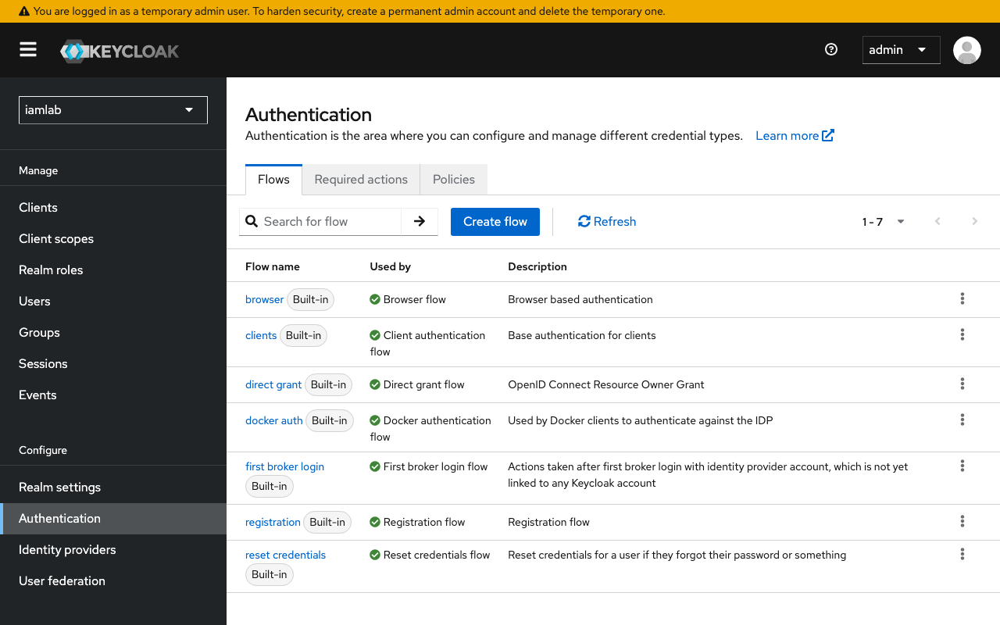

# Sesi 2 — SSO dan MFA (+ App-Komentar RBAC)

Indikator 2.1 (integrasi SSO SAML/OIDC) dan 2.2 (penegakan MFA). Dikerjakan pada
**Keycloak admin** (`https://kc.iamlab.test`).

## a. Tujuan Sesi

Peserta mampu:
- Membuat _realm_ dan **federasi LDAP** Keycloak ke Active Directory.
- Mengintegrasikan aplikasi via **OIDC** (Authorization Code + PKCE) dan **SAML 2.0**.
- Memetakan **grup → peran** sehingga beda hak akses terlihat nyata (RBAC).
- Menegakkan **MFA (Google Authenticator)** secara bersyarat pada layanan kritikal.
- Mengaktifkan pertahanan brute force dan pencatatan _event_.

## b. Output yang Diharapkan

- Pengguna AD tersinkron ke Keycloak dan dapat login SSO.
- Pada **App-Komentar**: _Viewer_ hanya melihat; _Editor_ menulis & menghapus miliknya;
  _Admin_ menghapus semua. Penolakan ditegakkan **di sisi server** (bukan sekadar
  menyembunyikan tombol).
- Akun admin/realm dipaksa memindai OTP; brute force aktif; _event_ login tercatat.

## c. Teori dan Struktur Sistem

- **SSO (Single Sign-On):** satu kali autentikasi ke _Identity Provider_ (IdP), lalu
  banyak aplikasi (_Service Provider_/_Relying Party_) memercayainya.
- **Protokol:**
  - *SAML 2.0* — XML Assertion bertanda tangan (App-SAML).
  - *OIDC* — ID Token (JWT) di atas OAuth 2.0 (App-Komentar, Grafana, Warpgate).
  - Alur aman: **Authorization Code + PKCE** (`state`, `nonce`). _Analogi PKCE:_ saat
    menitip kunci Anda juga memberi teka-teki yang hanya Anda bisa jawab, agar tiket
    tak bisa dipakai pihak yang mencegatnya.
- **MFA & tingkat jaminan (NIST SP 800-63B-4):** AAL2 mewajibkan MFA; peran istimewa
  sebaiknya memakai autentikator _phishing-resistant_ (WebAuthn/passkey). **Google
  Authenticator** menghasilkan kode TOTP (RFC 6238) — faktor "sesuatu yang dimiliki".
- **Federasi LDAP:** Keycloak memverifikasi kredensial langsung ke direktori dan
  mengimpor pengguna sebagai representasi lokal; grup dipetakan untuk otorisasi.

## d. Praktik: Instalasi dan Konfigurasi

### 1. Realm + federasi LDAP ke AD
Buat realm `iamlab`. Lalu **User federation → Add LDAP**:
- Vendor: *Active Directory* · Connection URL: `ldaps://dc1.iamlab.test:636`
- Bind DN: `CN=svc-keycloak,OU=AkunLayanan,DC=iamlab,DC=test` (sandi svc-keycloak)
- Edit mode: **READ_ONLY** · **Users DN: `DC=iamlab,DC=test`** (root — mencakup akun
  admin & layanan; jika hanya `OU=Pengguna`, login SSO admin akan gagal diam-diam)
- Username attr: `sAMAccountName` · UUID: `objectGUID`
- **Save → Test connection & authentication → Synchronize all users**
- **Mappers → group-ldap-mapper**: LDAP Groups DN `OU=Grup,DC=iamlab,DC=test` →
  **Sync LDAP groups to Keycloak**.

### 2. Client OIDC untuk App-Komentar
- **Clients → Create → OpenID Connect**, Client ID `app-komentar`.
- Client authentication **On**; Standard flow **On**; **Direct access grants Off**.
- Valid redirect URIs: `https://app.iamlab.test/callback` · Web origins: `https://app.iamlab.test`.
- **Advanced → PKCE: S256** (aplikasi mewajibkannya).
- Tambah **Group Membership mapper**: claim `groups`, **Full group path = Off**
  (agar bernama `GG-App-...`).
- Salin **Client secret** → isi berkas `.env` lingkungan, lalu muat ulang App-Komentar.

Uji: buka `https://app.iamlab.test` → *masuk (SSO)* dengan tiga akun berbeda grup;
amati perbedaan tombol & aksi. Perbandingan nyata tiga peran:

| Viewer (hanya lihat) | Editor (tulis + hapus miliknya) | Admin (hapus semua + step-up) |
|---|---|---|
|  |  |  |

> Perhatikan: Viewer tidak punya kotak tulis/tombol hapus; Admin punya tombol
> "hapus" per komentar dan "Hapus semua". Penolakan ditegakkan **di server**.

### 3. Client SAML untuk App-SAML
**Clients → Create → SAML**. Tukar metadata IdP
(`https://kc.iamlab.test/realms/iamlab/protocol/saml/descriptor`) untuk konfigurasi
SP (mod_auth_mellon); assertion **signed**.

### 4. MFA bersyarat (Google Authenticator)
- **Authentication → Required actions**: *Configure OTP* = On.
- **Flows → Browser (duplikat)** → tambah sub-flow **Conditional OTP** → *OTP Form*
  **Required**, targetkan ke grup admin & client kritikal (Grafana, Warpgate).
- Uji: pengguna biasa login App-Komentar tanpa OTP; **admin dipaksa memindai QR** Google Authenticator.

### 5. Brute force, SMTP, dan events
- **Realm settings → Security defenses → Brute force detection: On**.
- **Realm settings → Email**: Host `mailpit`, Port `1025` (reset & verifikasi sandi).
- **Realm settings → Sessions/Tokens**: perpendek masa hidup sesi & token.
- **Realm settings → Events**: aktifkan *Save events* (user + admin) + listener `jboss-logging`.

> Catatan: realm Keycloak 26 memiliki aksi default **Verify Profile**. Pengguna AD
> sudah lengkap (email/nama); jika membuat pengguna lokal untuk uji, isi email +
> firstName + lastName + sandi permanen, atau login ditolak "Account is not fully set up".
