# Sesi 2 — SSO dan MFA (+ App-Komentar RBAC)

Indikator 2.1 (integrasi SSO SAML/OIDC) dan 2.2 (penegakan MFA). Sebagian besar
dikerjakan di 🌐 **Keycloak admin** (`https://kc.iamlab.test`); beberapa langkah di
🖥️ **terminal peserta** dan 🐳 **container**.

## Keterhubungan dengan sesi sebelumnya

Sesi ini **memakai direktori hasil Sesi 1**: Keycloak berfederasi ke AD memakai akun
layanan `svc-keycloak` (dibuat di Sesi 1), dan memetakan grup `GG-App-Viewer/Editor/Admin`
(juga dari Sesi 1) menjadi peran aplikasi. Jadi pastikan Sesi 1 selesai (akun & grup ada)
sebelum mulai. **Dipakai sesi berikutnya:** SSO Keycloak ini menjadi login untuk Warpgate
(Sesi 3); event login yang dihasilkan di sini dipantau di Sesi 4.

## a. Tujuan Sesi

Peserta mampu:
- Memahami cara sistem SSO di-*deploy*, lalu **mengonfigurasinya** sendiri.
- Membuat *realm* dan **federasi LDAP** Keycloak ke direktori (Samba AD).
- Mengintegrasikan aplikasi via **OIDC** (Authorization Code + PKCE) dan **SAML 2.0**.
- Memetakan **grup → peran** sehingga beda hak akses terlihat nyata (RBAC).
- Menegakkan **MFA (Google Authenticator)** bersyarat pada layanan kritikal.

## b. Output yang Diharapkan

- Pengguna AD tersinkron ke Keycloak dan dapat login SSO.
- Pada **App-Komentar**: *Viewer* hanya melihat; *Editor* menulis & menghapus miliknya;
  *Admin* menghapus semua. Penolakan ditegakkan **di sisi server**.
- Akun admin/realm dipaksa memindai OTP; brute force aktif; *event* login tercatat.

## c. Teori dan Struktur Sistem

**Single Sign-On (SSO)** berarti satu kali autentikasi ke *Identity Provider* (IdP), lalu banyak
aplikasi (*Service Provider*/*Relying Party*) memercayainya. Hasilnya: jumlah sandi berkurang,
kebijakan & audit terpusat, dan penonaktifan akun berlaku serentak.

**Alur data:**

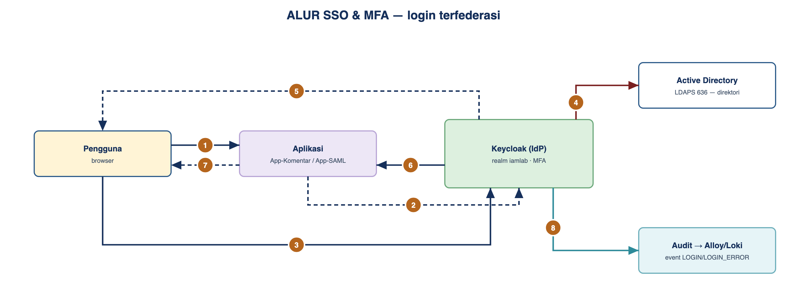

*Gambar 1. Alur SSO & MFA — login terfederasi*


*Legenda: garis penuh = langkah utama; putus-putus = redirect/token & sesi; teal = jejak audit. Nomor dijelaskan pada Agenda Aktivitas di bawah.*

**Agenda Aktivitas (nomor pada diagram):**
1. Pengguna membuka aplikasi (akses `/`).
2. Aplikasi mengarahkan ke Keycloak — OIDC *Authorization Code + PKCE* atau SAML *AuthnRequest*.
3. Pengguna mengisi form login di Keycloak.
4. Keycloak memverifikasi kredensial ke **direktori (Samba AD)** via LDAPS 636 + menarik atribut/grup.
5. Keycloak meminta **MFA** bila kondisi (grup/klien kritikal) terpenuhi.
6. Keycloak mengembalikan **token/assertion** ke aplikasi.
7. Aplikasi membuka sesi; peran ditentukan dari klaim grup.
8. Event login (LOGIN/LOGIN_ERROR) dikirim ke **audit** (Alloy→Loki, Sesi 4).


*Gambar: pengguna menekan login di aplikasi → diarahkan ke Keycloak → Keycloak memeriksa kredensial ke AD lewat LDAPS, meminta OTP bila perlu → menerbitkan token yang dipercaya aplikasi.*

**Protokol:**
- *SAML 2.0* — XML Assertion bertanda tangan (App-SAML).
- *OIDC* — ID Token (JWT) di atas OAuth 2.0 (App-Komentar, Grafana, Warpgate). Alur aman:
  **Authorization Code + PKCE** (`code_challenge`/`code_verifier`), dilengkapi `state`
  (anti-CSRF) dan `nonce` (anti-replay ID Token). *Analogi PKCE:* saat menitip kunci
  Anda juga memberi teka-teki yang hanya Anda bisa jawab, agar tiket tak bisa dipakai
  pihak yang mencegatnya.

**MFA & tingkat jaminan (NIST SP 800-63B-4).** AAL2 mewajibkan MFA; peran istimewa
sebaiknya memakai autentikator *phishing-resistant* (WebAuthn/passkey). **Google
Authenticator** menghasilkan kode TOTP (RFC 6238) — faktor "sesuatu yang dimiliki".

**RBAC via klaim grup.** Keycloak menyertakan daftar grup pengguna di token; aplikasi
membaca klaim itu untuk menentukan izin. *Analogi:* gelang berwarna yang menentukan
panggung mana yang boleh dimasuki.

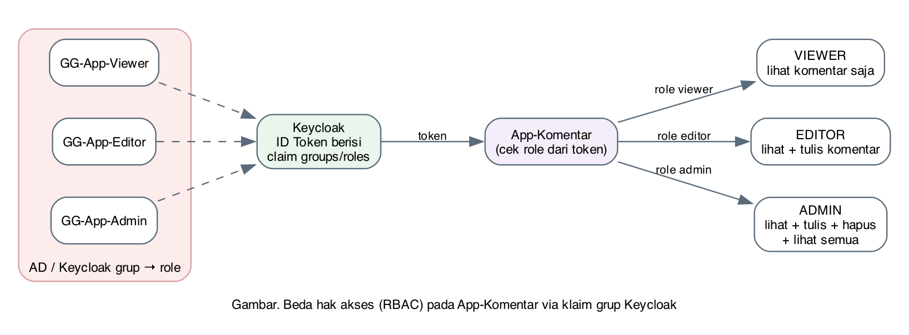

*Gambar 2. Alur RBAC App-Komentar — grup → peran → izin*


*Legenda: putus-putus = klaim grup dalam token; nomor 1–3 = urutan grup → token → izin.*

*Gambar: grup tempat pengguna berada (Viewer/Editor/Admin) ikut dalam token sebagai klaim `groups`; aplikasi membaca klaim itu untuk memutuskan tombol & aksi yang boleh.*

## d. Praktik: Instalasi dan Konfigurasi

### 0. 🖥️ Deploy (sudah disiapkan)
Bagian ini hanya untuk diketahui saja. Konfigurasi detail (langkah 1–5) yang dikerjakan peserta.
```bash
cd ../deploy        # stack di IAMLAB-BuildBag; modul diklon di IAMLAB-BuildBag/Pelatihan_IAM
cp .env.example .env            # sesuaikan DC_IP & sandi
docker compose up -d            # Keycloak + PostgreSQL + aplikasi + proxy berjalan (kosong)
```
Setelah ini Keycloak hidup di `https://kc.iamlab.test` tetapi **belum punya realm/
federasi/MFA** — semua itu Anda buat berikut.

> **✅ Validasi / Output yang diharapkan.** Keycloak butuh ±60 dtk sampai `healthy`:
> ```bash
> docker compose ps keycloak                       # → Up … (healthy)
> # dari host (setelah healthy); sertifikat CA internal → pakai -k
> curl -sk -o /dev/null -w "%{http_code}\n" https://kc.iamlab.test/realms/master   # → 200
> ```
> Di browser, `https://kc.iamlab.test` menampilkan halaman *Welcome to Keycloak*
> (login admin: `admin` / sandi dari `.env`).
> **⚠️ Jika dari host dapat `404`/halaman asing padahal container `healthy`:** ada
> aplikasi lain memegang **port 443** (sering `vmware-hostd` dari VMware Workstation).
> Uji cepat bahwa stack sebenarnya sehat dari dalam jaringan Docker:
> ```bash
> docker run --rm --network iamlab_iamnet curlimages/curl -s http://keycloak:8080/realms/master | head -c 80
> # → {"realm":"master","public_key":"MIIB…   (artinya Keycloak OK; masalah hanya di port host)
> ```
> Perbaikan: bebaskan port 443 di host (hentikan `vmware-hostd`/aplikasi lain) — lihat
> cek kesiapan host di **Sesi 0**.

### 1. 🌐 Realm + federasi LDAP ke AD
**Prasyarat (Sesi 1 langkah 5b):** CA Samba sudah disalin ke `deploy/certs/ad-ca.pem` dan
Keycloak di-*recreate* — tanpa itu koneksi LDAPS gagal dengan galat sertifikat (PKIX).

**Langkah A — buat realm `iamlab`:**
1. Login konsol admin `https://kc.iamlab.test` (realm **master**, user admin).
2. Di **pojok kiri atas** klik dropdown realm (bertuliskan **Keycloak**/**master**) → **Create realm**.
3. **Realm name**: `iamlab` → **Create**.
4. Pastikan dropdown kiri-atas kini menampilkan **iamlab** — **semua langkah Sesi 2 dilakukan di realm `iamlab`**, bukan master.

**Langkah B — tambah provider LDAP:** menu kiri **User federation** → klik kartu **Add LDAP providers** (atau **Add provider → LDAP**). Isi formulir **persis** seperti ini:
- Vendor: *Active Directory* (Samba AD kompatibel-AD) · Connection URL: `ldaps://dc1.iamlab.test:636`
- Bind DN: `CN=svc-keycloak,OU=AkunLayanan,DC=iamlab,DC=test` · Bind credential: sandi
  svc-keycloak **terbaru** (yang Anda set saat reset di Sesi 1 langkah 5)
- Edit mode: **READ_ONLY** · **Users DN: `DC=iamlab,DC=test`** (root — mencakup akun
  admin & layanan; jika hanya `OU=Pengguna`, login SSO admin gagal diam-diam)
- Username LDAP attr: `sAMAccountName` · UUID: `objectGUID`
- **Trust Email: On** ⚠️ **wajib.** Pengguna hasil federasi default `emailVerified=false`. Tanpa
  ini, **Warpgate SSO menolak** mereka (*"e-mail is not verified"*, Sesi 3) dan Keycloak bisa
  memaksa aksi *Verify Email*. "Trust Email" menandai email dari direktori sebagai terverifikasi.

Cocokkan layar Anda dengan tangkapan berikut (form terisi), lalu — **berurutan**:
1. Klik **Save** (provider tersimpan; halaman memuat ulang dengan tab tambahan).
2. Pada halaman provider, jalankan **Test connection** → harus **Success**, lalu **Test
   authentication** → **Success** (memvalidasi Bind DN + sandi `svc-keycloak`). Bila gagal
   PKIX/sertifikat → ulang prasyarat 5b (salin `ad-ca.pem` + recreate Keycloak).
3. Klik **Action** (dropdown kanan atas) → **Sync all users** → notifikasi "N users imported"
   (±220). Cek menu kiri **Users** sudah terisi.

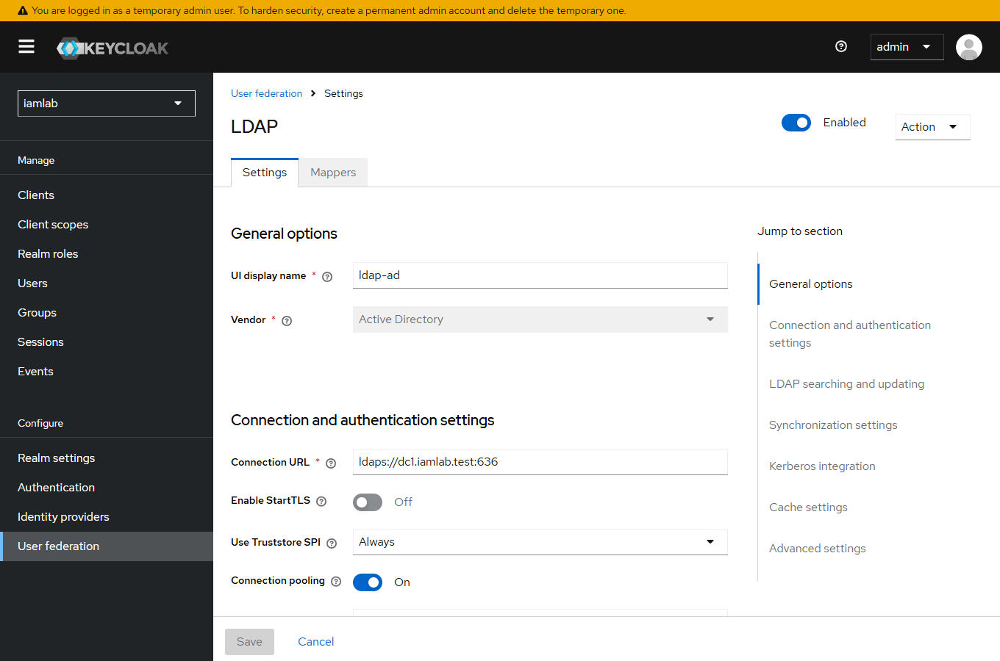

*Gambar 3. Keycloak — form User federation LDAP*


*Gambar: form federasi LDAP terisi — Vendor *Active Directory*, Connection URL `ldaps://dc1.iamlab.test:636`. Cocokkan nilai di layar Anda dengan ini sebelum menekan Save.*

**Langkah C — mapper grup** (agar grup AD ikut terbaca di Keycloak, dipakai RBAC §2):
1. Masih di provider LDAP (**User federation → ldap**), buka tab **Mappers**.
2. Cari mapper **`group-ldap-mapper`** (sering dibuat otomatis). Bila belum ada:
   **Add mapper** → **Mapper type: `group-ldap-mapper`**.
3. Isi lalu **Save**: **LDAP Groups DN** `OU=Grup,DC=iamlab,DC=test` · **Group Name LDAP
   Attribute** `cn` · **Membership LDAP Attribute** `member` · **Mode** `READ_ONLY` ·
   **Preserve Group Inheritance** `Off`.
4. Pada tab **Mappers**, klik mapper tersebut → **Action/Sync → Sync LDAP groups to Keycloak**
   (atau pada provider: **Action → Sync changed users** tidak menarik grup — gunakan menu sync
   grup pada mapper).
5. **Verifikasi:** menu kiri **Groups** memuat `GG-App-Viewer`, `GG-App-Editor`, `GG-App-Admin`,
   `GG-Tier1-Admin`, dst. Tanpa ini, klaim `groups` di §2 akan kosong.

> **⚠️ Grup muncul tapi tab Members KOSONG (atau klaim `groups` kosong di §2)?**
> Keanggotaan **ada di Samba** (dibuat di Sesi 1 dari CSV — mis. `GG-App-Viewer` ±35 anggota),
> tetapi Keycloak belum me-*resolve*-nya. Keanggotaan hanya di-resolve saat **sinkron USER**, dan
> **harus setelah group-ldap-mapper dibuat**. Perbaiki berurutan:
>
> 1. **Re-sync (penyebab tersering — lakukan ini dulu):** **User federation → ldap → Action →
>    Sync all users** SEKALI LAGI (setelah membuat group-ldap-mapper). Sinkron user pertama
>    (sebelum mapper ada) tidak mengisi keanggotaan.
> 2. **Cek sumber (pastikan datanya memang ada):**
>    ```bash
>    docker compose exec samba-dc samba-tool group listmembers GG-App-Viewer   # → daftar ±35 user
>    ```
>    Jika di sini **kosong** → masalah ada di Sesi 1 (import-ad.sh belum dijalankan / kolom
>    `groups` CSV kosong), bukan di Keycloak.
> 3. **Periksa setelan group-ldap-mapper** (User federation → ldap → Mappers → `group-ldap-mapper`):
>    - **LDAP Groups DN** `OU=Grup,DC=iamlab,DC=test` · **Group Name LDAP Attribute** `cn`
>    - **Membership LDAP Attribute** `member` · **Membership Attribute Type** `DN`
>    - **Membership User LDAP Attribute** `cn` *(user dibuat `--use-username-as-cn`, jadi cn=username)*
>    - **User Groups Retrieve Strategy** `LOAD_GROUPS_BY_MEMBER_ATTRIBUTE`
>    - **Preserve Group Inheritance = Off** *(On sering menggagalkan impor keanggotaan di AD)* · **Mode** `READ_ONLY`
>    Ubah → **Save** → tab Mappers → **Sync LDAP groups** → lalu **Action → Sync all users** lagi.
> 4. **Pastikan user tercakup:** provider **Users DN = `DC=iamlab,DC=test`** (root) agar
>    `OU=Pengguna` ikut — semua anggota `GG-App-*` berada di sana.
> 5. **Cek sisi user (paling otoritatif):** **Users → `dewi.puspita001` → tab Groups** harus
>    memuat `GG-App-Viewer`. Bila di sini **ADA** tapi tab *Members* grup tetap kosong, itu hanya
>    tampilan Members yang *lazy* — klaim `groups` tetap jalan (buktikan via **Evaluate**, §2).

Daftar provider federasi:

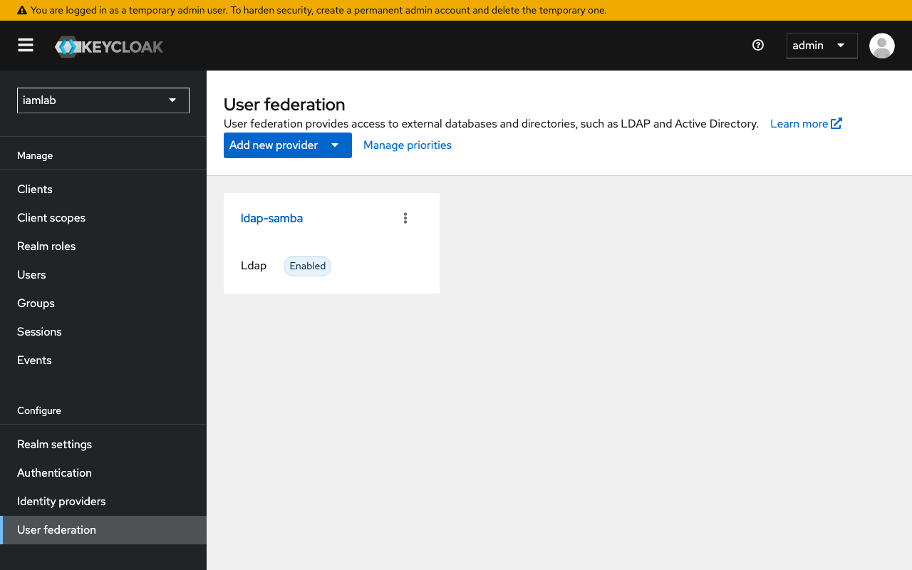

*Gambar 4. Keycloak — User federation (provider LDAP aktif)*


### 2. 🌐 Client OIDC untuk App-Komentar
**Clients → Create → OpenID Connect**, Client ID `app-komentar`:
- Client authentication **On**; Standard flow **On**; **Direct access grants Off**.
- Valid redirect URIs: `https://app.iamlab.test/callback` · Web origins: `https://app.iamlab.test`.
- **Advanced → PKCE: S256** (aplikasi mewajibkannya — tanpa ini login gagal
  "Missing parameter: code_challenge_method").
- **Tambahkan klaim `groups` ke token** melalui **Group Membership mapper**.

  > ⚠️ **Di Keycloak 26 mapper TIDAK ada di tab “Mappers” pada client.** Ia berada di dalam
  > **dedicated scope** milik client (`app-komentar-dedicated`). Inilah sebab mapper sering
  > "tidak ditemukan". Ikuti langkah berikut persis:
  >
  > 1. Menu kiri **Clients** → klik **`app-komentar`**.
  > 2. Buka tab **Client scopes** (deretan tab atas: Settings · Keys · Credentials · Roles ·
  >    **Client scopes** · Advanced).
  > 3. Pada tabel, klik baris paling atas **`app-komentar-dedicated`**
  >    (keterangan *"Dedicated scope and mappers for this client"*).
  > 4. Klik tab **Mappers** → tombol **Add mapper** → **By configuration**.
  > 5. Dari daftar jenis mapper, pilih **Group Membership**.
  > 6. Isi formulir lalu **Save**:
  >    - **Name**: `groups`
  >    - **Token Claim Name**: `groups`
  >    - **Full group path**: **Off**  *(agar nilai klaim `GG-App-Viewer`, bukan `/GG-App-Viewer`)*
  >    - **Add to ID token**: **On** · **Add to access token**: **On** · **Add to userinfo**: **On**
  >
  > **Verifikasi klaim `groups` (tanpa perlu login aplikasi) — lewat tab Evaluate:**
  >
  > 1. Buka **Clients → `app-komentar` → tab Client scopes**. Di dalam tab ini ada dua sub-tab:
  >    **Setup** dan **Evaluate** — klik **Evaluate**.
  > 2. Cari kolom **Users** (sisi kanan atas panel Evaluate). **Ketik nama seorang pengguna yang
  >    menjadi anggota grup `GG-App-*`**, mis. `dewi.puspita001`, lalu **klik nama itu** dari
  >    daftar saran yang muncul (kolom harus terisi satu user — ini "memilih user").
  >    - *Belum tahu user mana yang ada di grup?* Buka **Groups → `GG-App-Viewer` → tab Members**
  >      untuk melihat satu nama; **atau** masukkan user ke grup dulu: **Users → (cari & klik
  >      user) → tab Groups → Join Group → centang `GG-App-Viewer` → Join**.
  > 3. Setelah kolom Users terisi, lihat bagian hasil dan klik sub-tab **Generated ID token**
  >    (bersebelahan dengan *Generated access token*, *Generated user info*, *Effective protocol
  >    mappers*).
  > 4. Pada JSON yang tampil, pastikan ada klaim:
  >    ```json
  >    "groups": [ "GG-App-Viewer" ]
  >    ```
  >    - Jika `groups` **tidak** muncul → mapper belum tersimpan di dedicated scope (ulangi
  >      langkah 1–6 pembuatan mapper di atas).
  >    - Jika muncul `"/GG-App-Viewer"` (ada awalan path) → setel **Full group path = Off**
  >      pada mapper.
  >    - Jika kosong padahal mapper benar → user yang dipilih belum anggota grup (lihat langkah 2).

- Klaim `groups` cukup dari **Group Membership mapper pada dedicated scope** di atas; `app.py`
  hanya meminta scope `"openid profile email"`, jadi **tidak perlu** membuat client scope `groups`
  terpisah.
  ⚠️ **Hanya jika** versi aplikasi lama di lab Anda masih meminta *scope* `groups` dan Keycloak
  menolak *"Invalid scopes: … groups"*: **Client scopes → Create client scope** `groups` (Type
  OIDC) → tab **Mappers → Add mapper → By configuration → Group Membership** (isi sama seperti di
  atas) → lalu **Clients → app-komentar → Client scopes → Add client scope → `groups` → Default**.
  Pada image terbaru langkah ini **opsional**.

Cocokkan layar pengaturan client:

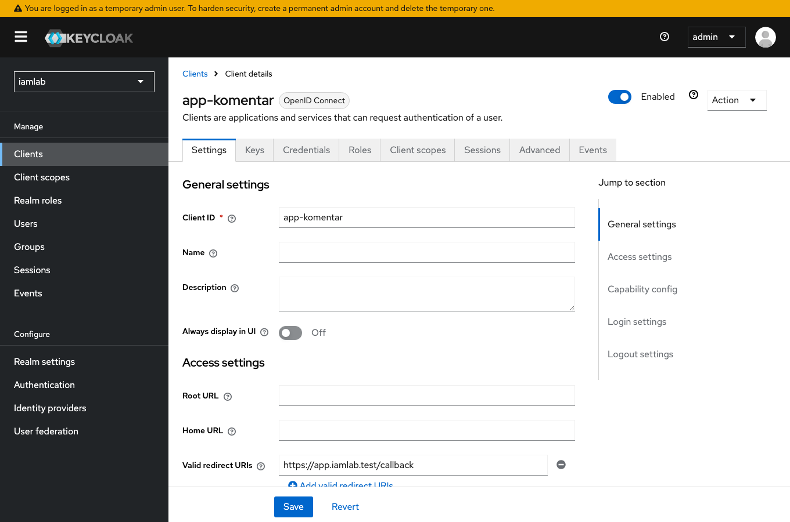

*Gambar 5. Keycloak — detail Client app-komentar*


Tab Advanced menampilkan PKCE S256 (wajib):

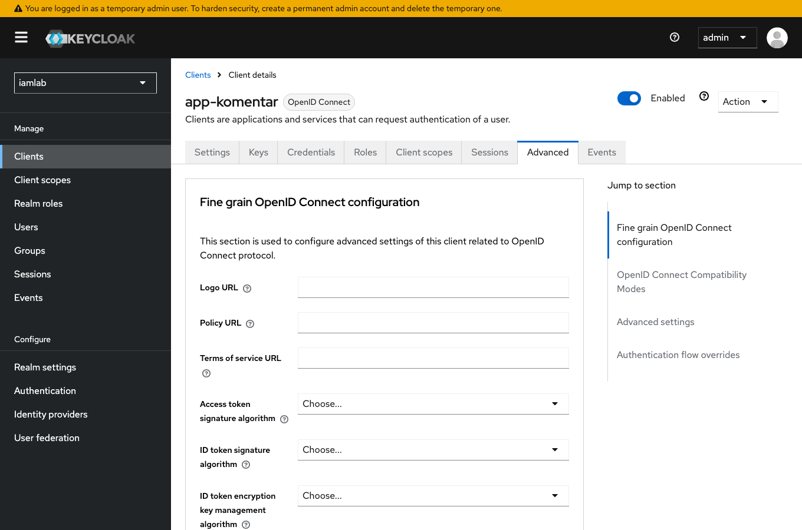

*Gambar 6. Keycloak — Client tab Advanced (PKCE S256)*


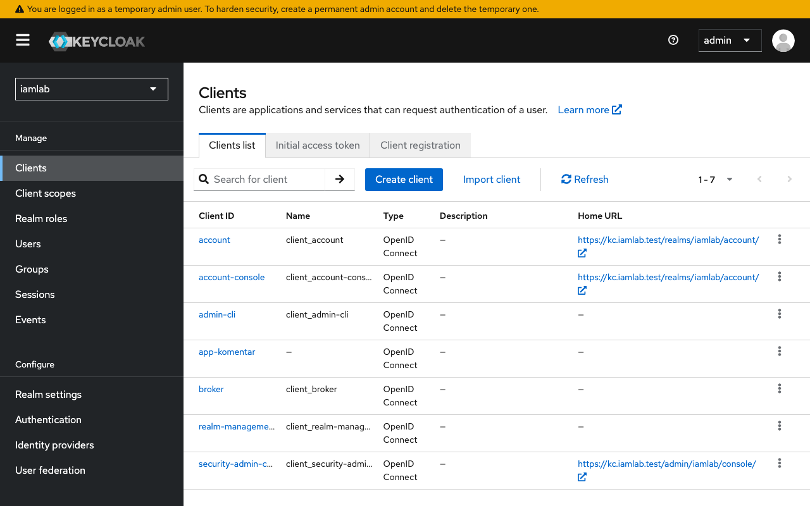

*Gambar 7. Keycloak — daftar Clients realm iamlab*


Lalu 🖥️ salin **Client secret** ke `deploy/.env` (`APP_OIDC_CLIENT_SECRET=…`) dan muat
ulang aplikasi: `docker compose up -d app-komentar`.

### 2b. 🌐 Client OIDC untuk Warpgate (dipakai Sesi 3)
**Clients → Create → OpenID Connect**, Client ID `warpgate`:
- Client authentication **On**; Standard flow **On**; Direct access grants **Off**.
- Valid redirect URIs: `https://pam.iamlab.test/@warpgate/api/sso/return`.
- Simpan **Client secret** — diisi di konfigurasi SSO Warpgate pada Sesi 3 bagian C.

Cocokkan layar client `warpgate` Anda dengan tangkapan berikut (perhatikan redirect URI khusus
bastion dan Direct access grants **Off**):

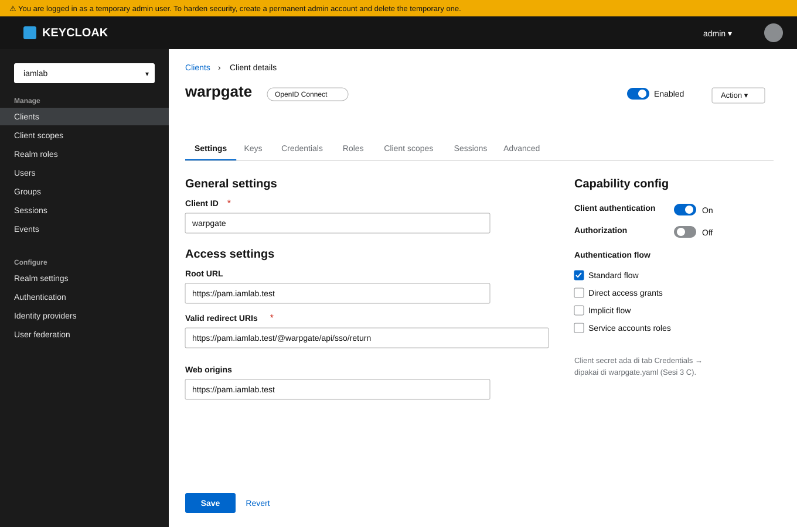

*Gambar 8. Keycloak — detail Client warpgate (OIDC untuk bastion Sesi 3)*

### 3. 🌐 Client SAML untuk App-SAML
**Clients → Create → SAML**. Tukar metadata IdP
(`https://kc.iamlab.test/realms/iamlab/protocol/saml/descriptor`) untuk konfigurasi SP
(mod_auth_mellon); assertion **signed**.

Layar pengaturan client SAML — perhatikan badge **SAML**, Name ID format, dan **Sign assertions On**:

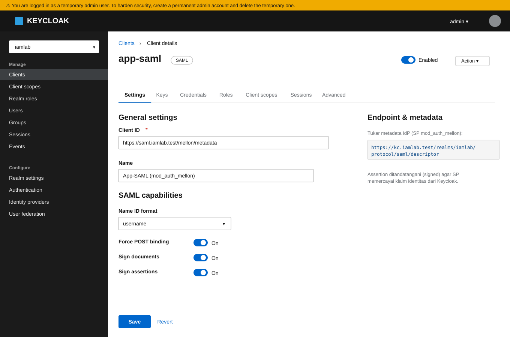

*Gambar 9. Keycloak — detail Client SAML (assertion ditandatangani)*

### 4. 🌐 MFA bersyarat (Google Authenticator)
- **Authentication → Required actions**: *Configure OTP* = On.

  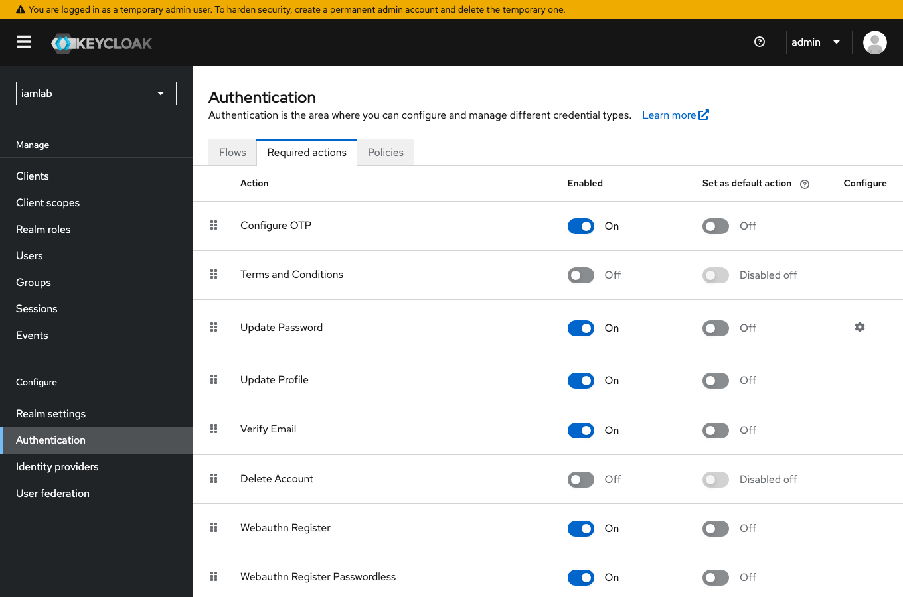

*Gambar 10. Keycloak — Required actions (Configure OTP aktif)*

- **Authentication → Flows** — buat alur browser yang **memaksa OTP hanya untuk admin**.
  Di Keycloak 26 langkahnya:
  1. Menu kiri **Authentication** → tab **Flows** → baris **Browser** → ikon **⋮ (titik tiga,
     kanan) → Duplicate** → **Name**: `browser-mfa` → **Duplicate**.
  2. Buka flow **`browser-mfa`**. Temukan sub-flow **"browser-mfa Browser - Conditional OTP"**
     (hasil duplikat). Di dalamnya ada **Condition - User Configured** dan **OTP Form**.
  3. Paksa untuk admin: pada sub-flow Conditional OTP klik **+ → Add condition** →
     **Condition - User Role** → **Add**; set **User role** = `admin-app` (atau role yang
     melekat pada grup `GG-App-Admin`/`GG-Tier1-Admin`) → **Save**. Set requirement
     **Condition - User Role = Required**.
  4. Set **OTP Form = Required** (bukan Alternative). Biarkan **Condition - User Configured**
     (Required) agar pengguna tanpa OTP diminta mendaftar via required action *Configure OTP*.
  5. **Aktifkan alur** — pilih salah satu target:
     - **Realm-wide:** tab **Flows** → `browser-mfa` → **Action → Bind flow → Browser flow → Save**.
     - **Per client kritikal (Warpgate):** **Clients → `warpgate` → Advanced → Authentication
       flow overrides → Browser Flow = `browser-mfa` → Save** (hanya klien ini yang wajib MFA).

  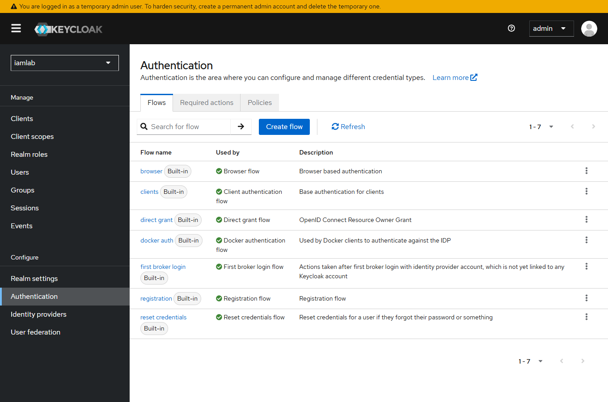

*Gambar 11. Keycloak — Authentication flows (Conditional OTP = Required)*

  > Catatan: "grup admin" ditargetkan lewat **role** yang melekat pada grup itu (Keycloak
  > mengkondisikan via role, bukan grup langsung). Pastikan role admin sudah di-assign ke grup
  > admin: **Groups → `GG-App-Admin` → Role mapping → Assign role**.

- Uji: pengguna biasa login App-Komentar tanpa OTP; **admin dipaksa memindai QR**
  Google Authenticator.

> Keamanan: Keycloak menampilkan banner "temporary admin user". Buat akun admin
> permanen (Realm master → Users) lalu hapus akun sementara sebelum produksi.

### 5. 🌐 Brute force, SMTP, events
- **Brute force detection:** menu kiri **Realm settings** → tab **Security defenses** →
  sub-tab **Brute force detection** → **Mode: Lockout temporarily** (atau "Enabled") → set
  **Max login failures** mis. `10`, **Wait increment** `1 minute` → **Save**.
- **Email (SMTP ke Mailpit):** **Realm settings → tab Email** → **Host** `mailpit`, **Port**
  `1025`, **From** `no-reply@iamlab.test` (Encryption/Auth **Off** — Mailpit uji) → **Save**
  → **Test connection** (cek email masuk di `https://mail.iamlab.test`). Dipakai reset &
  verifikasi sandi.
- **Sesi & token:** **Realm settings → tab Sessions** dan tab **Tokens** → perpendek
  *SSO Session Idle/Max* dan *Access Token Lifespan* sesuai kebijakan → **Save**.
- **Events (audit, dipakai Sesi 4):** buka konfigurasi event realm (**Realm settings**, cari
  bagian/tab **"User events config" & "Admin events config"** — pada sebagian versi di bawah
  menu **⋮ (overflow)** halaman Realm settings):
  - **User events settings** → **Save events = On** → **Save**.
  - **Admin events settings** → **Save events = On**, **Include representation = On** → **Save**.
  - Pastikan **Event listeners** memuat **`jboss-logging`** (default aktif) agar event mengalir
    ke stdout → Alloy → Loki (Sesi 4).

Cocokkan layar Anda dengan tiga tangkapan berikut:

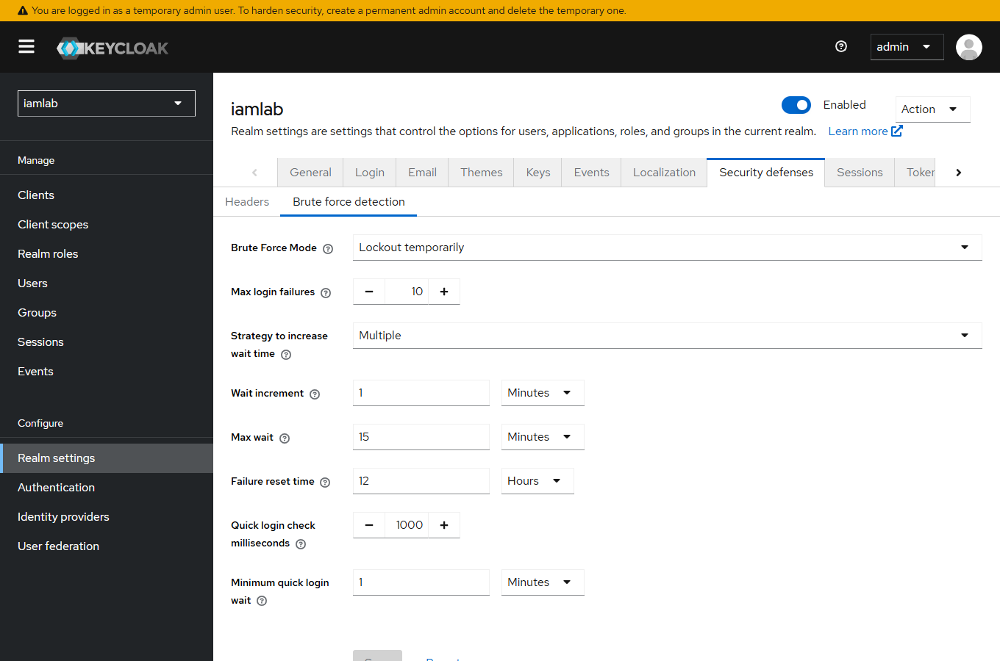

*Gambar 12. Keycloak — Brute force detection aktif*


*Gambar: proteksi brute force menyala — akun dikunci sementara setelah sejumlah kegagalan login (mis. 10), waktu tunggu bertambah.*

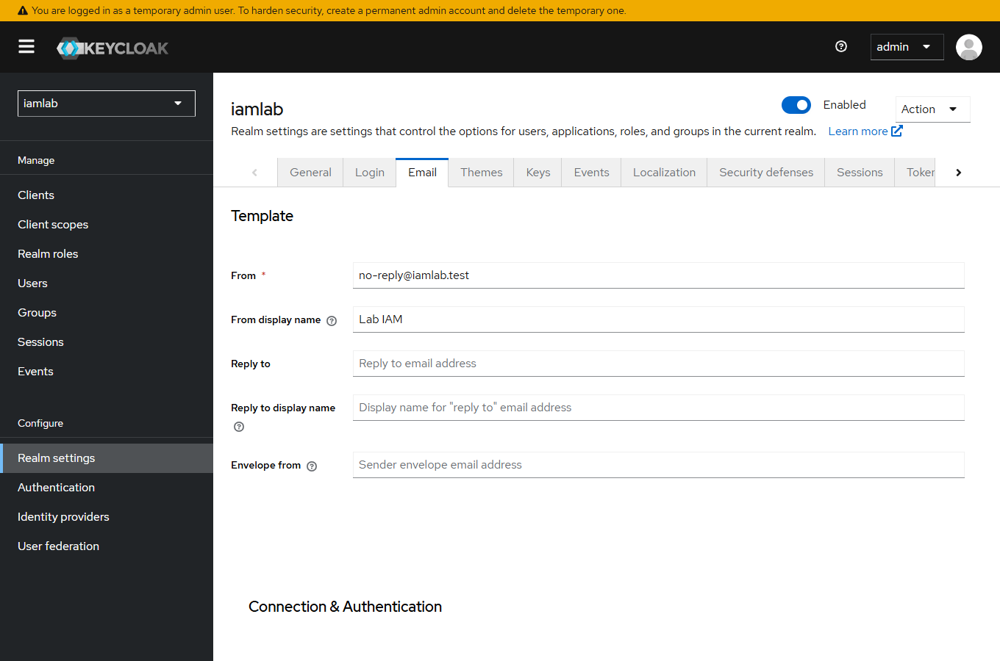

*Gambar 13. Keycloak — Email (SMTP ke Mailpit)*


*Gambar: SMTP diarahkan ke Mailpit (`mailpit:1025`) agar email reset/verifikasi tertangkap di kotak surat uji, bukan terkirim ke internet.*

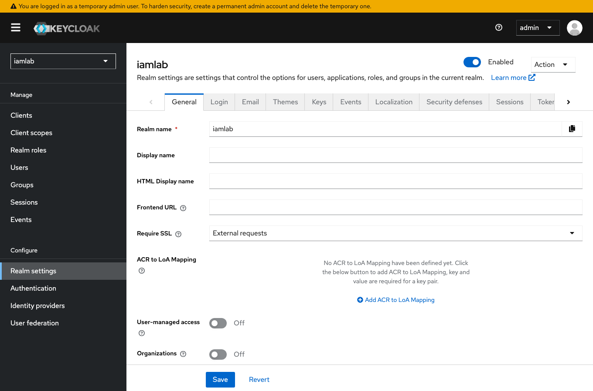

*Gambar 14. Keycloak — konfigurasi Events*


*Gambar: pencatatan event diaktifkan sehingga login/perubahan admin terekam dan bisa dipanen Alloy → Loki di Sesi 4.*

### Hasil: beda hak akses (RBAC) pada App-Komentar
Login `https://app.iamlab.test` dengan tiga akun berbeda grup — perhatikan tombol/aksi
yang tersedia berbeda, dan penolakan ditegakkan **di server** (bukan sekadar tombol disembunyikan):

| Viewer (hanya lihat) | Editor (tulis + hapus miliknya) | Admin (hapus semua + step-up) |
|---|---|---|
| 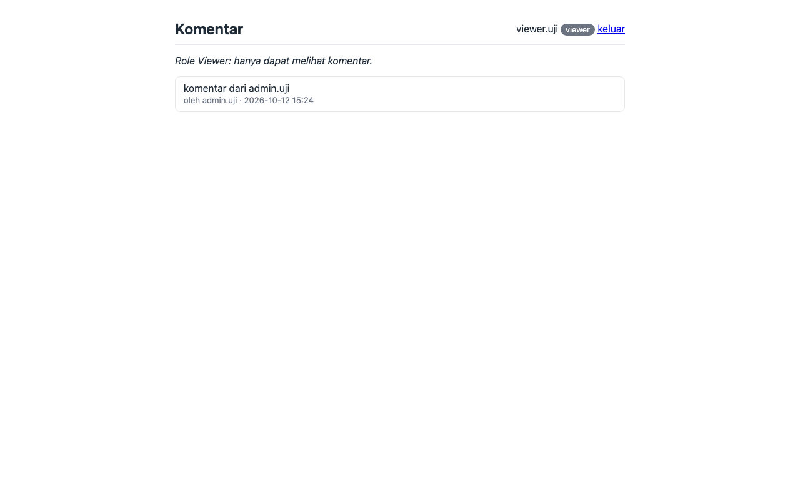 | 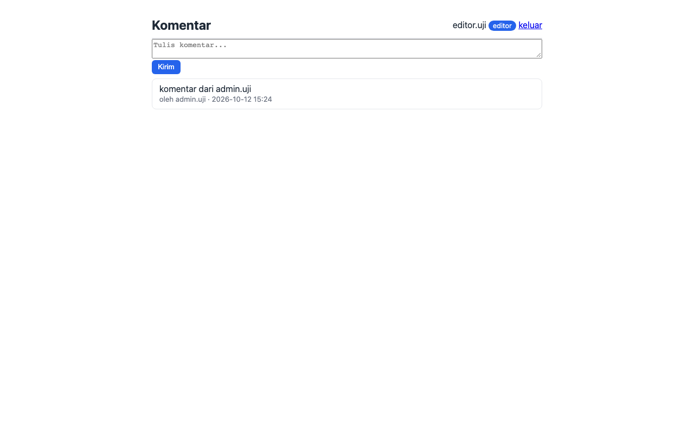 | 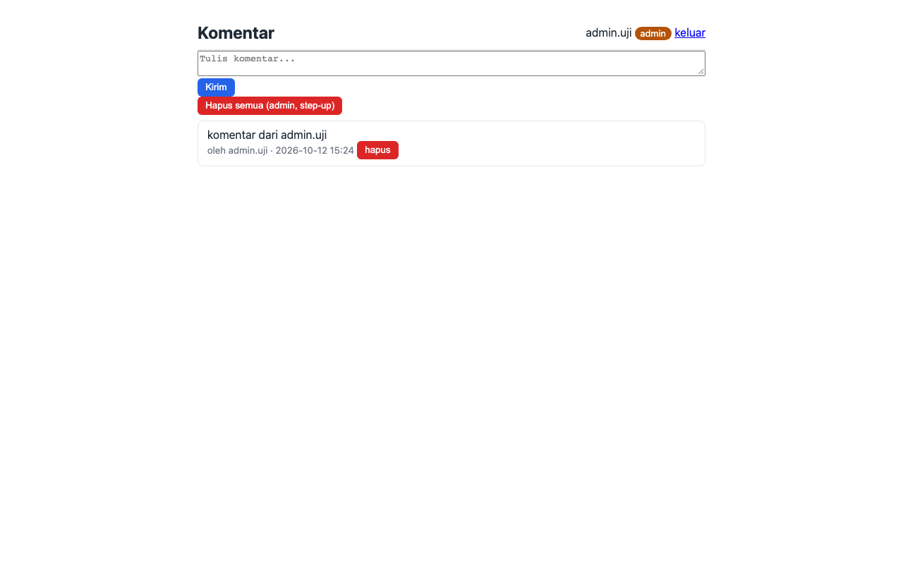 |

*Gambar 15. App-Komentar — tampilan peran Viewer, Editor, Admin*

Halaman login SSO Keycloak yang muncul saat menekan "masuk":

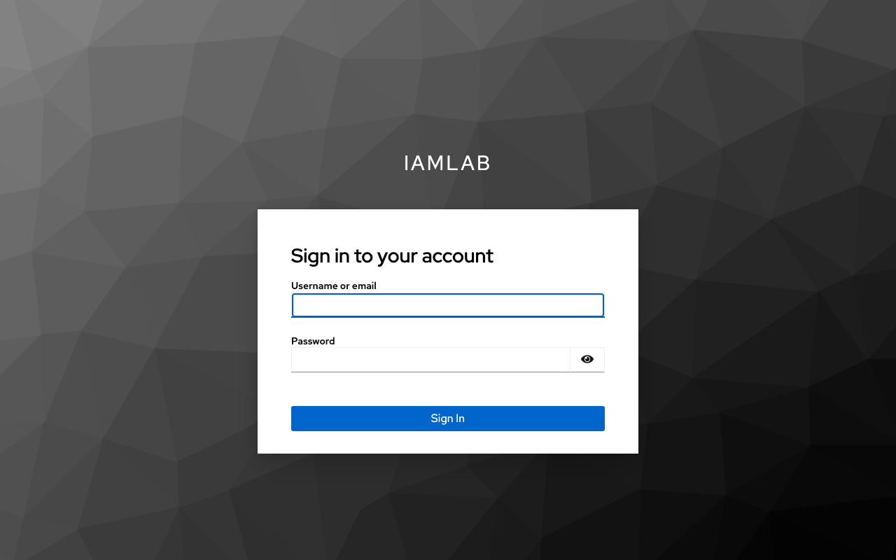

*Gambar 16. Halaman login Keycloak (SSO)*


### (Terkait) Distribusi kata sandi awal via email
Saat *bulk import* (Sesi 1), sandi awal dikirim ke **Mailpit** (kotak surat uji), dan
Keycloak juga mengirim email aksi akun (set sandi/verifikasi). Alurnya:

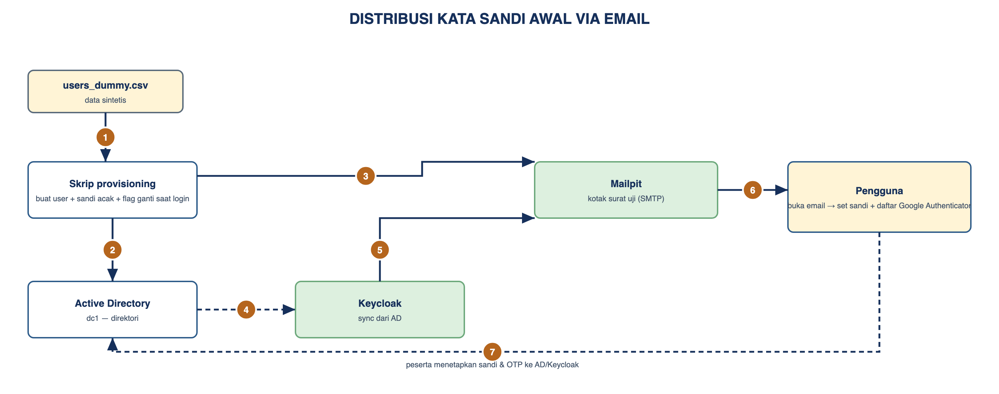

*Gambar 17. Distribusi kata sandi awal via email*


> Catatan: realm Keycloak 26 punya aksi default **Verify Profile**. Pengguna AD sudah
> lengkap (email/nama); jika membuat pengguna lokal untuk uji, isi email + firstName +
> lastName + sandi permanen, atau login ditolak "Account is not fully set up".

---

[⬅️ Sebelumnya: Sesi 1 — Direktori & CIS](../sesi-1-direktori-akses-cis/README.md) · [🏠 Home](../README.md) · [Selanjutnya: Sesi 3 — PAM ➡️](../sesi-3-pam/README.md)
