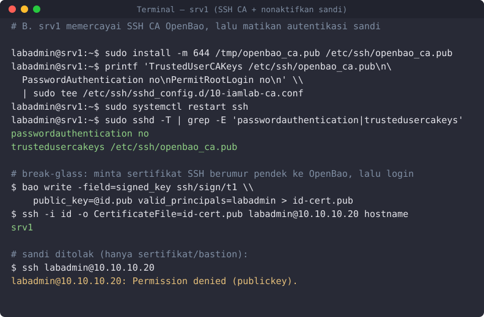
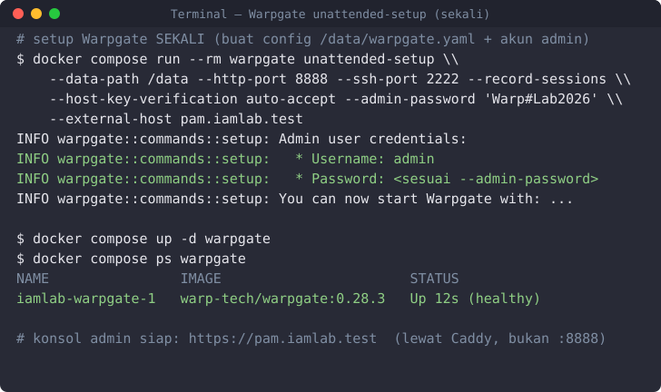
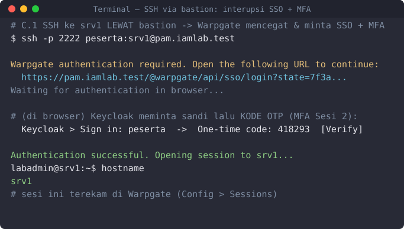

# Sesi 3 — Privileged Access Management (OpenBao + Warpgate)

Indikator 3.1 (jump server/bastion) & 3.2 (password vault). Mengamankan kredensial admin dan
memusatkan akses istimewa lewat **bastion yang merekam sesi**. Penanda: 🖥️ **terminal host** ·
🌐 **web UI**. OpenBao & Warpgate dijalankan lewat `docker compose` **dari terminal host** (bukan
shell interaktif di dalam container).

## Keterhubungan dengan sesi sebelumnya

Memakai **Sesi 1 & 2**: login bastion lewat **SSO Keycloak** (Sesi 2, MFA wajib); OpenBao
autentikasi ke **AD** (Sesi 1) via `svc-openbao`, memetakan grup `GG-Tier1-Admin` → *policy*.
Email serah-terima lewat **Mailpit** (Sesi 2). **Dipakai Sesi 4:** audit OpenBao, sesi Warpgate,
dan sshd jadi sumber log.

## a. Tujuan Sesi

Peserta mampu:
- Menginisialisasi & membuka (*unseal*) brankas **OpenBao**; mengaktifkan audit, auth LDAP,
  *policy least privilege*, KV *break-glass*, dan **SSH CA**.
- Mengonfigurasi **Warpgate** sebagai bastion ber-SSO + perekaman sesi, lalu **mengakses `srv1`
  via SSH melalui bastion**.

## b. Output yang Diharapkan

- OpenBao *unsealed*, audit aktif, *root token* dicabut setelah login LDAP admin terbukti.
- Target SSH menolak sandi; akses hanya via sertifikat CA / bastion.
- Sesi admin lewat Warpgate **terekam** dan dapat diputar ulang.

## c. Teori dan Struktur Sistem

*Privileged Access Management* memperlakukan akun admin ("kunci induk") secara khusus. **Vault**
menyimpan kredensial terenkripsi, memberi akses berbasis kebijakan, mencatat tiap pengambilan, dan
dapat menerbitkan kredensial berumur pendek. **Bastion/jump server** memaksa semua akses admin
lewat satu pintu yang merekam sesi. Kredensial statis yang tersebar memperbesar *attack surface*;
akses langsung tanpa jejak sulit diaudit — PAM menutup keduanya.


*Gambar 1. Alur PAM — SSO+MFA → Warpgate → target; OpenBao kredensial & SSH CA*

*Legenda: penuh = akses/sesi; putus-putus = SSO/auth & kredensial; teal = log.*

**Agenda Aktivitas (nomor pada diagram):**
1. Admin login ke **bastion Warpgate**.
2. Warpgate meneruskan autentikasi ke **Keycloak** (SSO OIDC + MFA).
3. Keycloak mengembalikan **token + grup** ke Warpgate.
4. Sesi **SSH ke target** diproksikan lewat bastion **dan direkam**.
5. Admin mengambil kredensial *break-glass* / meminta **sertifikat SSH** dari **OpenBao**.
6. Target memercayai **SSH CA** OpenBao (atau memakai kredensial yang diambil).
7. Aktivitas (akses vault, sesi bastion, sshd) dikirim ke **audit** (Sesi 4).

**SSH CA.** Alih-alih menyebar kunci publik ke tiap server, server cukup memercayai satu
*Certificate Authority*; OpenBao menandatangani sertifikat SSH berumur pendek (mis. 30 menit) —
masa berlaku singkat membuat kredensial curian tak berguna lama.

## d. Praktik: Instalasi dan Konfigurasi

### 0. Deploy (sudah disiapkan)
```bash
cd ../deploy
docker compose up -d openbao warpgate      # OpenBao BELUM di-init; Warpgate perlu setup sekali
```
**Target akses istimewa = VM `srv1`** (`10.10.10.20`, Ubuntu Server anggota domain Sesi 1).
Peserta mengakses `srv1` **hanya** lewat bastion.

### A. OpenBao — brankas kredensial 🖥️
OpenBao di lab ini **berbasis CLI (tanpa web UI)**. Setiap perintah `bao …` dijalankan di dalam
container **lewat `docker compose exec` dari terminal host** (alias di bawah) — Anda **tidak**
membuka shell interaktif di container. Validasi ditulis inline sebagai `# →`.
```bash
export MSYS_NO_PATHCONV=1   # Windows/Git Bash: agar path /openbao/… tak diubah jadi path Windows
alias bao='docker compose exec -T -e BAO_ADDR=http://127.0.0.1:8200 openbao bao'

bao operator init -key-shares=3 -key-threshold=2   # → cetak 3 Unseal Key + Root Token (SIMPAN! sekali saja)
bao operator unseal <key1>                          # → Sealed true · Progress 1/2
bao operator unseal <key2>                          # → Sealed false  (brankas terbuka)
bao login <root-token>                              # → Success

bao audit enable file file_path=/openbao/file/audit.log   # → Success (catat SEMUA akses)
bao audit enable -path=stdout file file_path=stdout       # → Success (audit→STDOUT→Alloy→Loki)
bao auth enable ldap                                      # → Success
bao write auth/ldap/config url="ldaps://dc1.iamlab.test:636" \
  certificate=@/openbao/certs/ad-ca.pem \
  userdn="DC=iamlab,DC=test" groupdn="OU=Grup,DC=iamlab,DC=test" \
  binddn="CN=svc-openbao,OU=AkunLayanan,DC=iamlab,DC=test" bindpass="<sandi svc-openbao>" \
  userattr=sAMAccountName                                 # → Success

bao policy write admin-t1 - <<'HCL'                        # izin minimal (least privilege)
path "kv/data/breakglass/*" { capabilities=["read"] }
path "ssh/sign/t1"          { capabilities=["update"] }
HCL
bao write auth/ldap/groups/GG-Tier1-Admin policies=admin-t1   # grup AD → policy

bao secrets enable -path=kv kv-v2                           # → Success
bao kv put kv/breakglass/srv1 user=labadmin pass='BreakGlass#2026'
bao secrets enable ssh                                      # mesin SSH CA
bao write ssh/config/ca generate_signing_key=true          # → public_key ssh-rsa AAAA… (kunci CA)
bao write ssh/roles/t1 - <<'JSON'                           # allowed_users WAJIB (OpenBao 2.x)
{"key_type":"ca","allow_user_certificates":true,"allowed_users":"labadmin","default_user":"labadmin","default_extensions":{"permit-pty":""},"ttl":"30m"}
JSON

# GATED — buktikan login LDAP admin Tier 1 (adm-t1-anda, anggota GG-Tier1-Admin) BERHASIL,
# token harus memuat policy admin-t1. Simpan unseal key dulu, BARU cabut root:
bao login -method=ldap username=adm-t1-anda                 # → token_policies ["admin-t1" "default"]
bao token revoke <root-token>                               # cabut root (akses selanjutnya via LDAP)
```
> **Cek akhir:** `bao status` → `Initialized true`, `Sealed false`, `Total Shares 3`,
> `Threshold 2`; `bao audit list` → **dua** device (`file/` dan `stdout/`). Jangan cabut root
> sebelum `bao login -method=ldap` menampilkan `policies [admin-t1 default]`.


*Gambar 2. Terminal OpenBao (via `docker compose exec`) — status, audit, engine kv & ssh*

### B. Target `srv1` memercayai SSH CA 🖥️
Ambil kunci publik CA OpenBao, pasang di `srv1` sebagai `TrustedUserCAKeys`, lalu matikan auth sandi:
```bash
# 🖥️ terminal host — ambil kunci publik CA
docker compose exec -T -e BAO_ADDR=http://127.0.0.1:8200 openbao \
  bao read -field=public_key ssh/config/ca > openbao_ca.pub
scp openbao_ca.pub labadmin@srv1.iamlab.test:/tmp/openbao_ca.pub
```
```bash
# 🖥️ di srv1
sudo install -m 644 /tmp/openbao_ca.pub /etc/ssh/openbao_ca.pub
printf 'TrustedUserCAKeys /etc/ssh/openbao_ca.pub\nPasswordAuthentication no\nPermitRootLogin no\n' \
  | sudo tee /etc/ssh/sshd_config.d/10-iamlab-ca.conf
sudo systemctl restart ssh
sudo sshd -T | grep -E 'passwordauthentication|trustedusercakeys'
# → passwordauthentication no   |   trustedusercakeys /etc/ssh/openbao_ca.pub
```
Login sandi ke `srv1` kini **ditolak** (`Permission denied (publickey)`); yang diterima hanya
sertifikat SSH dari CA (break-glass) atau koneksi via bastion.



*Gambar 3. Terminal srv1 — percaya SSH CA, sandi dimatikan, login via sertifikat (break-glass)*

### C. Warpgate — bastion + rekam sesi

**C1. Setup sekali 🖥️**
```bash
export MSYS_NO_PATHCONV=1    # agar '--data-path /data' tak jadi path Windows
docker compose run --rm warpgate unattended-setup \
  --data-path /data --http-port 8888 --ssh-port 2222 --record-sessions \
  --host-key-verification auto-accept --admin-password 'Warp#Lab2026' --external-host pam.iamlab.test
docker compose up -d warpgate
docker compose ps warpgate      # → Up … (healthy) dalam ±15 dtk
```



*Gambar 4. Terminal — setup Warpgate sekali (buat config + akun admin)*

**C2. Buka konsol admin 🌐** — `https://pam.iamlab.test` (lewat Caddy, **bukan** `:8888`), login
`admin` / `Warp#Lab2026`. Semua konfigurasi berikut ada di menu **Config**:


*Gambar 5. Warpgate — konsol admin (menu Config)*

**C3. Arahkan login bastion ke SSO Keycloak 🖥️** — agar MFA (Sesi 2) ikut berlaku. Provider SSO
diatur di `/data/warpgate.yaml` (bukan web UI), memakai client `warpgate` dari **Sesi 2 langkah 2b**.
Tiga langkah jelas:
```bash
# (1) salin config keluar dari container
docker compose cp warpgate:/data/warpgate.yaml ./warpgate.yaml
```
```yaml
# (2) buka ./warpgate.yaml, tambahkan blok ini (isi client_secret dari Keycloak):
sso_providers:
  - name: keycloak
    label: Keycloak (iamlab)
    provider:
      type: custom
      client_id: warpgate
      client_secret: <secret client warpgate dari Keycloak>
      issuer_url: https://kc.iamlab.test/realms/iamlab
      scopes: ["email"]
```
```bash
# (3) salin balik ke container & restart
docker compose cp ./warpgate.yaml warpgate:/data/warpgate.yaml
docker compose restart warpgate
```
→ Halaman login bastion kini menampilkan tombol **"Keycloak (iamlab)"**.

**C4. Tambah target `srv1` 🌐** — **Config → Targets → Add → SSH**: Name `srv1`, Host `10.10.10.20`,
Port `22`, Username `labadmin`, Authentication **Public key**, Session recording **Enabled**.
Warpgate masuk ke target memakai **kunci kliennya sendiri** (Config → *SSH keys*) yang dipasang di
`authorized_keys` milik `labadmin` di `srv1` — bukan sandi (sandi target sudah dimatikan di bagian B).


*Gambar 6. Warpgate — target SSH `srv1`*

**C5. Tambah pengguna & peran 🌐** — **Config → Users**: buat `peserta`, kredensial **Single
sign-on** (Keycloak, email = akun AD-nya). **Config → Access roles**: buat role `pam-ssh`, lalu
beri *grant* user→role dan target→role.


*Gambar 7. Warpgate — pengguna `peserta` (SSO + role `pam-ssh`)*

> **Otomasi (fasilitator, opsional).** Target+user+role dapat didaftarkan via Admin API dengan
> `configure-target.sh` (di `IAMLAB-BuildBag/deploy/warpgate/`) — mempercepat penyiapan kelas.

### C.1 Akses target via SSH melalui bastion 🖥️
Peserta **tidak** SSH langsung ke server — selalu lewat bastion. Format Warpgate: `user:target@bastion`.


*Gambar 8. Akses SSH ke srv1 via bastion Warpgate*

```bash
ssh -p 2222 peserta:srv1@pam.iamlab.test
```
Warpgate **mencegat** koneksi lalu meminta autentikasi SSO: ia menampilkan **URL** untuk dibuka di
browser → **Keycloak** meminta sandi lalu **kode OTP (MFA, Sesi 2)** → setelah lolos, sesi
diteruskan ke `srv1` dan **direkam**.



*Gambar 9. Terminal — interupsi **SSO + MFA** saat SSH via bastion, lalu tersambung ke `srv1`*

Setelah autentikasi Anda berada di `srv1` sebagai `labadmin` (`hostname` → `srv1`) **tanpa pernah
memegang sandi server**. Sesi muncul **terekam** di **Config → Sessions** dan dapat diputar ulang
(bukti audit, Sesi 4):


*Gambar 10. Warpgate — Sessions (sesi `srv1 ← peserta` terekam)*

### D. Serah-terima kredensial via email + formulir
Akses istimewa tidak diberikan lisan — alurnya berbasis **email + formulir yang dikembalikan**.
Email lab memakai **Mailpit**: kotak surat uji **catch-all** yang **tanpa akun/autentikasi** —
peserta **tidak perlu kredensial email**. Mailpit menangkap semua email yang dikirim ke
`mailpit:1025`; isinya dibaca di web UI `https://mail.iamlab.test`.

1. Pemohon mengisi [`formulir-serah-terima.docx`](formulir-serah-terima.docx), lalu mengirim email
   permohonan. Di lab, kirim langsung ke Mailpit (SMTP tanpa login) — contoh otomatis:
   ```bash
   docker compose exec -T samba-dc python3 - <<'PY'
   import smtplib
   from email.message import EmailMessage
   m = EmailMessage()
   m["From"], m["To"] = "pemohon@iamlab.test", "approver@iamlab.test"
   m["Subject"] = "Serah-terima akses istimewa srv1"
   m.set_content("Mohon persetujuan akses break-glass srv1. Formulir terlampir. (lab sintetis)")
   with smtplib.SMTP("mailpit", 1025) as s:
       s.send_message(m)
   print("email terkirim ke Mailpit")
   PY
   ```
2. Buka `https://mail.iamlab.test` → email masuk. Pemberi persetujuan (dual control untuk Tier 0)
   **membalas** dengan status *Disetujui* — bukti formulir kembali.
3. Barulah kredensial diambil dari **OpenBao** (teraudit) dan akses dibuka lewat **bastion** (terekam).
4. Setelah selesai: **rotasi** sandi *break-glass* dan kirim buktinya; pihak independen meninjau log.

**Hasil yang diharapkan:** OpenBao *unsealed* & audit aktif; root token tak valid; `srv1` menolak
sandi; akses hanya via bastion dan **terekam**.
