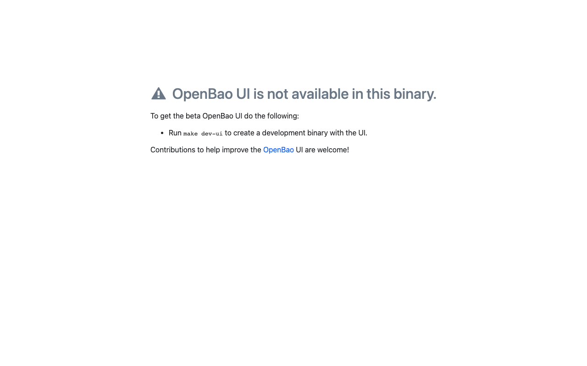

# Sesi 3 — Privileged Access Management (OpenBao + Warpgate)

Indikator 3.1 (jump server/bastion) dan 3.2 (password vault). Mengamankan kredensial
administratif dan memusatkan akses istimewa melalui bastion yang merekam sesi.

## a. Tujuan Sesi

Peserta mampu:
- Menginisialisasi dan membuka (_unseal_) brankas kredensial **OpenBao**.
- Mengaktifkan **audit device**, autentikasi LDAP, dan _policy_ berprinsip _least privilege_.
- Menyimpan kredensial _break-glass_ (KV) dan menerbitkan sertifikat SSH berumur pendek (SSH CA).
- Mengonfigurasi **Warpgate** sebagai jump server ber-SSO + perekaman sesi.
- Menjalankan prosedur serah-terima kredensial yang tertib.

## b. Output yang Diharapkan

- OpenBao _unsealed_, audit aktif, dan _root token_ dicabut setelah LDAP admin terbukti jalan.
- Target SSH menolak autentikasi sandi; akses hanya via sertifikat CA / bastion.
- Sesi admin melalui Warpgate **terekam** dan dapat diputar ulang.

## c. Teori dan Struktur Sistem

- **Privileged Access Management (PAM):** akun admin adalah "kunci induk", jadi
  diperlakukan khusus. **Vault** (brankas) menyimpan kredensial terenkripsi, memberi
  akses berbasis kebijakan, mencatat tiap pengambilan, dan dapat menerbitkan kredensial
  berumur pendek. **Jump server/bastion** memaksa semua akses admin melewati satu pintu
  yang merekam sesi. _Analogi:_ brankas bank dengan buku peminjaman, dan satu-satunya
  koridor menuju ruang server yang dipasangi CCTV.
- **SSH CA:** alih-alih menyebar kunci publik ke tiap server, server cukup memercayai
  satu **Certificate Authority**; OpenBao menandatangani sertifikat SSH berumur pendek
  (mis. 30 menit) untuk pengguna yang berhak.
- **Prinsip kerja OpenBao:** seal/unseal (pecahan kunci Shamir), token, lease, policy,
  dan audit device yang mencatat setiap permintaan.

## d. Praktik: Instalasi dan Konfigurasi

> Antarmuka web OpenBao tersedia di `https://bao.iamlab.test` (status awal: belum di-_init_).
>
> 

### A. OpenBao
```bash
export BAO_ADDR=https://bao.iamlab.test        # atau http://127.0.0.1:8200 internal
# 1. init (3 pecahan / ambang 2) — SIMPAN output dengan aman
bao operator init -key-shares=3 -key-threshold=2
# 2. unseal (jalankan 2x dengan pecahan berbeda), lalu login root
bao operator unseal <key1> ; bao operator unseal <key2>
bao login <root-token>
# 3. audit device file (SEBELUM menyimpan rahasia)
bao audit enable file file_path=/openbao/file/audit.log
# 4. auth LDAP ke AD + policy least privilege
bao auth enable ldap
bao write auth/ldap/config url="ldaps://dc1.iamlab.test:636" \
  userdn="OU=Pengguna,DC=iamlab,DC=test" groupdn="OU=Grup,DC=iamlab,DC=test" \
  binddn="CN=svc-openbao,OU=AkunLayanan,DC=iamlab,DC=test" bindpass="***" \
  userattr=sAMAccountName insecure_tls=false
bao policy write admin-t1 - <<'HCL'
path "kv/data/breakglass/*" { capabilities=["read"] }
path "ssh/sign/t1"          { capabilities=["update"] }
HCL
bao write auth/ldap/groups/GG-Tier1-Admin policies=admin-t1
# 5. KV break-glass + SSH CA
bao secrets enable -path=kv kv-v2
bao kv put kv/breakglass/srv-app01 user=root pass='BreakGlass#2026'
bao secrets enable ssh
bao write ssh/config/ca generate_signing_key=true
bao write ssh/roles/t1 key_type=ca allow_user_certificates=true default_user=labadmin ttl=30m
# 6. GATED: pastikan login LDAP admin BERHASIL dulu, simpan unseal key, BARU cabut root
bao token revoke <root-token>
```

### B. Target memercayai SSH CA
Pasang kunci publik CA ke tiap target lalu matikan autentikasi sandi:
```bash
# ambil kunci publik CA dari OpenBao, salurkan ke target, tambahkan ke sshd
bao read -field=public_key ssh/config/ca   # → /etc/ssh/openbao_ca.pub pada srv-app01/srv-db01
# di target:
#   TrustedUserCAKeys /etc/ssh/openbao_ca.pub
#   PasswordAuthentication no
#   PermitRootLogin no
```

### C. Warpgate (bastion + rekam sesi)
Lakukan _setup_ awal (sekali), lalu di `https://pam.iamlab.test`:
- Aktifkan **SSO OIDC** ke Keycloak (MFA wajib).
- Tambah target `srv-app01`/`srv-db01` dengan peran terbatas per target.
- **Aktifkan perekaman sesi.** Uji akses `ssh -p 2222`.

### D. Serah-terima kredensial (sikap: tertib dokumentasi)
Permintaan tercatat → persetujuan (dual control untuk Tier 0) → pengambilan dari
OpenBao (teraudit) → pakai via bastion (terekam) → rotasi pasca break-glass → review.
Gunakan formulir serah-terima yang disediakan instruktur.
