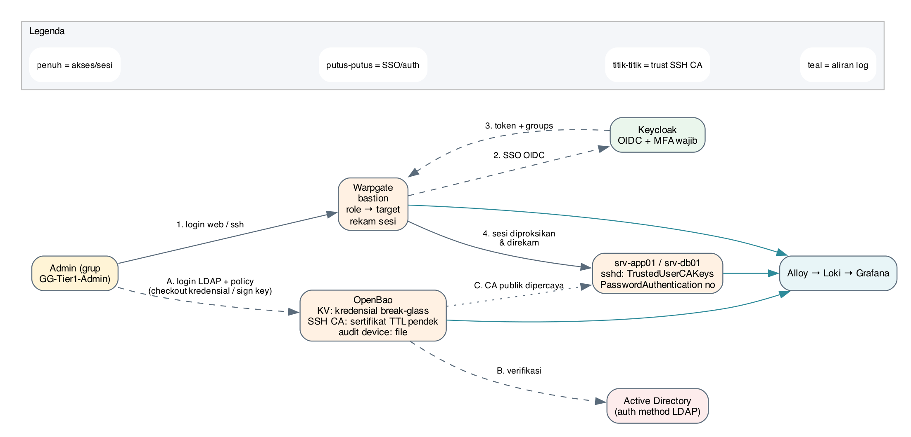
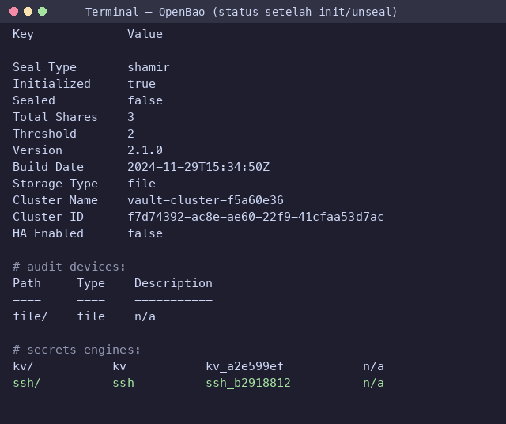
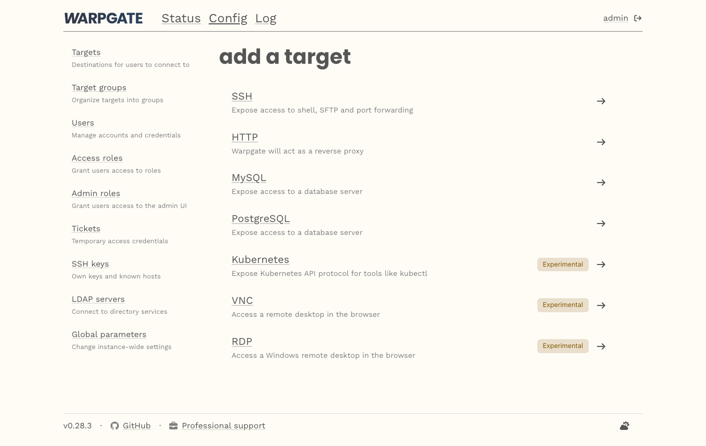
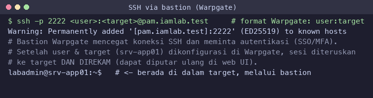

# Sesi 3 — Privileged Access Management (OpenBao + Warpgate)

Indikator 3.1 (jump server/bastion) dan 3.2 (password vault). Mengamankan kredensial
administratif dan memusatkan akses istimewa melalui bastion yang merekam sesi.
Penanda: 🖥️ **terminal peserta** · 🐳 **container** · 🌐 **web UI**.

## Keterhubungan dengan sesi sebelumnya

Sesi ini **memakai Sesi 1 & 2**: Warpgate login memakai **SSO Keycloak** (Sesi 2, MFA
wajib), dan OpenBao berautentikasi ke **AD** (Sesi 1) memakai `svc-openbao`, memetakan grup
`GG-Tier1-Admin` (Sesi 1) ke *policy*. Email serah-terima memakai **Mailpit** (sudah diset
di Sesi 2). **Dipakai Sesi 4:** audit OpenBao, sesi Warpgate, dan sshd menjadi sumber log.

## a. Tujuan Sesi

Peserta mampu:
- Memahami cara komponen PAM di-*deploy*, lalu **mengonfigurasinya**.
- Menginisialisasi & membuka (*unseal*) brankas kredensial **OpenBao**.
- Mengaktifkan **audit device**, auth LDAP, *policy* *least privilege*, KV *break-glass*, dan **SSH CA**.
- Mengonfigurasi **Warpgate** sebagai jump server ber-SSO + perekaman sesi, lalu
  **mengakses target via SSH melalui bastion**.

## b. Output yang Diharapkan

- OpenBao *unsealed*, audit aktif, *root token* dicabut setelah LDAP admin terbukti jalan.
- Target SSH menolak autentikasi sandi; akses hanya via sertifikat CA / bastion.
- Sesi admin melalui Warpgate **terekam** dan dapat diputar ulang.

## c. Teori dan Struktur Sistem

**Apa.** *Privileged Access Management* memperlakukan akun admin ("kunci induk")
secara khusus. **Vault** menyimpan kredensial terenkripsi, memberi akses berbasis
kebijakan, mencatat tiap pengambilan, dan dapat menerbitkan kredensial berumur pendek.
**Jump server/bastion** memaksa semua akses admin lewat satu pintu yang merekam sesi.

**Mengapa.** Kredensial admin statis yang tersebar = permukaan serang besar; akses
langsung ke server tanpa jejak = sulit diaudit. PAM menutup keduanya.

**Bagaimana alurnya:**



**SSH CA.** Alih-alih menyebar kunci publik ke tiap server, server cukup
memercayai satu *Certificate Authority*; OpenBao menandatangani sertifikat SSH berumur
pendek (mis. 30 menit) untuk pengguna yang berhak — **Kapan** kadaluwarsa cepat
sehingga kredensial curian tak berguna lama.

## d. Praktik: Instalasi dan Konfigurasi

### 0. 🖥️ Deploy (sudah disiapkan — tetap dipahami)
```bash
cd deploy
docker compose up -d openbao warpgate srv-app01 srv-db01   # berjalan, OpenBao BELUM di-init
```
OpenBao sengaja mulai dalam keadaan *uninitialized*; Warpgate perlu *setup* sekali.

### A. 🐳 OpenBao (brankas kredensial)
Jalankan `bao` **di dalam container** OpenBao. Tiap langkah dijelaskan di komentar:
```bash
alias bao='docker compose exec -T -e BAO_ADDR=http://127.0.0.1:8200 openbao bao'
bao operator init -key-shares=3 -key-threshold=2   # pecah master key jadi 3, butuh 2 utk buka
bao operator unseal <key1> ; bao operator unseal <key2>   # buka brankas (2 dari 3)
bao login <root-token>
bao audit enable file file_path=/openbao/file/audit.log    # catat SEMUA akses (sebelum isi rahasia)
bao auth enable ldap                                        # login pakai akun AD
bao write auth/ldap/config url="ldaps://dc1.iamlab.test:636" \
  userdn="OU=Pengguna,DC=iamlab,DC=test" groupdn="OU=Grup,DC=iamlab,DC=test" \
  binddn="CN=svc-openbao,OU=AkunLayanan,DC=iamlab,DC=test" bindpass="***" userattr=sAMAccountName
bao policy write admin-t1 - <<'HCL'                         # izin minimal (least privilege)
path "kv/data/breakglass/*" { capabilities=["read"] }
path "ssh/sign/t1"          { capabilities=["update"] }
HCL
bao write auth/ldap/groups/GG-Tier1-Admin policies=admin-t1 # grup AD → policy
bao secrets enable -path=kv kv-v2                            # brankas KV
bao kv put kv/breakglass/srv-app01 user=root pass='BreakGlass#2026'
bao secrets enable ssh                                       # mesin SSH CA
bao write ssh/config/ca generate_signing_key=true
bao write ssh/roles/t1 key_type=ca allow_user_certificates=true default_user=labadmin ttl=30m
# GATED: pastikan login LDAP admin BERHASIL dulu, simpan unseal key, BARU cabut root:
bao token revoke <root-token>
```
Status nyata setelah init/unseal (OpenBao di lab ini berbasis **CLI**, tanpa web UI):



### B. 🐳 Target memercayai SSH CA
Ambil kunci publik CA dari OpenBao lalu salurkan ke tiap target, dan matikan sandi:
```bash
for t in srv-app01 srv-db01; do
  docker compose exec -T -e BAO_ADDR=http://127.0.0.1:8200 openbao bao read -field=public_key ssh/config/ca \
    | docker compose exec -T $t tee /etc/ssh/openbao_ca.pub >/dev/null
  docker compose exec $t sh -c 'printf "\nTrustedUserCAKeys /etc/ssh/openbao_ca.pub\nPasswordAuthentication no\nPermitRootLogin no\n" >> /etc/ssh/sshd_config; kill -HUP 1'
done
```

### C. 🌐 Warpgate (bastion + rekam sesi)
Setup sekali di 🖥️ terminal, lalu konfigurasi di 🌐 web UI `https://pam.iamlab.test`:
```bash
docker compose run --rm warpgate unattended-setup \
  --data-path /data --http-port 8888 --ssh-port 2222 --record-sessions \
  --host-key-verification auto-accept --admin-password 'Warp#Lab2026' --external-host pam.iamlab.test
docker compose up -d warpgate
```
Agar login ke bastion **terkendali dan seragam**, arahkan autentikasi Warpgate ke
**SSO Keycloak** (bukan akun lokal Warpgate): di admin → *Config → Global parameters →
SSO providers*, tambahkan provider OIDC ke realm `iamlab`
(`https://kc.iamlab.test/realms/iamlab`), sehingga **MFA dari Sesi 2 ikut berlaku** saat
masuk bastion. Lalu tambahkan **target** SSH `srv-app01`/`srv-db01` dengan **role**
terbatas, dan aktifkan **perekaman sesi**:



### C.1 🖥️ Akses target via SSH melalui bastion (sesuai silabus)
Peserta tidak SSH langsung ke server — selalu lewat bastion. Format Warpgate memakai
`user:target@bastion`; sesi direkam dan bisa diputar ulang di web UI:



```bash
ssh -p 2222 <user>:srv-app01@pam.iamlab.test     # bastion mencegat, minta SSO/MFA, lalu teruskan
```

### D. Serah-terima kredensial via email + formulir
Akses istimewa tidak diberikan lisan. Alurnya **berbasis email dan formulir yang
dikembalikan**:
1. Pemohon mengisi [`formulir-serah-terima.md`](formulir-serah-terima.md) lalu mengirimnya
   via email ke pemberi persetujuan (di lab: lewat Mailpit `https://mail.iamlab.test`).
2. Pemberi persetujuan (dual control untuk Tier 0) **membalas email** dengan kolom
   *Status dikembalikan = Disetujui* terisi — inilah bukti formulir kembali.
3. Barulah kredensial diambil dari **OpenBao** (teraudit) dan akses dibuka lewat **bastion**
   (sesi terekam).
4. Setelah selesai: **rotasi** sandi *break-glass* dan kirim buktinya; pihak independen meninjau log.

**Hasil yang diharapkan:** OpenBao unsealed & audit aktif; root token tak valid; target
menolak sandi; akses hanya via bastion dan **terekam**.
