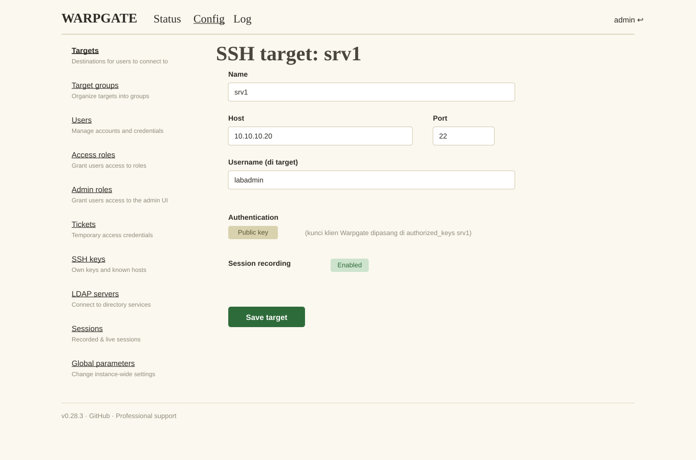
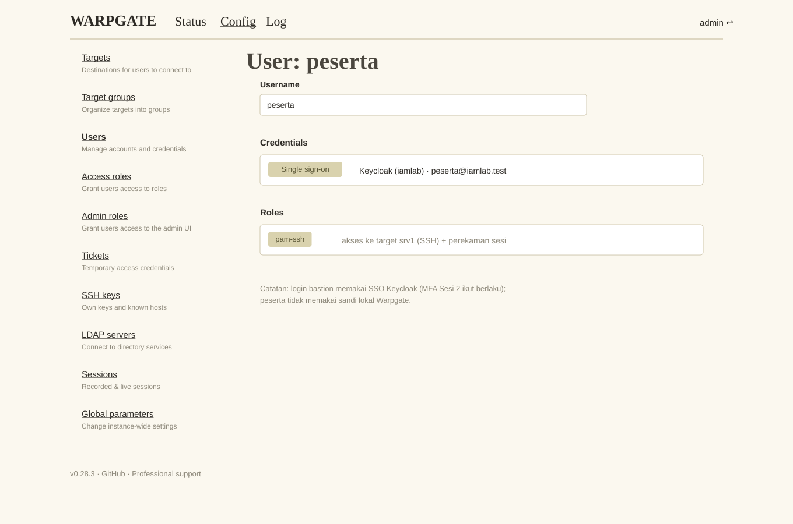
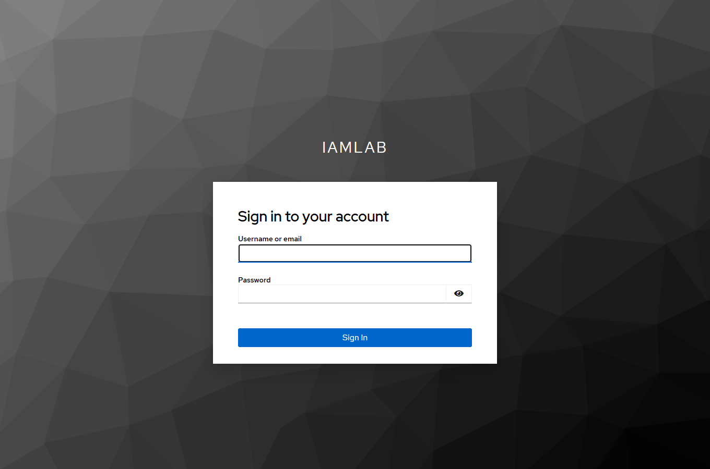
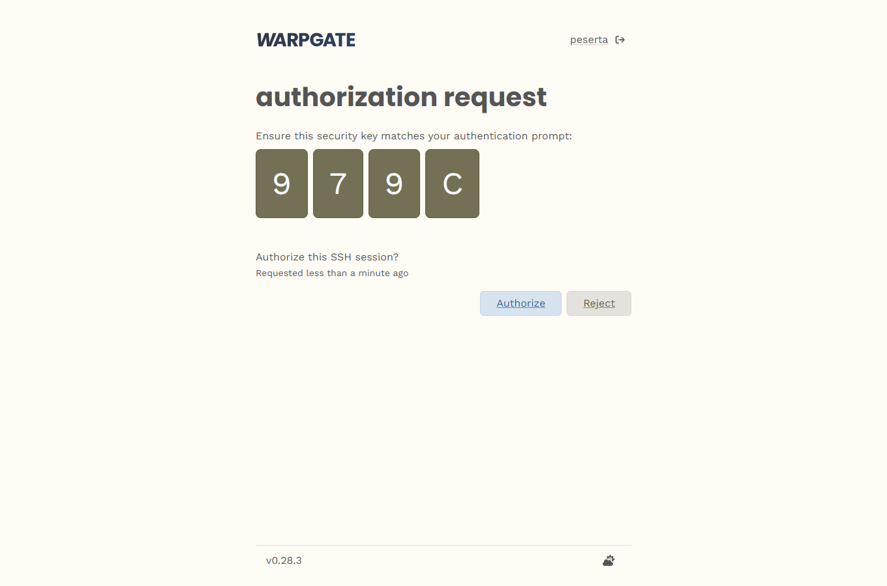
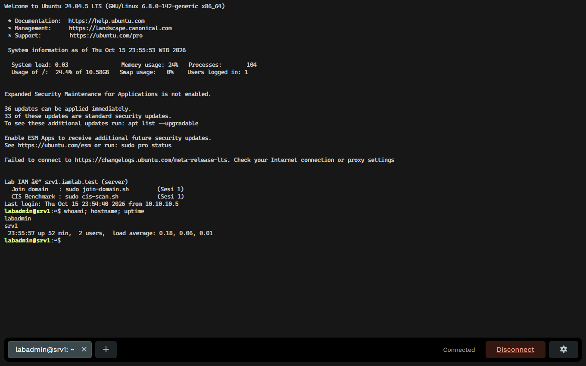
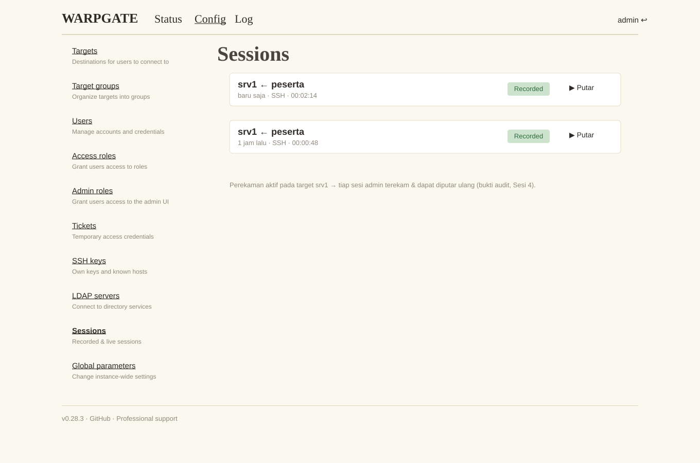
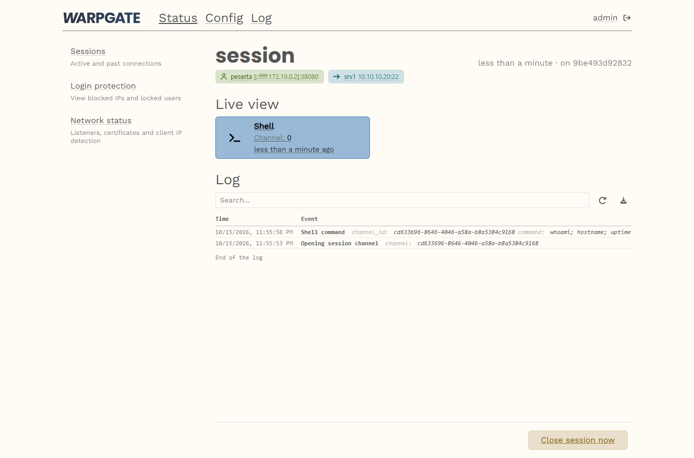

# Sesi 3 — Privileged Access Management (OpenBao + Warpgate)

Indikator 3.1 (jump server/bastion) & 3.2 (password vault). Mengamankan kredensial admin dan
memusatkan akses istimewa lewat **bastion yang merekam sesi**. Penanda: 🖥️ **terminal host** ·
🌐 **web UI**. OpenBao & Warpgate dijalankan lewat `docker compose` **dari terminal host** (bukan
shell interaktif di dalam container).

> **Konvensi validasi.** Langkah **🖥️ (CLI)** — termasuk OpenBao yang sepenuhnya CLI —
> menyertakan hasil yang diharapkan (`# →` atau **✅ Validasi**). Langkah **🌐 (web UI Warpgate)**
> **tidak** memakai blok validasi teks — cukup **cocokkan dengan screenshot** yang menyertainya.

## Keterhubungan dengan sesi sebelumnya

Memakai **Sesi 1 & 2**: login bastion lewat **SSO Keycloak** (Sesi 2, MFA wajib); OpenBao
autentikasi ke **AD** (Sesi 1) via `svc-openbao`, memetakan grup `GG-Tier1-Admin` → *policy*.
Email serah-terima lewat **Mailpit** (Sesi 2). **Dipakai Sesi 4:** audit OpenBao, sesi Warpgate,
dan sshd jadi sumber log.

## a. Tujuan Sesi

Peserta mampu:
- Menginisialisasi & membuka (*unseal*) brankas **OpenBao**; mengaktifkan audit, auth LDAP,
  *policy least privilege*, KV *break-glass*, dan **SSH CA**.
- Mengonfigurasi **Warpgate** sebagai bastion ber-SSO + perekaman sesi, lalu **mengakses `srv1`
  via SSH melalui bastion**.

## b. Output yang Diharapkan

- OpenBao *unsealed*, audit aktif, *root token* dicabut setelah login LDAP admin terbukti.
- Target SSH menolak sandi; akses hanya via sertifikat CA / bastion.
- Sesi admin lewat Warpgate **terekam** dan dapat diputar ulang.

## c. Teori dan Struktur Sistem

*Privileged Access Management* memperlakukan akun admin ("kunci induk") secara khusus. **Vault**
menyimpan kredensial terenkripsi, memberi akses berbasis kebijakan, mencatat tiap pengambilan, dan
dapat menerbitkan kredensial berumur pendek. **Bastion/jump server** memaksa semua akses admin
lewat satu pintu yang merekam sesi. Kredensial statis yang tersebar memperbesar *attack surface*;
akses langsung tanpa jejak sulit diaudit — PAM menutup keduanya.


*Gambar 1. Alur PAM — SSO+MFA → Warpgate → target; OpenBao kredensial & SSH CA*

*Legenda: penuh = akses/sesi; putus-putus = SSO/auth & kredensial; teal = log.*

**Agenda Aktivitas (nomor pada diagram):**
1. Admin login ke **bastion Warpgate**.
2. Warpgate meneruskan autentikasi ke **Keycloak** (SSO OIDC + MFA).
3. Keycloak mengembalikan **token + grup** ke Warpgate.
4. Sesi **SSH ke target** diproksikan lewat bastion **dan direkam**.
5. Admin mengambil kredensial *break-glass* / meminta **sertifikat SSH** dari **OpenBao**.
6. Target memercayai **SSH CA** OpenBao (atau memakai kredensial yang diambil).
7. Aktivitas (akses vault, sesi bastion, sshd) dikirim ke **audit** (Sesi 4).

**SSH CA.** Alih-alih menyebar kunci publik ke tiap server, server cukup memercayai satu
*Certificate Authority*; OpenBao menandatangani sertifikat SSH berumur pendek (mis. 30 menit) —
masa berlaku singkat membuat kredensial curian tak berguna lama.

## d. Praktik: Instalasi dan Konfigurasi

> ⚡ **Jalur Cepat (opsional, hanya bila stuck pada Warpgate).** Pendaftaran **target + user +
> role** Warpgate (bagian C4–C5 di konsol web) bisa diotomasi via Admin API agar Anda bisa
> **lanjut ke lab berikutnya**:
> ```bash
> cd ../deploy
> ./warpgate/configure-target.sh     # buat role pam-ssh, user peserta, target srv1, pasang kunci
> ```
> Rincian opsi env ada di `deploy/warpgate/README.md`. Bagian **SSO Keycloak (C3)** tetap edit
> `warpgate.yaml` manual (singkat) karena menyangkut `client_secret` spesifik lab Anda. **OpenBao
> (bagian A) sepenuhnya CLI** — cukup salin-tempel perintah `bao …` berurutan. Langkah manual
> tetap jalur utama; pintasan ini hanya agar tidak terhenti di satu lab.

### 0. Deploy (sudah disiapkan)
```bash
cd ../deploy
docker compose up -d openbao warpgate      # OpenBao BELUM di-init; Warpgate perlu setup sekali
```
**Target akses istimewa = VM `srv1`** (`10.10.10.20`, Ubuntu Server anggota domain Sesi 1).
Peserta mengakses `srv1` **hanya** lewat bastion.

> **🔑 User & login di Sesi 3 (dari mana akunnya).**
> - **Konsol admin Warpgate** (`https://pam.iamlab.test`) → akun lokal **`admin`** / `Warp#Lab2026`
>   (dibuat saat `unattended-setup`, C1).
> - **OpenBao via LDAP** → akun **`adm-t1-anda`** (AD Tier-1 admin, anggota `GG-Tier1-Admin`,
>   dibuat Sesi 1) — dipakai setelah root token dicabut.
> - **Akses bastion ke `srv1` (SSO)** → akun pengguna domain **`peserta`** lewat Keycloak; sandi =
>   sandi akun AD-nya (sandi awal di Mailpit, Sesi 1), + MFA/OTP bila diaktifkan di Sesi 2.

### A. OpenBao — brankas kredensial 🖥️
> **Prasyarat:** `deploy/certs/ad-ca.pem` **ber-SAN** harus ada (diekspor di Sesi 1 §5.3; sudah
> tersedia pada BuildBag). Dipakai `auth/ldap/config` di bawah (`certificate=@/openbao/certs/ad-ca.pem`).

OpenBao di lab ini **berbasis CLI (tanpa web UI)**. Setiap perintah `bao …` dijalankan di dalam
container **lewat `docker compose exec` dari terminal host** (alias di bawah) — Anda **tidak**
membuka shell interaktif di container. Validasi ditulis inline sebagai `# →`.
```bash
export MSYS_NO_PATHCONV=1   # Windows/Git Bash: agar path /openbao/… tak diubah jadi path Windows
alias bao='docker compose exec -T -e BAO_ADDR=http://127.0.0.1:8200 openbao bao'

bao operator init -key-shares=3 -key-threshold=2   # → cetak 3 Unseal Key + Root Token (SIMPAN! sekali saja)
bao operator unseal <key1>                          # → Sealed true · Progress 1/2
bao operator unseal <key2>                          # → Sealed false  (brankas terbuka)
bao login <root-token>                              # → Success

bao audit enable file file_path=/openbao/file/audit.log   # → Success (catat SEMUA akses)
bao audit enable -path=stdout file file_path=stdout       # → Success (audit→STDOUT→Alloy→Loki)
bao auth enable ldap                                      # → Success
bao write auth/ldap/config url="ldaps://dc1.iamlab.test:636" \
  certificate=@/openbao/certs/ad-ca.pem \
  userdn="DC=iamlab,DC=test" groupdn="OU=Grup,DC=iamlab,DC=test" \
  binddn="CN=svc-openbao,OU=AkunLayanan,DC=iamlab,DC=test" bindpass="Svc#Lab2026!" \
  userattr=sAMAccountName        # → Success  (bindpass = sandi svc-openbao dari Sesi 1 §1; TIDAK di-reset di §5)

bao policy write admin-t1 - <<'HCL'                        # izin minimal (least privilege)
path "kv/data/breakglass/*" { capabilities=["read"] }
path "ssh/sign/t1"          { capabilities=["update"] }
HCL
bao write auth/ldap/groups/GG-Tier1-Admin policies=admin-t1   # grup AD → policy

bao secrets enable -path=kv kv-v2                           # → Success
bao kv put kv/breakglass/srv1 user=labadmin pass='BreakGlass#2026'
bao secrets enable ssh                                      # mesin SSH CA
bao write ssh/config/ca generate_signing_key=true          # → public_key ssh-rsa AAAA… (kunci CA)
bao write ssh/roles/t1 - <<'JSON'                           # allowed_users WAJIB (OpenBao 2.x)
{"key_type":"ca","allow_user_certificates":true,"allowed_users":"labadmin","default_user":"labadmin","default_extensions":{"permit-pty":""},"ttl":"30m"}
JSON

# GATED — buktikan login LDAP admin Tier 1 (adm-t1-anda, anggota GG-Tier1-Admin) BERHASIL,
# token harus memuat policy admin-t1. Simpan unseal key dulu, BARU cabut root:
bao login -method=ldap username=adm-t1-anda                 # → token_policies ["admin-t1" "default"]  (WAJIB sukses dulu)
# --- VALIDASI (sebelum cabut root) ---
bao status                                                  # → Initialized true · Sealed false · Total Shares 3 · Threshold 2
bao audit list                                              # → file/  dan  stdout/  (dua device)
bao token revoke <root-token>                               # cabut root HANYA setelah login LDAP di atas sukses
```
**Keluaran yang diharapkan.** `bao status` → `Initialized true`, `Sealed false`, `Total Shares 3`,
`Threshold 2`; `bao audit list` → **dua** device (`file/`, `stdout/`); `bao login -method=ldap` →
`policies [admin-t1 default]`. ⚠️ **Jangan cabut root** sebelum login LDAP admin Tier 1 terbukti
berhasil — bila gagal, Anda bisa terkunci dari brankas.

### B. Target `srv1` memercayai SSH CA 🖥️
> ⚠️ **Urutan penting (jebakan).** Langkah ini **mematikan `PasswordAuthentication`** di `srv1`.
> Warpgate mengakses `srv1` memakai **kunci klien SSH-nya sendiri** (public-key biasa, BUKAN
> sertifikat CA) yang harus ada di `authorized_keys` `labadmin` (dipasang di **C4**). Maka:
> **pasang kunci klien Warpgate ke `srv1` DULU** (C4, selagi sandi masih aktif), **atau** —
> bila sandi sudah terlanjur dimatikan — pasang nanti lewat **SSH break-glass** memakai
> sertifikat CA OpenBao (`bao write -field=signed_key ssh/sign/t1 public_key=@~/.ssh/id.pub`).
> Tanpa kunci klien Warpgate di `srv1`, akses bastion (C6) gagal otentikasi.

Ambil kunci publik CA OpenBao, pasang di `srv1` sebagai `TrustedUserCAKeys`, lalu matikan auth sandi:
```bash
# 🖥️ terminal host — ambil kunci publik CA
docker compose exec -T -e BAO_ADDR=http://127.0.0.1:8200 openbao \
  bao read -field=public_key ssh/config/ca > openbao_ca.pub
scp openbao_ca.pub labadmin@srv1.iamlab.test:/tmp/openbao_ca.pub
```
```bash
# 🖥️ di srv1
sudo install -m 644 /tmp/openbao_ca.pub /etc/ssh/openbao_ca.pub
printf 'TrustedUserCAKeys /etc/ssh/openbao_ca.pub\nPasswordAuthentication no\nPermitRootLogin no\n' \
  | sudo tee /etc/ssh/sshd_config.d/10-iamlab-ca.conf
sudo systemctl restart ssh
sudo sshd -T | grep -E 'passwordauthentication|trustedusercakeys'
# → passwordauthentication no   |   trustedusercakeys /etc/ssh/openbao_ca.pub
```
**Keluaran yang diharapkan.** `sshd -T` menampilkan `passwordauthentication no` dan
`trustedusercakeys /etc/ssh/openbao_ca.pub`. Login **sandi** ke `srv1` kini **ditolak**
(`Permission denied (publickey)`); yang diterima hanya sertifikat SSH dari CA (break-glass) atau
koneksi via bastion.

### C. Warpgate — bastion + rekam sesi

**C1. Setup sekali 🖥️**
```bash
export MSYS_NO_PATHCONV=1    # agar '--data-path /data' tak jadi path Windows
docker compose run --rm warpgate unattended-setup \
  --data-path /data --http-port 8888 --ssh-port 2222 --record-sessions \
  --host-key-verification auto-accept --admin-password 'Warp#Lab2026' --external-host pam.iamlab.test
docker compose up -d warpgate
docker compose ps warpgate      # → Up … (healthy) dalam ±15 dtk
```
**Keluaran yang diharapkan.** `docker compose ps warpgate` → `Up … (healthy)` dalam ±15 dtk
(config + akun admin dibuat sekali oleh `unattended-setup`).

**C2. Buka konsol admin 🌐** — `https://pam.iamlab.test` (lewat Caddy, **bukan** `:8888`), login
`admin` / `Warp#Lab2026`. Semua konfigurasi berikut ada di menu **Config**:


*Gambar 2. Warpgate — konsol admin (menu Config)*

**C3. Arahkan login bastion ke SSO Keycloak 🖥️** — agar MFA (Sesi 2) ikut berlaku. Provider SSO
diatur di `/data/warpgate.yaml` (bukan web UI), memakai client `warpgate` dari **Sesi 2 §3**.
Tiga langkah jelas:
```bash
# (1) salin config keluar dari container
docker compose cp warpgate:/data/warpgate.yaml ./warpgate.yaml
```
```yaml
# (2) buka ./warpgate.yaml, tambahkan blok ini (isi client_secret dari Keycloak):
sso_providers:
  - name: keycloak
    label: Keycloak (iamlab)
    provider:
      type: custom
      client_id: warpgate
      client_secret: <secret client warpgate dari Keycloak>
      issuer_url: https://kc.iamlab.test/realms/iamlab
      scopes: ["openid", "email"]
```
```bash
# (3) salin balik ke container & restart
docker compose cp ./warpgate.yaml warpgate:/data/warpgate.yaml
docker compose restart warpgate
```
→ Halaman login bastion kini menampilkan tombol **"Keycloak (iamlab)"**.

> **⚠️ Tiga penyesuaian WAJIB agar SSO bastion berfungsi** (sekali, saat setup):
> 1. **Warpgate percaya CA Caddy** (discovery OIDC ke `https://kc.iamlab.test`). Buat bundle =
>    root sistem + root Caddy, lalu arahkan `SSL_CERT_FILE`:
>    ```bash
>    docker compose exec -T warpgate cat /etc/ssl/certs/ca-certificates.crt > certs/ca-bundle-warpgate.crt
>    cat caddy/data/caddy/pki/authorities/local/root.crt >> certs/ca-bundle-warpgate.crt
>    echo 'WARPGATE_SSL_CERT_FILE=/certs/ca-bundle-warpgate.crt' >> .env   # dibaca compose terbaru
>    docker compose up -d warpgate
>    ```
>    *Lab lama (compose belum punya `SSL_CERT_FILE`)?* Buat `deploy/compose.override.yaml`:
>    ```yaml
>    services:
>      warpgate:
>        environment:
>          SSL_CERT_FILE: /certs/ca-bundle-warpgate.crt
>        volumes:
>          - ./certs:/certs:ro
>    ```
>    lalu `docker compose up -d warpgate`.
> 2. **URL eksternal lewat 443 (Caddy)** agar `redirect_uri` cocok dengan client Keycloak. Di
>    `/data/warpgate.yaml` seksi `http:`, set `external_host: pam.iamlab.test`, `external_port: 443`,
>    `trust_x_forwarded_headers: true` (lalu `docker compose restart warpgate`). Tanpa ini Keycloak
>    menolak: *Invalid parameter: redirect_uri* (Warpgate mengirim `:8888`).
> 3. **Email akun Keycloak terverifikasi** — Warpgate menolak SSO *"e-mail is not verified"*.
>    Biasanya **sudah** teratasi oleh **Trust Email = On** (federasi LDAP, Sesi 2 §1). Bila masih
>    tertolak, set manual via kcadm — **login dulu** lalu ambil `<id>`:
>    ```bash
>    # 🖥️ dari folder deploy. <admin>/<pass> = KC_BOOTSTRAP_ADMIN_* di .env; <user> = username peserta
>    KC='/opt/keycloak/bin/kcadm.sh'
>    docker compose exec keycloak $KC config credentials --server http://localhost:8080 \
>      --realm master --user <admin> --password <pass>          # login (wajib sebelum kcadm apa pun)
>    docker compose exec keycloak $KC get users -r iamlab -q username=<user> --fields id   # -> salin "id"
>    docker compose exec keycloak $KC update users/<id> -r iamlab -s emailVerified=true
>    ```
>
> *(Setelah menyunting `warpgate.yaml`, pastikan kepemilikannya uid 1000 & mode 600 agar Warpgate
> mau memuatnya; dan isi `sso_providers` yang ADA — jangan menambah kunci `sso_providers` kedua.)*

**C4. Tambah target `srv1` 🌐** — **Config → Targets → Add → SSH**: Name `srv1`, Host `10.10.10.20`,
Port `22`, Username `labadmin`, Authentication **Public key**, Session recording **Enabled**.
Warpgate masuk ke target memakai **kunci klien SSH-nya sendiri** (bukan sandi). **Pasang public
key itu di `authorized_keys` `labadmin@srv1` — langkah WAJIB & tidak otomatis:**
1. Ambil public key klien Warpgate: konsol admin **Config → SSH keys** → salin baris public key.
   (Atau API: `curl -sk https://pam.iamlab.test/@warpgate/admin/api/ssh/own-keys`.)
2. Tambahkan ke `srv1` **selagi sandi masih aktif** (lihat peringatan urutan di Bagian B):
   ```bash
   # 🖥️ di srv1 — tempel public key klien Warpgate
   echo '<public key klien Warpgate>' | sudo tee -a /home/labadmin/.ssh/authorized_keys
   ```
3. **Jalur cepat:** langkah 1–2 + target + user + role dapat otomatis via
   `deploy/warpgate/configure-target.sh` (jalankan dari folder `deploy`).



*Gambar 3. Warpgate — target SSH `srv1`*

**C5. Tambah pengguna & peran 🌐.** Di Warpgate, user hanya bisa membuka target **jika keduanya
berbagi role yang sama** — jadi role harus di-*grant* ke **dua sisi** (user dan target). Langkah:
1. **Config → Users → Add user**: **Username** `peserta`. Buka user itu → **Credentials → Add
   credential → Single sign-on (SSO)**; isi **e-mail = email akun AD** pengguna (harus sama
   dengan yang di Keycloak) → **Save**.
2. **Config → Roles** (Access roles) → **Add role** → **Name** `pam-ssh` → **Save**.
3. **Grant ke user:** buka **Users → `peserta` → tab Roles** → **Add role → `pam-ssh`**.
4. **Grant ke target:** buka **Targets → `srv1` → tab Roles** (Allowed roles) → **Add role →
   `pam-ssh`**.
5. **Verifikasi:** login bastion sebagai `peserta` (via SSO) → target `srv1` tampil di daftar.

> **🔧 TROUBLESHOOT — target `srv1` tidak muncul setelah login.** Role belum ter-*grant* di salah
> satu sisi. Pastikan `pam-ssh` ada di **Users → peserta → Roles** **DAN** **Targets → srv1 →
> Roles** (ulangi langkah 3–4). User & target **harus berbagi role yang sama**.



*Gambar 4. Warpgate — pengguna `peserta` (SSO + role `pam-ssh`)*

> **Otomasi (fasilitator, opsional).** Target+user+role dapat didaftarkan via Admin API dengan
> `configure-target.sh` (di `IAMLAB-BuildBag/deploy/warpgate/`) — mempercepat penyiapan kelas.

### C6. Akses target via SSH melalui bastion 🖥️
Peserta **tidak** SSH langsung ke server — selalu lewat bastion. Format Warpgate: `user:target@bastion`.


*Gambar 5. Akses SSH ke srv1 via bastion Warpgate*

```bash
ssh -p 2222 peserta:srv1@pam.iamlab.test
# → Please open this URL in your browser: https://pam.iamlab.test/@warpgate/...   (verifikasi SSO)
# → Enter this security key: AB12-CD34                 (cocokkan dgn layar Authorize di browser)
```
Warpgate **mencegat** koneksi lalu di terminal menampilkan **URL verifikasi + security key**
(contoh: `Please open this URL in your browser: https://pam.iamlab.test/@warpgate/… · security
key: AB12-CD34`). Buka URL → **Keycloak** meminta login (SSO). Bila **MFA/OTP** diaktifkan (Sesi 2), Keycloak juga
meminta kode OTP di langkah ini:



*Gambar 6. Keycloak — login SSO saat akses bastion*

Setelah login, Warpgate menampilkan **permintaan otorisasi**: cocokkan **security key** di layar
dengan yang tampil di terminal, lalu klik **Authorize** (konfirmasi *out-of-band*):



*Gambar 7. Warpgate — persetujuan sesi SSH (security key, *out-of-band*)*

Sesi lalu diteruskan ke `srv1` sebagai `labadmin` **tanpa peserta memegang sandi server**. Akses
dapat lewat klien SSH atau **terminal web** di portal Warpgate (`https://pam.iamlab.test`):



*Gambar 8. Terminal web Warpgate ke `srv1` (via bastion, tersambung)*

Setiap sesi **terekam** dan tampil di **Status → Sessions** (SSH `peserta on srv1`):



*Gambar 9. Warpgate — Status/Sessions (sesi `peserta on srv1`)*

Detail sesi menampilkan **rekaman (Live view)** dan **log perintah** — bukti audit untuk Sesi 4:



*Gambar 10. Warpgate — detail sesi (rekaman + log perintah)*

### D. Serah-terima kredensial via email + formulir
Akses istimewa tidak diberikan lisan — alurnya berbasis **email + formulir yang dikembalikan**.
Email lab memakai **Mailpit**: kotak surat uji **catch-all** yang **tanpa akun/autentikasi** —
peserta **tidak perlu kredensial email**. Mailpit menangkap semua email yang dikirim ke
`mailpit:1025`; isinya dibaca di web UI `https://mail.iamlab.test`.

1. Pemohon mengisi [`formulir-serah-terima.docx`](formulir-serah-terima.docx), lalu mengirim email
   permohonan. Di lab, kirim langsung ke Mailpit (SMTP tanpa login) — contoh otomatis:
   ```bash
   docker compose exec -T samba-dc python3 - <<'PY'
   import smtplib
   from email.message import EmailMessage
   m = EmailMessage()
   m["From"], m["To"] = "pemohon@iamlab.test", "approver@iamlab.test"
   m["Subject"] = "Serah-terima akses istimewa srv1"
   m.set_content("Mohon persetujuan akses break-glass srv1. Formulir terlampir. (lab sintetis)")
   with smtplib.SMTP("mailpit", 1025) as s:
       s.send_message(m)
   print("email terkirim ke Mailpit")
   PY
   ```
2. Buka `https://mail.iamlab.test` → email masuk. Pemberi persetujuan (dual control untuk Tier 0)
   **membalas** dengan status *Disetujui* — bukti formulir kembali.
3. Barulah kredensial diambil dari **OpenBao** (teraudit) dan akses dibuka lewat **bastion** (terekam).
4. Setelah selesai: **rotasi** sandi *break-glass* dan kirim buktinya; pihak independen meninjau log.

**Hasil yang diharapkan:** OpenBao *unsealed* & audit aktif; root token tak valid; `srv1` menolak
sandi; akses hanya via bastion dan **terekam**.

---

[⬅️ Sebelumnya: Sesi 2 — SSO & MFA](../sesi-2-sso-mfa/README.md) · [🏠 Home](../README.md) · [Selanjutnya: Sesi 4 — Audit & Monitoring ➡️](../sesi-4-audit-monitoring/README.md)
