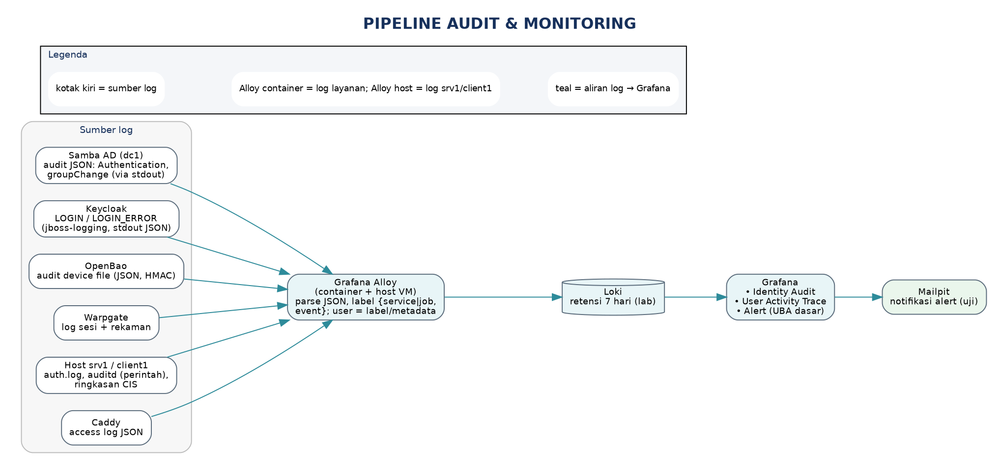
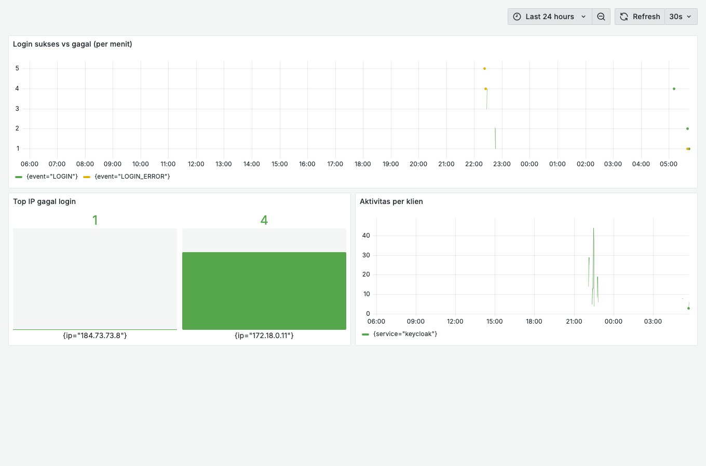
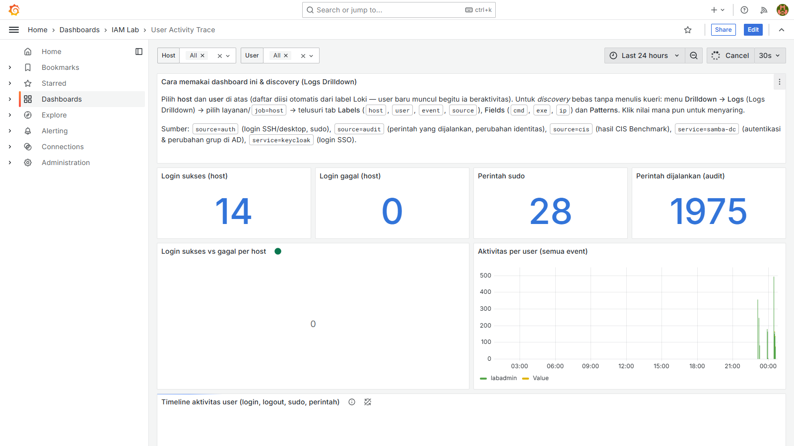
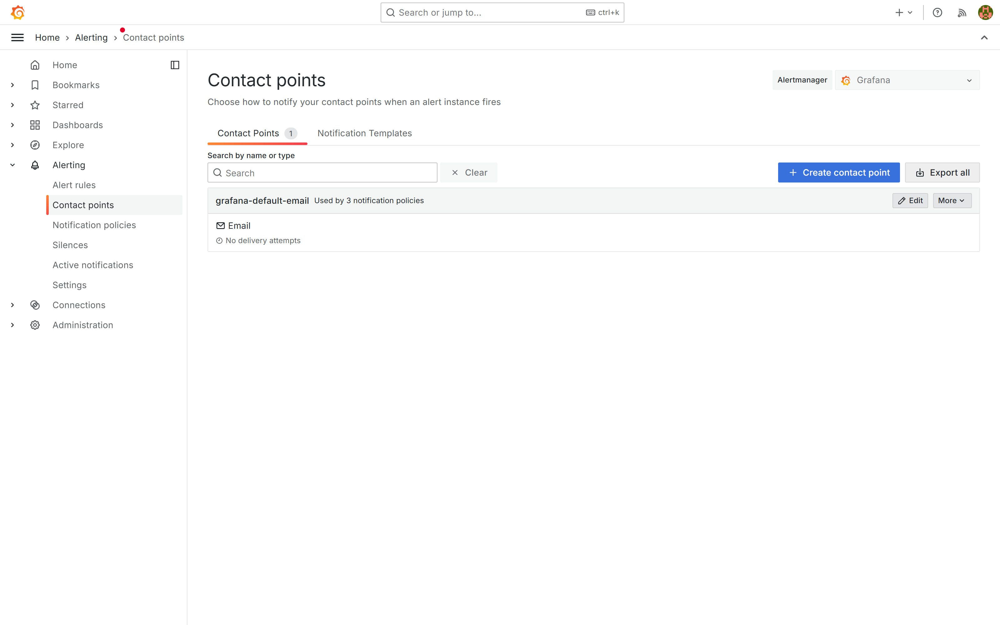
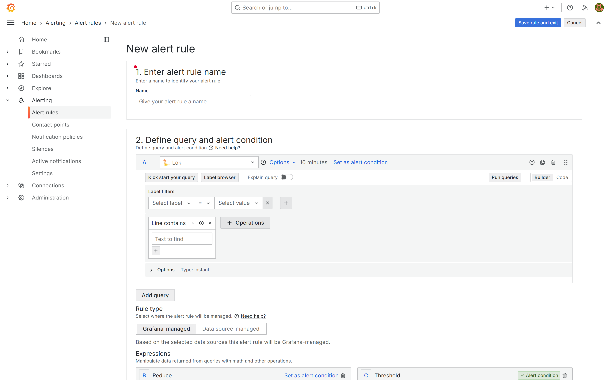
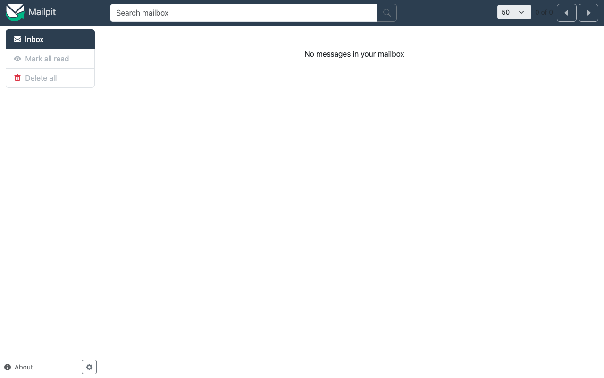
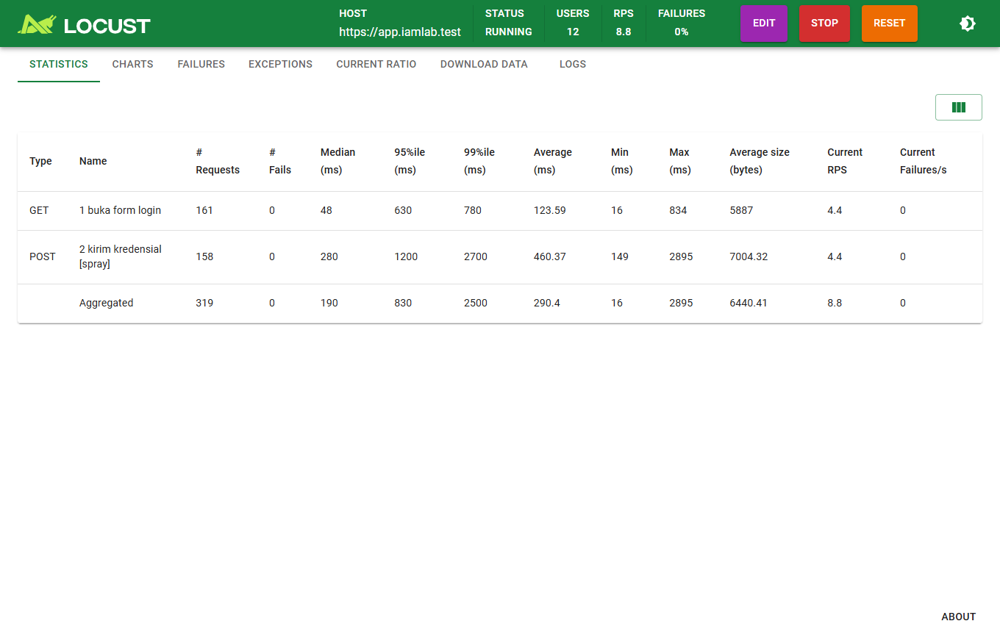

# Sesi 4 — Audit & Monitoring Aktivitas Identitas

Indikator 4.1 (audit autentikasi/otorisasi) dan 4.2 (deteksi anomali). Membangun jejak
audit identitas *end-to-end* dan dashboard pemantauan. Penanda: 🖥️ **terminal peserta**
· 🐳 **container** · 🌐 **web UI (Grafana)**.

> **Konvensi validasi.** Langkah **🖥️/🐳 (CLI)** menyertakan hasil yang diharapkan
> (`# →` atau **✅ Validasi**). Langkah **🌐 (web UI Grafana)** **tidak** memakai blok validasi
> teks — cukup **cocokkan dashboard Anda dengan screenshot**; catatan yang tersisa pada langkah
> web UI hanya bersifat *troubleshooting* (bila data tak muncul), bukan validasi.

## Keterhubungan dengan sesi sebelumnya

Sesi ini **menutup rangkaian**: ia memanen event dari **Sesi 1** (Samba AD: autentikasi
Kerberos/LDAP, perubahan grup; endpoint `srv1`/`client1`: login, sudo, perintah user, skor CIS),
**Sesi 2** (Keycloak: LOGIN/LOGIN_ERROR), dan **Sesi 3** (OpenBao: akses vault; Warpgate: sesi
bastion; sshd target). Tanpa konfigurasi audit di sesi-sesi itu, dashboard di sini akan kosong —
jadi pastikan sumbernya sudah aktif.

## a. Tujuan Sesi

Peserta mampu:
- Memahami cara pipeline log di-*deploy*, lalu **melengkapinya**.
- Mengumpulkan log identitas dari seluruh komponen ke satu tempat (Loki).
- Membuat **dashboard** audit identitas dan **aturan alert** di Grafana.
- Menerapkan **UBA dasar** untuk mendeteksi perilaku tak lazim / akun kompromi, lalu merespons.

## b. Output yang Diharapkan

- ≥ 5 sumber log tampil di Loki; dashboard menampilkan login sukses vs gagal, top IP gagal,
  aktivitas per klien, dan perubahan grup istimewa.
- Minimal 4 aturan alert aktif; alert memicu email uji di Mailpit.
- Pada capstone: akun terindikasi kompromi dikunci di semua layanan + laporan insiden.

## c. Teori dan Struktur Sistem

*Jejak audit identitas* menjawab "**siapa** mengakses **apa**, **kapan**,
dari **mana**, berhasil/gagal". **UBA (User Behavior Analytics) dasar** mencari
penyimpangan dari kebiasaan.

Kontrol pencegahan tidak pernah 100%; deteksi + respons memperpendek
waktu tinggal penyerang dan memenuhi kewajiban audit (mis. Peraturan BSSN tentang audit SPBE).

**Pola yang dicari:** ledakan kegagalan login (brute force), gagal lalu
tiba-tiba berhasil, login di jam/IP tak lazim, perubahan keanggotaan grup istimewa,
tiket Kerberos RC4. *Analogi:* satpam yang hafal pola normal dan curiga saat ada yang
mencoba 100 pintu dalam semenit.

### Standar audit trail yang diterapkan

Rancangan audit lab mengikuti kerangka yang diakui luas sehingga jejaknya cukup untuk
investigasi pasca-insiden:

- **Peristiwa apa yang dicatat** (mengacu NIST SP 800-53 **AU-2** & CIS Control 8): login
  sukses/gagal, logoff, pembuatan/perubahan/penghapusan akun, perubahan hak & keanggotaan
  grup istimewa, akses kredensial (vault), serta start/stop layanan.
- **Isi tiap catatan** (mengacu NIST SP 800-53 **AU-3**): *apa* jenis event, *kapan*
  (timestamp tersinkron), *di mana* (host/sumber), *sumber* (IP/akun), *hasil*
  (sukses/gagal), dan *identitas* pelaku. Pipeline Alloy mengekstrak field ini (mis.
  `event`, `user`, `ip`) dari tiap sumber.
- **Pengelolaan** (mengacu NIST SP 800-92 & CIS Control 8): kumpulkan terpusat (Loki),
  **sinkronkan waktu** antar-komponen, tetapkan **retensi** (lab: 7 hari; produksi minimal
  90 hari), dan **tinjau berkala**. Di Indonesia hal ini selaras dengan kewajiban audit
  keamanan SPBE (Peraturan BSSN tentang audit).

> Rujukan: NIST SP 800-92 (manajemen log), NIST SP 800-53 AU-2/AU-3/AU-6/AU-9/AU-12,
> CIS Control 8 (Audit Log Management).

**Pipeline log:** tiap komponen menulis log → **Alloy** memungut,
mem-*parse*, memberi label → **Loki** menyimpan → **Grafana** menampilkan & memberi alert.



*Gambar 1. Pipeline log identitas — sumber → Alloy → Loki → Grafana*

*Legenda: teal = aliran log; label hanya service/event (low-cardinality). Nomor dijelaskan pada Agenda Aktivitas di bawah.*

**Agenda Aktivitas (nomor pada diagram):**
1. Sumber log (Samba AD, Keycloak, OpenBao, Warpgate, Caddy via Alloy container; `srv1`/`client1` via Alloy host) mengirim ke **Alloy**.
2. Alloy mem-*parse* & memberi label (hanya `service`/`event`) lalu mengirim ke **Loki**.
3. **Grafana** membaca Loki untuk dashboard & evaluasi alert.
4. Alert dikirim sebagai email ke **Mailpit** (kotak surat uji).


**Prinsip label (penting).** Jadikan label hanya dimensi *low-cardinality* (`service`,
`event`); nilai seperti `user`/`ip` disimpan sebagai *structured metadata*/field (dikueri
LogQL), **bukan** label — agar kardinalitas tidak meledak dan Loki tetap cepat.

**Sumber log kunci:** Samba AD (autentikasi JSON, perubahan grup), endpoint `srv1`/`client1`
(auth.log: login/sudo; auditd: perintah user & perubahan identitas; ringkasan CIS), Keycloak
(LOGIN, LOGIN_ERROR), OpenBao (audit device), Warpgate, Caddy.

## d. Praktik: Instalasi dan Konfigurasi

> **🔑 User & login di Sesi 4 (dari mana akunnya).**
> - **Grafana** (`https://grafana.iamlab.test`) → user **`admin`**, sandi = `GRAFANA_ADMIN_PASSWORD`
>   pada `deploy/.env` (default `ChangeMe_Grafana#2026`).
> - **Mailpit** (`https://mail.iamlab.test`) → **tanpa login** (kotak surat catch-all uji).
> - **Locust** (`http://localhost:8089`) → tanpa login; `LAB_TEST_USER` = akun AD bersandi
>   **permanen tanpa OTP** (mis. `dewi.puspita001` setelah mengganti sandi awalnya).

### 0. 🖥️ Deploy (sudah disiapkan)
Loki, Grafana, dan Alloy berjalan dari `docker compose up -d`; datasource Loki sudah
ter-*provision* di Grafana. Pipeline Keycloak sudah terisi sebagai contoh; sumber lain
Anda lengkapi.

Pastikan pipeline log hidup sebelum membuat panel:
```bash
# 🐳 Loki & Grafana sehat
docker compose exec -T loki    wget -qO- http://localhost:3100/ready        # → "ready"
docker compose exec -T grafana wget -qO- http://localhost:3000/api/health   # → {"database":"ok",...}
# 🐳 Loki menerima log dari semua container (Alloy → Loki)
docker compose exec -T loki wget -qO- 'http://localhost:3100/loki/api/v1/label/service_name/values'
```
**Keluaran yang diharapkan.** Query terakhir memuat layanan yang berjalan, mis.
`["alloy","app-komentar","app-saml","caddy","grafana","keycloak","loki","mailpit","openbao",
"postgres","samba-dc","warpgate"]`. (`warpgate` muncul **setelah** setup Sesi 3; `attacker` hanya
saat profil `attack`.) Loki juga menerima `job="host"` dari VM `srv1`/`client1`. Yang penting
titik akses inti ada: `caddy`, `keycloak`, `samba-dc`, `openbao`, `warpgate`, plus host.

> **🔧 TROUBLESHOOT.** `/ready` → `503 Service Unavailable`? Loki masih pemanasan — tunggu
> ±30–60 dtk lalu ulangi. `data` kosong `[]`? Alloy belum mengirim — cek `docker compose logs
> alloy` dan pastikan `/var/run/docker.sock` ter-mount.

### 1. 🐳 Lengkapi pipeline Alloy
Edit `deploy/monitoring/alloy/config.alloy`, tambahkan satu blok per sumber. Label hanya
`service`/`event`; `user`/`ip` sebagai *structured metadata*:
```alloy
stage.match {
  selector = "{service=\"openbao\"}"
  stage.json { expressions = { path = "request.path", bao_user = "auth.display_name", ip = "request.remote_address" } }
  stage.labels { values = { event = "path" } }
  stage.structured_metadata { values = { user = "bao_user", ip = "ip" } }
}
```
Lakukan serupa untuk **Warpgate** (`service="warpgate"`), lalu 🖥️ `docker compose restart alloy`.
(⚠️ **Jangan** membuat blok "sshd" di `config.alloy` — log sshd TIDAK dipungut Alloy *container*;
berasal dari VM `srv1`/`client1` via **Alloy host**, lihat paragraf di bawah.)
Log direktori **Samba AD** sudah dipungut Alloy container (`service="samba-dc"`, event
`login_ok`/`login_fail`/`group_change`). Log **endpoint** `srv1`/`client1` dikirim oleh **Alloy
host** (`lab/alloy/host.alloy`, sudah dipasang saat build) ke `http://10.10.10.5:3100` dengan
label `job="host"`, `host`, `source` (`auth`/`audit`/`cis`), `event`, dan `user`. Uji dari VM:
`nc -vz 10.10.10.5 3100`.

**Keluaran yang diharapkan.** Setelah `restart alloy`, ulangi query label Loki (§0) — kini memuat
semua sumber (`caddy, keycloak, samba-dc, openbao, warpgate, app-komentar, …`) **plus `host`** dari
VM; event Keycloak terparse ke label `event` (`LOGIN`/`LOGIN_ERROR`), dan `job="host"` mengalir
dari `srv1`/`client1`.

### 2. 🌐 Dashboard "Identity Audit" (`https://grafana.iamlab.test`)
> ℹ️ Dashboard **"Identity Audit" SUDAH ter-provision** (folder **"IAM Lab"**, datasource Loki) —
> buka langsung untuk melihatnya berisi data nyata. Tabel LogQL di bawah adalah **rujukan cara
> panel dibangun** (bahan latihan bila ingin membuat/menyalin panel sendiri), **bukan** keharusan
> membangun dari nol. (Bandingkan: §3 "User Activity Trace" juga sudah ter-provision.)

Label `event` = tipe event Keycloak; `ip`/`user` tersedia sebagai *structured metadata* sehingga
langsung dipakai di `sum by (...)`.

**Empat panel ringkas (stat) di baris atas** — indikator identitas 24 jam:

| Panel | Arti | Kueri (LogQL) |
|---|---|---|
| **Jumlah User** | user unik yang terlihat di event | `count(sum by (user) (count_over_time({service="keycloak", event=~"LOGIN|LOGIN_ERROR"}[24h])))` |
| **User Aktif** | user unik dengan login **sukses** | `count(sum by (user) (count_over_time({service="keycloak", event="LOGIN"}[24h])))` |
| **Notifikasi Email Terkirim** | email akun terkirim (reset/verify/aksi) | `sum(count_over_time({service="keycloak"} \|~ "execute-actions-email\|SEND_" [24h]))` |
| **User Password Expired/Reset** | reset/ganti sandi (admin & self-service) | `sum(count_over_time({service="keycloak"} \|~ "reset-password\|UPDATE_PASSWORD\|RESET_PASSWORD" [24h]))` |

**Panel tren (timeseries/bargauge) di bawahnya:**
- Login sukses vs gagal: `sum(count_over_time({service="keycloak", event="LOGIN"}[5m]))` vs `event="LOGIN_ERROR"`.
- Top IP gagal: `topk(10, sum by (ip) (count_over_time({service="keycloak", event="LOGIN_ERROR"}[15m])))`.
- Aktivitas per layanan · Perubahan grup Samba (`{service="samba-dc", event="group_change"}`).

> Dua panel email & password memakai **line-filter** (`|~`) karena email akun dan reset sandi
> dipicu via Admin API Keycloak (tercatat sebagai operasi `ACTION`, bukan event `type=` biasa).
> Semua stat diberi `noValue: "0"` agar menampilkan angka, bukan "No data", saat jendela kosong.

Dashboard akhir yang diharapkan (berisi data nyata dari lalu lintas lab):



*Gambar 2. Grafana — dashboard Identity Audit*

> Catatan: event **LOGIN (sukses)** muncul karena stack menyetel
> `KC_SPI_EVENTS_LISTENER_JBOSS_LOGGING_SUCCESS_LEVEL=info` (default DEBUG tersaring).

### 3. 🌐 Dashboard "User Activity Trace" + penelusuran (discovery)
Dashboard **User Activity Trace** sudah ter-*provision* (folder "IAM Lab"). Fungsinya menelusuri
**aktivitas satu pengguna lintas host**: pilih variabel **`host`** dan **`user`** di atas
dashboard (daftar terisi otomatis dari label log — inilah *discovery*), lalu panel menampilkan:
- lini masa aktivitas `user` (login, sudo, perintah) di `srv1`/`client1`;
- login sukses vs gagal per host; perintah `sudo`; perintah yang dieksekusi (auditd);
- login Keycloak `user`; perubahan grup Samba; skor CIS terakhir per host.

Untuk **discovery tanpa menulis LogQL**, buka **Explore → Drilldown → Logs** (plugin
*Logs Drilldown*, sudah terpasang): pilih label `job="host"`, lalu jelajahi field (`user`,
`event`, `host`) dan pola log yang muncul otomatis.

> **🔧 Troubleshooting (bila data tak muncul).** Perubahan grup direktori muncul di
> `{service="samba-dc", event="group_change"}`. Pilih satu `user` pada variabel dashboard →
> seluruh panel menyaring ke aktivitasnya (cocokkan dengan screenshot di bawah).
>
> **Catatan sumber event Samba.** `group_change` (mis. menambah anggota grup istimewa) sudah
> pasti tercatat. Event **login_ok/login_fail** dari Samba bergantung pada audit autentikasi yang
> dipancarkan DC: paling andal muncul dari **login Kerberos klien terdaftar** (SSH ke `srv1`,
> login GUI `client1`) dan bind Keycloak. Bila panel login Samba kosong padahal grup berubah,
> andalkan event login di sisi **host** (`{job="host", event=~"login_ok|login_fail"}`) dan Keycloak.



*Gambar 3. Grafana — dashboard User Activity Trace (data nyata lintas host)*

### 4. 🌐 Alert & UBA dasar
Buat aturan alert dengan *contact point* Mailpit (kotak surat uji). SMTP Grafana sudah diarahkan
ke Mailpit (`GF_SMTP_*`), jadi tinggal dibuat di UI Grafana `https://grafana.iamlab.test`:

**Langkah A — contact point (sekali):**
1. Menu kiri **Alerting → Contact points → + Add contact point**.
2. **Name** `mailpit` · **Integration** = **Email** · **Addresses** `soc@iamlab.test`.
3. **Test** → cek email masuk di `https://mail.iamlab.test` → **Save contact point**.
4. (opsional) **Alerting → Notification policies** → **Edit** default policy → **Default contact
   point = mailpit** → **Save** (agar semua alert terkirim ke Mailpit tanpa routing khusus).



*Gambar 4. Grafana — Contact points (email → Mailpit)*

**Langkah B — buat satu alert rule (contoh: brute force), lalu ulangi utk baris tabel:**
1. **Alerting → Alert rules → + New alert rule**.
2. **Name** mis. `Brute force per IP`.
3. **Query & condition** — pilih datasource **Loki**. `ip` adalah **structured metadata** (dari
   `config.alloy`), jadi langsung dipakai `sum by (ip)` **tanpa** parser `| logfmt` (sama persis
   dgn panel "Top IP gagal" di dashboard):
   ```logql
   sum by (ip) (count_over_time({service="keycloak", event="LOGIN_ERROR"} [5m]))
   ```
   Tambah ekspresi **Reduce** (Last) lalu **Threshold**: `IS ABOVE 10`.
4. **Evaluation behavior** — pilih/buat **Evaluation group** (mis. `iam-5m`, interval `1m`),
   **Pending period** `0`–`5m`.
5. **Folder** `IAM Lab` · **Labels** (mis. `severity=high`) · **Contact point** = `mailpit`
   (bila tak pakai notification policy default) · isi **Summary/annotation**.
6. **Save rule and exit**. Picu dengan Locust (capstone) → alert *Firing* → email di Mailpit.



*Gambar 5. Grafana — editor New alert rule (query Loki + Reduce/Threshold)*

Ulangi Langkah B untuk tiap baris tabel di bawah (sesuaikan kueri & ambang):



*Gambar 6. Mailpit — kotak surat uji (alert & reset sandi)*

| Aturan | Logika (disederhanakan) | Ambang |
|--------|-------------------------|--------|
| Brute force / spraying | `LOGIN_ERROR` per IP | > 10 gagal / 5 menit |
| Gagal → sukses | ≥5 gagal lalu sukses (user sama) | 1 kejadian |
| Perubahan grup istimewa | `event="group_change"` ke Domain Admins/GG-Tier0 (Samba) | tiap kejadian |
| Perintah sudo tak lazim | `event="sudo"` di luar admin yang berwenang | tiap kejadian |
| Skor CIS turun | skor `source="cis"` di bawah ambang | tiap scan |

> ℹ️ Alert **tidak** ter-provision otomatis — dibuat **manual** (Langkah A/B). Dua aturan terakhir
> ("Perintah sudo tak lazim", "Skor CIS turun") memakai log **`{job="host"}`** dari VM `srv1`/`client1`
> (Alloy host); bila VM belum disetup keduanya kosong & tak bisa dipicu — fokuskan dulu 3 aturan
> berbasis Keycloak (`service="keycloak"`) yang pasti berdata.

---

## Capstone — Deteksi & Respons

### 1. 🖥️ Bangkitkan lalu lintas (Locust)
Jalankan profil `normal` (baseline), lalu profil anomali pilihan instruktur
(`spray`, `fail-then-success`, `off-hours`), digabung hasil simulasi Sesi 1. Tiap percobaan
mengisi form login Keycloak sungguhan, jadi menghasilkan event `LOGIN`/`LOGIN_ERROR`.
Login **sukses** butuh akun uji bersandi permanen dan tanpa OTP (mis. pengguna biasa yang
sudah mengganti sandi awalnya):
```bash
# profil dipilih lewat variabel lingkungan (atau tulis di deploy/.env)
LAB_PROFILE=normal LAB_TEST_USER=dewi.puspita001 LAB_TEST_PASS='<sandi-permanen>' \
  docker compose --profile load up -d locust      # UI di http://localhost:8089 → Start
LAB_PROFILE=spray docker compose --profile load up -d --force-recreate locust   # ganti profil
```
> **Catatan:** profil `spray` tak butuh kredensial (semua jadi `LOGIN_ERROR`); profil `normal`
> perlu `LAB_TEST_USER`/`LAB_TEST_PASS` (sandi permanen, tanpa OTP) agar ada `LOGIN` sukses. Buka
> **http://localhost:8089 → Start** lalu amati statistik & grafik beban.



*Gambar 7. Locust — generator beban login (statistik sesi berjalan)*

### 2. Deteksi & respons (kunci akun di SEMUA layanan)
Dari dashboard & alert, identifikasi akun/IP terindikasi, lalu matikan aksesnya terpusat:
```bash
# 🐳 di container samba-dc (dc1) — nonaktifkan akun di direktori (berlaku ke semua layanan)
docker compose exec samba-dc samba-tool user disable <user>
```
- 🌐 Keycloak: verifikasi user ter-disable (sinkron dari LDAP) + *Sessions → Logout all*.
- 🐳 OpenBao: `bao token revoke` token terkait.
- 🌐 Warpgate: hapus akses/role user.
- 🖥️ Di `srv1`/`client1`: sesi aktif berakhir saat tiket Kerberos kedaluwarsa; bila perlu
  segera, `sudo loginctl terminate-user <user>`.

### 3. Laporan insiden
Tulis ringkas: *timeline*, bukti (query LogQL), tindakan; tinjau checklist *hardening*.

**Hasil yang diharapkan:** akun kompromi terkunci di semua layanan; laporan memuat bukti query.

---

[⬅️ Sebelumnya: Sesi 3 — PAM](../sesi-3-pam/README.md) · [🏠 Home](../README.md) · ✅ **Akhir modul** — lihat [Checklist Validasi Akhir](../ALUR-PESERTA.md#checklist-validasi-akhir-ringkas)
